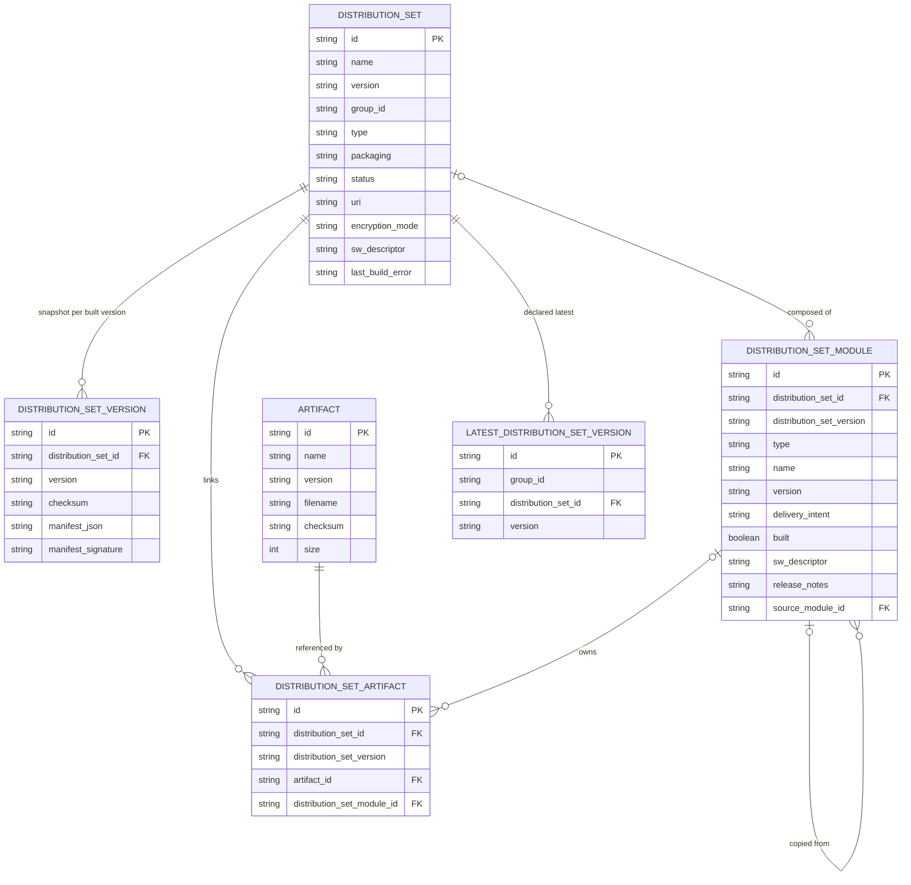
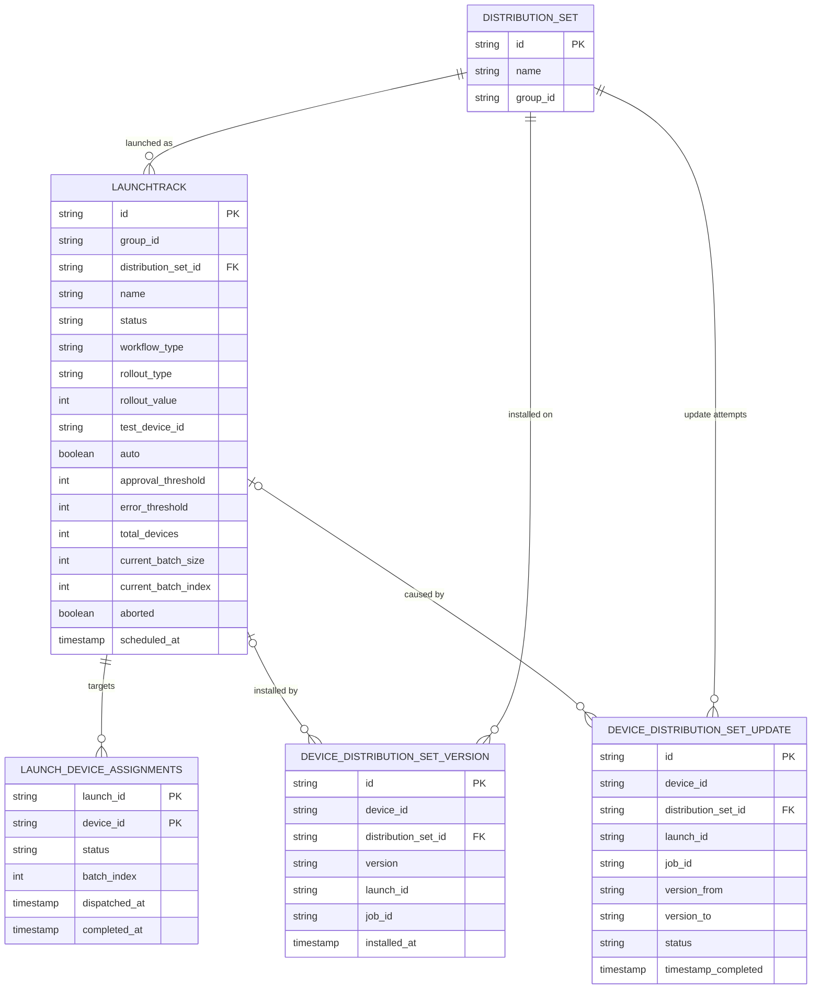

The tables Lamassu Updates keeps in Postgres, how they relate, and how the schema is created and migrated. This is a reference for operators and integrators who query the database, size it, or plan an upgrade.

## Native mode tables

Created in Postgres at startup, in the `updates` database. The Go types are in `pkg/models/updates.go` of the [ota repository](https://github.com/lamassuiot/ota).

| Table | Holds |
|---|---|
| `distribution_set` | An update pack: name, version, group, type, packaging, status, the sw-description (`sw_descriptor`), preconditions, encryption and signature settings, and the per-device build coverage |
| `distribution_set_version` | A snapshot of each built version, with its signed manifest |
| `distribution_set_module` | The modules of a pack version, keyed by pack, version, module type and name. It also holds catalog modules that belong to no pack, with an empty pack ID |
| `artifact` | A global artifact: the catalog entry for an uploaded file, unique by name and version |
| `distribution_set_artifact` | The link between a pack version, an artifact and optionally one module |
| `launchtrack` | A launch campaign: strategy, status, thresholds and batch bookkeeping |
| `launch_device_assignments` | Each device's status within a launch: `pending`, `active`, `completed` or `failed` |
| `device_distribution_set_version` | Which pack version a device currently carries |
| `device_distribution_set_update` | A device's update history |
| `latest_distribution_set_version` | The declared latest version per group and pack |
| `updates_schema_migrations` | One row per data migration that must run only once (the approval-threshold migration) |

File bytes (artifacts, builds, keys) are not in Postgres. They live in the blob stores described under [Configuration](/docs/platform/iot-fleets/updates/reference/configuration). The sw-description is in Postgres (a column of the pack and of each module).

## hawkBit mode tables

In hawkBit mode, packs, rollouts and jobs live in hawkBit. This service keeps only the following in the same Postgres (the `updates` database), for the things hawkBit has no equivalent of:

| Table | Holds |
|---|---|
| `hawkbit_staged_artifact` | Bytes from `POST /artifacts`. Uploads older than 30 minutes are discarded the next time anyone uploads an artifact, and stay readable until then. They cannot be linked to a pack in this mode |
| `hawkbit_artifact_alias` | Read when resolving an artifact ID, but nothing writes it any more |
| `hawkbit_sw_descriptor_v2` | sw-descriptions, launch preconditions and rollout flags (a general key-value text store, keyed by instance, kind and ID) |
| `hawkbit_set_manifest_v2` | Signed manifests of built sets |
| `hawkbit_cancelled_rollout_v2` | Rollouts cancelled through this service |
| `latest_distribution_set_version` | Declared latest versions (shared with native mode) |

Rows keyed by a hawkBit ID carry an `instance_id`, a marker of the hawkBit data they describe. If hawkBit loses its data and starts again, IDs repeat, and the service stops reading rows written for the old instance. The service re-checks the marker every 30 seconds.

hawkBit keeps its own schema in its own `hawkbit` database. In the Docker Compose stack, `init.sql` creates both databases when the Postgres container first starts.

## Entity-relationship diagrams

The native-mode tables, with their main columns. `*_id` columns that point at another table are drawn as the relationship lines. These are logical references: the service creates no database foreign-key constraints, and `FK` only marks which column holds the reference.

### Packs, modules and artifacts

### Launches and devices

Values worth knowing:

- `distribution_set.status` is `draft`, `built` or `build_failed`. `packaging` is `swu` or `non-swu`. `encryption_mode` is empty, `shared` or `per-device`.
- `launchtrack.status` is `running`, `paused`, `cancelled` or `completed`. A new launch is stored with an empty status, which means running. `aborted` is true for a cancelled launch (operator or error threshold) and stops every rollout path. The precondition outcome of the launch (`forced_preconditions`, `precondition_failures`) is stored on the row, but not the preconditions themselves: those live on the pack.
- `rollout_type` is not validated: only the value `percentage` makes `rollout_value` a percentage, and any other value (the dashboard sends `numeric`, the examples use `fixed`) makes it a device count.
- `launch_device_assignments.status` is `pending`, `active`, `completed` or `failed`. (`cancelled` also exists as a value, but only hawkBit mode reports it, for a canary whose launch was cancelled; it is never stored.)
- `device_distribution_set_update.status` is `pending`, `running`, `success` or `failed` (hawkBit mode can also report `cancelled`), and its `source` is `service`.
- `distribution_set_module` is unique by pack, pack version, type and name. A standalone catalog module has an empty `distribution_set_id`, and its `distribution_set_version` equals its own `version`.
- `distribution_set_version` is unique by pack and version, and `distribution_set_artifact` by pack, version and artifact.

Not drawn: `updates_schema_migrations`, a marker table the start-up data migrations use, and the hawkBit-mode tables listed above.

### Reading the diagram

- A **pack** (`distribution_set`) is one row that moves through versions. Each built version is snapshotted into `distribution_set_version`, with its signed manifest.
- **Modules** and **artifacts** are separate: an artifact is a file in the global catalog, and `distribution_set_artifact` links it to a pack version (and optionally to one module). A module whose `distribution_set_id` is empty is a catalog module that no pack holds yet.
- A **launch** (`launchtrack`) targets a group through one assignment row per device. The assignment moves `pending` → `active` → `completed` or `failed`, and `batch_index` records which batch dispatched it.
- Two device tables answer different questions. `device_distribution_set_version` is what a device carries **now**. `device_distribution_set_update` is the **history** of attempts, with `version_from` and `version_to`.
- `latest_distribution_set_version` is the version an operator declared devices of a group should be on, used for drift and compliance.

## Schema creation and migrations

There are no migration files. In native mode the service creates and upgrades its own schema when it starts, holding a Postgres lock so that replicas starting together do not race. It runs these steps in order (hawkBit mode only creates its six tables):

1. **Rename step** (`MigrateDistributionSetNaming`). Databases created before the "update pack" → "distribution set" rename have their tables and columns renamed. It runs before step 2 so that the new tables are not created empty beside the old ones.
2. **Create and add** (GORM `AutoMigrate`). Missing tables and columns are created. It never drops or renames anything.
3. **Data migrations.** Standalone modules (`software_module_definition` rows move into the module and artifact tables, keeping IDs and files, and the old table is dropped), device assignments (rebuilt from the legacy launch columns), and approval-threshold semantics.

Most steps check the current schema instead of a version number, and the approval-threshold migration records a row in `updates_schema_migrations` so it runs only once. Repeated starts are safe, and a new database has nothing to migrate. After the schema steps the service also copies binaries from the legacy pack-scoped layout on disk into the artifact store, skipping any that are already there.

`init.sql` is a Docker Compose seed: it creates the `updates` and `hawkbit` databases and still contains older table definitions, so do not use it to define the schema yourself.

See [Operations](/docs/platform/iot-fleets/updates/operations#upgrades) for what to do before upgrading.

## Next steps

<Cards>
  <Card title="Configuration" description="Blob stores, storage and every config field." href="/docs/platform/iot-fleets/updates/reference/configuration" />
  <Card title="Operations" description="Back up, scale and upgrade the database." href="/docs/platform/iot-fleets/updates/operations" />
</Cards>
