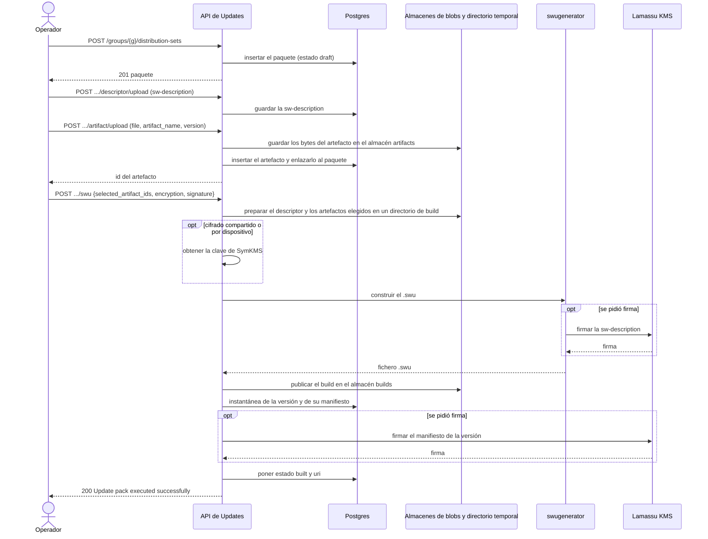
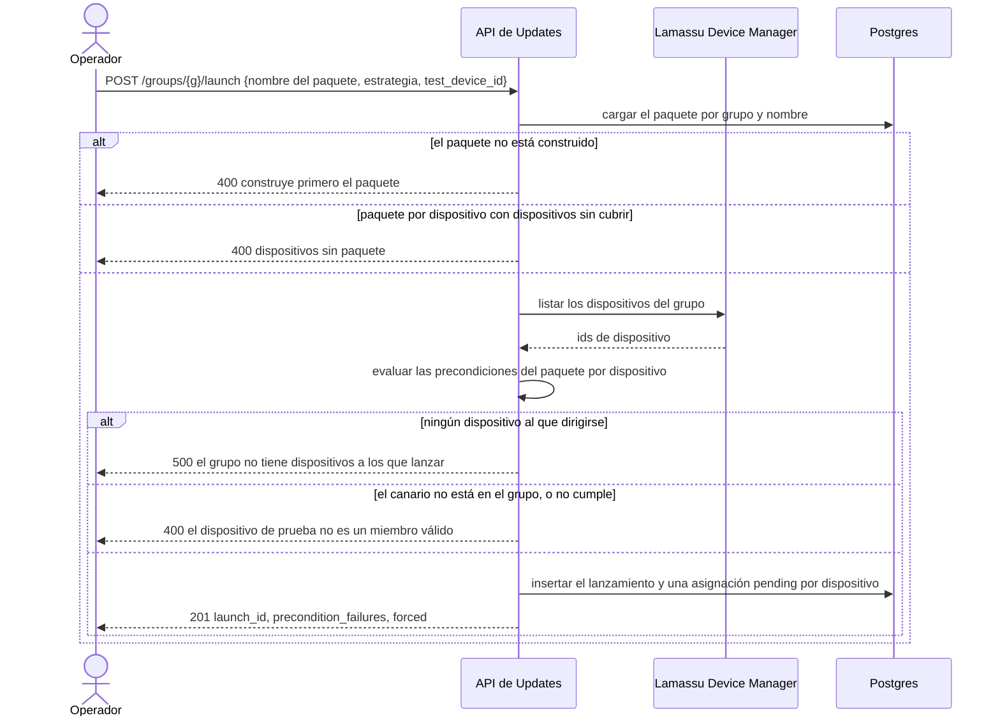
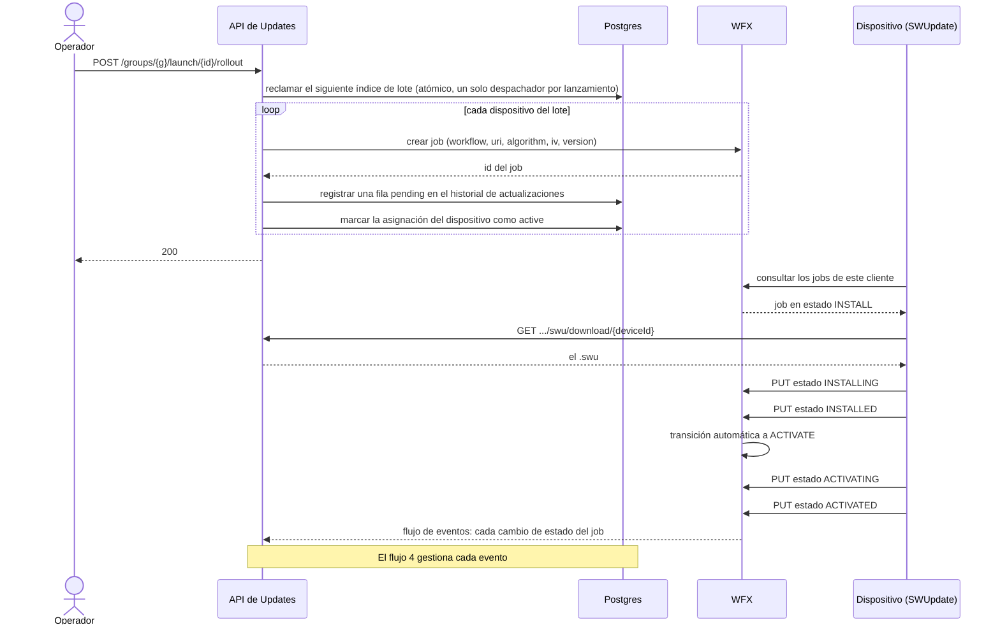
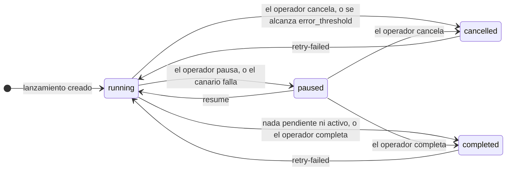
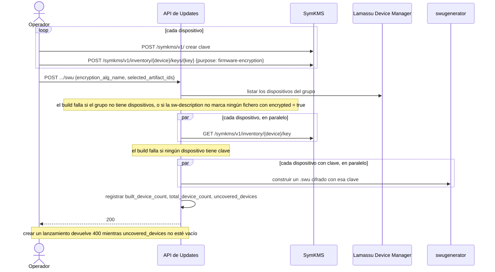
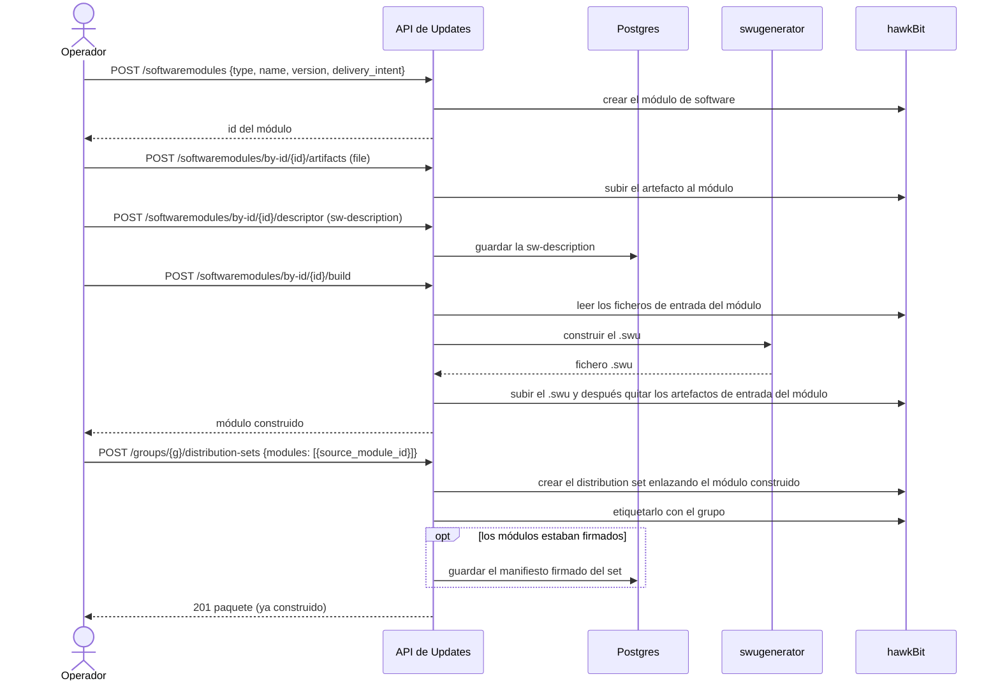
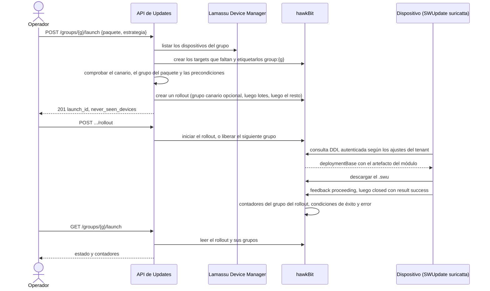

Estos diagramas siguen lo que hace el servicio, paso a paso. Las rutas son relativas a `/updates/v1`. Para ver comandos ejecutables consulta las guías de curl [nativa](/docs/platform/iot-fleets/updates/guides/native-curl) y [hawkBit](/docs/platform/iot-fleets/updates/guides/hawkbit-curl), y la [referencia de la API](/docs/platform/iot-fleets/updates/reference/api) para cada ruta y cuerpo.

## Modo nativo

### 1. Publicar y construir un paquete

Construir convierte los artefactos subidos y la sw-description en un único `.swu`. Nada se firma ni se cifra salvo que la petición de build lo pida.

Cosas que conviene saber sobre el build:

- El paquete se crea con un nombre, una `version` semántica, un `group_id`, un `type` y un `packaging` opcional. Un nombre duplicado en el grupo da un `409`.
- Subir un artefacto (o un entregable ya construido) a una versión que ya está construida se rechaza con `409`: crea primero una versión nueva. Un build o cambio que colisione con otro sobre el mismo paquete también responde `409`.
- Un fichero mayor que `max_artifact_size_mb` (10240 MiB por defecto) se rechaza con `413`.
- El cifrado lo decide el cuerpo del build: `user` más `encryption_key_name` es cifrado con clave compartida, y `encryption_alg_name` solo es cifrado por dispositivo (flujo 5).
- Si el build falla, el paquete pasa a `build_failed`, `last_build_error` dice por qué, y el paquete sigue siendo editable. Los artefactos seleccionados reemplazan los enlaces de artefactos anteriores de la versión del paquete.
- Sin campos de firma, el manifiesto se guarda sin firmar. Si se indica una clave de firma pero no un certificado, el build falla.
- Un paquete `non-swu` se construye con `POST .../package` en un `.tar.gz`, y un entregable construido fuera se adjunta con `POST .../swu/upload` o `.../package/upload`.

### 2. Crear un lanzamiento

Crear un lanzamiento decide a quién se dirige y comprueba que el paquete se puede entregar. Todavía no se envía nada a ningún dispositivo.

`?dry_run=true` se detiene tras la comprobación de precondiciones y responde `200` con `qualifying_devices`, `precondition_failures`, `superseded_devices` y `never_seen_devices`. `force_preconditions` apunta a todos los dispositivos del grupo y aun así registra cuáles fallaron. `distribution_set_name`, `workflow_type` y `rollout_type` son obligatorios, y también un `rollout_value` mayor que cero. `approval_threshold` y `error_threshold` deben estar entre 0 y 100, y cada incumplimiento es un `400`. Un lanzamiento también puede llevar `auto`, `scheduled_at`, `name`, `description` y `weight` (consulta [Conceptos](/docs/platform/iot-fleets/updates/concepts#campañas-de-lanzamiento)).

### 3. Desplegar un lote y actualizar un dispositivo

Una llamada `rollout` envía el siguiente lote. El canario va solo primero, y después lotes del tamaño configurado, elegidos al azar entre los dispositivos que siguen pendientes. El lado del dispositivo de abajo es el workflow `direct`, donde un job empieza en `INSTALL`.

Con el workflow `phased`, un job empieza en `CREATED`, y algunas transiciones necesitan que una persona o un sistema las confirme en WFX. Este servicio no las avanza. El workflow `download-install`, que usan los paquetes `non-swu`, recorre `DOWNLOAD → DOWNLOADING → DOWNLOADED → INSTALL → INSTALLING → INSTALLED`.

Con `auto` activado, una llamada `rollout` inicia el lanzamiento y los lotes siguientes los libera el flujo 4. Un lanzamiento con `scheduled_at` lo inicia el disparador de lanzamientos programados en la réplica líder cuando pasa esa hora.

La llamada `rollout` no siempre es un `200` simple:

- Se rechaza con `400` cuando el lanzamiento está pausado, cancelado, completado o abortado, y en un lanzamiento `auto` una vez que ha salido algún lote.
- No hace nada y responde `200` mientras `scheduled_at` esté todavía en el futuro, y mientras el canario siga activo. Devuelve un error si el canario falló.
- Si no se pueden crear algunos jobs, esos dispositivos siguen `pending` y la llamada devuelve un error de «partial rollout» (`500`).

### 4. Reaccionar cuando un dispositivo termina

Cada cambio de estado que notifica WFX ejecuta la misma lógica. Es lo que hace funcionar el lote automático, la compuerta del canario y el umbral de error.

En **cada** evento, el servicio actualiza el historial de actualizaciones del dispositivo y escribe el evento en los metadatos del dispositivo en Lamassu. Después, solo si el estado es terminal en el workflow, ejecuta estas comprobaciones en orden, y la primera que se cumple decide lo que ocurre:

| # | Comprobación | Si se cumple |
|---|---|---|
| 1 | ¿Es el estado terminal en el workflow? | Si no, no ocurre nada más |
| 2 | (siempre) | Marcar la asignación del dispositivo como `completed` o `failed`. Si tuvo éxito, registrar la versión instalada |
| 3 | ¿Falló el dispositivo canario? | Pausar el lanzamiento. Reanuda para reintentar |
| 4 | ¿Está el lanzamiento pausado, cancelado o completado? | Parar: no hay más lotes |
| 5 | ¿Está definido `error_threshold`, y los fallos han alcanzado esa proporción de todos los dispositivos (redondeada hacia arriba)? | Cancelar el lanzamiento. Los dispositivos pendientes no se envían |
| 6 | ¿No hay nada pendiente ni nada activo? | Marcar el lanzamiento como `completed` |
| 7 | ¿Está `auto` desactivado, o no queda nada por enviar? | Esperar a la siguiente llamada `rollout` del operador, o a los dispositivos que siguen en curso |
| 8 | ¿Tuvo éxito al menos `approval_threshold` de este lote? (0, 100 o más significa todo el lote) | Enviar el siguiente lote. Si no, esperar más resultados |

Solo los dispositivos enviados en el lote actual cuentan para su aprobación: un rezagado de un lote anterior nunca cuenta. Las comprobaciones mueven el lanzamiento entre estos estados:

Un lanzamiento nuevo se guarda con estado vacío, que significa `running`. Reanudar tras un fallo del canario vuelve a encolar el canario para que se intente de nuevo. Cancelar detiene los lotes siguientes, pero no retira los jobs que ya se están ejecutando en los dispositivos.

### 5. Construir un paquete cifrado por dispositivo

Cada dispositivo recibe su propio paquete, cifrado con su propia clave. El build resuelve primero la clave de cada dispositivo y después construye. Un dispositivo sin clave se omite, y se rechaza un lanzamiento sobre un paquete con dispositivos omitidos.

`uncovered_devices` lista los dispositivos sin clave y también aquellos cuyo propio build falló. Un build en el que ningún dispositivo obtuvo paquete deja el paquete en `build_failed`.

## Modo hawkBit

### 6. Construir un módulo y crear un paquete

El propio hawkBit no tiene noción de módulo construido, y este servicio solo enlaza módulos construidos a un distribution set de hawkBit. Un set nunca se construye directamente: `POST .../swu` y `.../package` responden `501` en este modo. Primero se construye el módulo, en el catálogo, y el paquete se crea a partir de él. El diagrama muestra la intención `swu-build`.

Las otras intenciones de entrega se saltan pasos: `swu-prebuilt` solo sube el `.swu` terminado, que es lo que construye el módulo, y `raw` solo cifra o firma los ficheros, sin swugenerator ni sw-description (firmar añade un documento de checksum `.sha256` y su firma desacoplada como artefactos extra). Un build puede firmar a través del KMS y cifrar con una clave compartida de SymKMS. El cifrado por dispositivo se rechaza en modo hawkBit. Un módulo enlazado queda congelado: para cambiarlo, edítalo y constrúyelo en el catálogo, y vuelve a enlazarlo.

### 7. Lanzamiento y actualización del dispositivo

El dispositivo habla con hawkBit, no con este servicio. El servicio lee el progreso de hawkBit cada vez que se le pide.

Un grupo canario existe solo cuando se indica `test_device_id`. hawkBit decide cuándo un grupo tiene éxito y empieza el siguiente, usando los umbrales de aprobación y de error que le dio el servicio. Con `auto` desactivado, hawkBit se pausa tras cada grupo y la siguiente llamada `rollout` libera el siguiente. La respuesta del lanzamiento también lista `superseded_devices` (dispositivos cuya actualización en curso reemplaza el nuevo rollout) y `never_seen_devices` (dispositivos que nunca han consultado, lo que puede bloquear un grupo que debe alcanzar su umbral de éxito).

La llamada `rollout` depende del estado del rollout:

- Un rollout `ready` se inicia, y no ocurre nada mientras su hora de inicio esté en el futuro.
- Un rollout pausado solo se reanuda si está pausado entre lotes. Una pausa del operador necesita `resume`, y un rollout detenido por su umbral de error no se puede reanudar.
- Un rollout manual en ejecución libera su siguiente grupo.
- Un rollout `auto` que ya está en ejecución se rechaza con `400`.
- Un segundo `rollout` sobre el mismo lanzamiento mientras hay otro en curso responde `409`.

La autenticación de dispositivos es un ajuste del tenant de hawkBit. Los tokens de seguridad de target vienen desactivados por defecto. Consulta [Conectar un dispositivo](/docs/platform/iot-fleets/updates/guides/connect-a-device).

## Siguientes pasos

<Cards>
  <Card title="Publicar y desplegar una actualización" description="Recorre los flujos 1 a 4 de principio a fin." href="/docs/platform/iot-fleets/updates/guides/publish-and-roll-out" />
  <Card title="Modelo de datos" description="Las tablas detrás de estos flujos." href="/docs/platform/iot-fleets/updates/data-model" />
  <Card title="Firma y cifrado" description="Claves, firmas y el manifiesto." href="/docs/platform/iot-fleets/updates/signing-and-encryption" />
</Cards>
