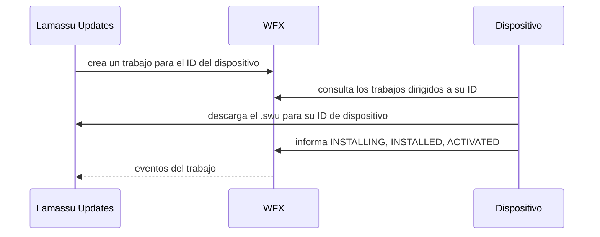
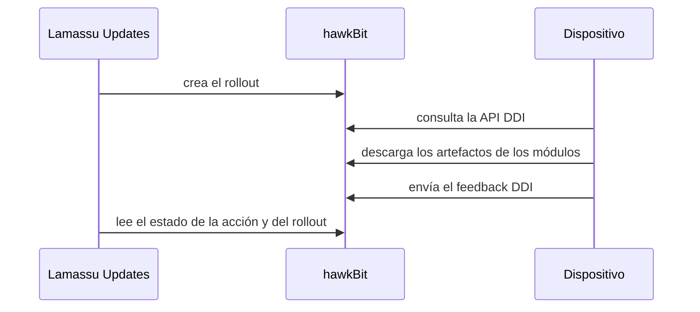

Esta guía describe el contrato entre un dispositivo y Lamassu Updates, para cada backend. El software del dispositivo es [SWUpdate](https://swupdate.org/): esta página cubre lo que el dispositivo debe enviar y recibir, no la instalación ni la configuración de SWUpdate, que describe su documentación. Úsala cuando haya un lanzamiento en marcha y ningún dispositivo avance.

## Antes de empezar

- Un dispositivo con SWUpdate instalado y una forma de ejecutar un cliente de actualización: un agente pequeño o el módulo `suricatta` de SWUpdate.
- Una identidad de dispositivo: un único ID igual en todas partes. Es el ID de cliente de WFX en modo nativo y el ID de controlador de hawkBit en modo hawkBit, y debe coincidir con el ID del dispositivo en el registro de dispositivos de Lamassu (consulta [Dispositivos e identidades](/docs/platform/iot-fleets/device-management)).
- El dispositivo debe ser miembro de un grupo de dispositivos de Lamassu IoT, porque un paquete pertenece a un grupo y un lanzamiento apunta a los dispositivos del grupo. En modo hawkBit, la pertenencia al grupo también se lee del registro cuando `dms_endpoint` está definido.
- Solo modo nativo: `update_domain` debe ser una dirección que el dispositivo alcance. Consulta [Configuración](/docs/platform/iot-fleets/updates/reference/configuration). En modo hawkBit los dispositivos descargan desde hawkBit.

## Modo nativo: el dispositivo consulta a WFX

En modo nativo, un lanzamiento crea un trabajo de WFX por dispositivo. El dispositivo consulta a WFX los trabajos dirigidos a su ID, descarga el entregable de la API de Updates, lo instala y comunica cada estado a WFX. Lamassu Updates lee esos estados de WFX para conducir el lanzamiento.



El dispositivo de ejemplo de `docker-compose.yml` (`swupdate-device1`) muestra la configuración mínima. Usa tres variables: `DEVICE_NAME` (su ID), `WFX_URI` (la API **cliente** de WFX, `http://custom-wfx:8080/api/wfx/v1` dentro de la red de Compose, `localhost:9080` desde el host) y `PORT`. La API de gestión de WFX, en el `9081`, es para el servicio, no para los dispositivos.

### El trabajo que recibe el dispositivo

El trabajo está dirigido al dispositivo (el `clientId` de WFX es el ID del dispositivo), nombra un workflow y lleva etiquetas del lanzamiento (`lms://secure-updates/<launch id>`) y del grupo (`lms://dms/<group id>`). Su definición es así:

```json
{
  "type": ["firmware"],
  "launchID": "<launch id>",
  "version": "1.0.0",
  "groupID": "<group id>",
  "artifacts": [
    {
      "name": "my-firmware",
      "uri": "http://updates:10090/updates/v1/groups/<group>/distribution-sets/my-firmware/swu/download/<device-id>",
      "algorithm": "<algorithm name>",
      "iv": "<hex>"
    }
  ]
}
```

| Campo | Significado |
|---|---|
| `type` | El tipo del paquete: `rawfile`, `firmware`, o ambos (`["rawfile","firmware"]`) |
| `artifacts[0].uri` | Dónde descargar el entregable. El servicio añade el ID del dispositivo, así que cada dispositivo descarga su propio fichero. Un `.swu` para paquetes SWU, un `.tar.gz` para paquetes `non-swu` |
| `algorithm`, `iv` | Presentes solo en un paquete cifrado: el algoritmo y, en paquetes de clave compartida, el IV o nonce en hexadecimal. Un paquete por dispositivo lleva el algoritmo pero no `iv` |
| `signature_key_id`, `signature_algorithm`, `signature_certificate` | Presentes solo en un paquete firmado |

El dispositivo necesita la clave para descifrar, y la tiene él mismo. En un paquete por dispositivo es la clave que SymKMS asignó a ese dispositivo, y cada dispositivo descarga un fichero distinto.

### La descarga

La descarga responde con los bytes, o con `302` a una URL firmada de corta duración cuando las descargas prefirmadas están activadas para el almacén de construcciones. Asegúrate de que el cliente HTTP del dispositivo sigue redirecciones. La ruta también responde a `HEAD` y a peticiones de rango de bytes (`206`), de modo que una descarga interrumpida puede reanudarse. La URL se fija al construir el paquete, así que un dispositivo no ve un `update_domain` nuevo hasta que reconstruyes.

### Los estados que comunica el dispositivo

El dispositivo mueve su trabajo por los estados del workflow, y el workflow decide quién puede hacer cada movimiento. Para el workflow `direct`:

```text
INSTALL → INSTALLING → INSTALLED → (WFX, automatic) ACTIVATE → ACTIVATING → ACTIVATED
```

El dispositivo comunica `INSTALLING`, `INSTALLED`, `ACTIVATING` y `ACTIVATED`. El paso `INSTALLED → ACTIVATE` lo hace el propio WFX. Desde `INSTALL`, `INSTALLING`, `ACTIVATE` y `ACTIVATING` el dispositivo puede pasar a `TERMINATED` para comunicar un fallo; `INSTALLED` no tiene transición de fallo.

| Workflow | Se usa para | Estados terminales |
|---|---|---|
| `wfx.workflow.dau.direct` | Paquetes SWU, sin confirmación | `ACTIVATED` (éxito), `TERMINATED` (fallo) |
| `wfx.workflow.dau.phased` | Paquetes SWU con pasos de confirmación (`CREATED → DOWNLOAD → ... → ACTIVATED`) | `ACTIVATED`, `TERMINATED` |
| `wfx.workflow.dau.download-install` | Paquetes `non-swu`: `DOWNLOAD → ... → INSTALLED`, cada movimiento lo hace el dispositivo | `INSTALLED`, `TERMINATED` |
| `wfx.workflow.dau.simple` | Mínimo `DOWNLOAD → INSTALL → INSTALLED` | `INSTALLED`, `TERMINATED` |

Un trabajo `phased` tiene movimientos que hace WFX o un operador, y nada en Lamassu Updates los avanza: se queda en `CREATED` hasta que alguien lo confirma a través de WFX (el botón **Next** del dashboard lo hace). Los endpoints `force-version` y `sync-to-latest` usan `phased` para los paquetes SWU salvo que indiques un `workflow`. Los ficheros de workflow están en `wfx/workflow/dau/` del repositorio. La API HTTP de WFX (listar trabajos, actualizar estado) la documenta [WFX](https://github.com/siemens/wfx).

## Modo hawkBit: el dispositivo consulta a hawkBit

En modo hawkBit los dispositivos no consultan a Lamassu Updates. Consultan la API DDI de hawkBit, y Lamassu Updates lee de hawkBit el estado resultante de las acciones.



<Steps>
  <Step>
    ### Haz del dispositivo un target de hawkBit

    El dispositivo necesita un ID de controlador y un target etiquetado `group:<id>` para su grupo. Con `dms_endpoint` definido, el servicio lo hace por sí mismo: cuando lee del registro los dispositivos de un grupo, crea los targets que faltan y los etiqueta. Sin `dms_endpoint`, creas tú los targets y las etiquetas. En ambos casos el dispositivo debe consultar a hawkBit con credenciales válidas.
  </Step>
  <Step>
    ### Configura SWUpdate

    Apunta el SWUpdate del dispositivo (`suricatta`) a la URL de hawkBit (`hawkbit.ddi_url`, que por defecto es `hawkbit.base_url`), con el tenant, el ID de controlador y un método de autenticación que acepte tu tenant de hawkBit. hawkBit rechaza por defecto a los dispositivos sin autenticar. Con tokens de seguridad de target, actívalos para el tenant (`PUT /rest/v1/system/configs/authentication.targettoken.enabled` con `{"value":true}`) y entrega a cada dispositivo el `securityToken` de su target, que envía como `Authorization: TargetToken <token>`. La [guía curl de hawkBit](/docs/platform/iot-fleets/updates/guides/hawkbit-curl) muestra cada petición.
  </Step>
  <Step>
    ### Apunta al hawkBit correcto

    El dispositivo debe consultar el **mismo hawkBit** para el que está configurado el servicio. Un servicio apuntado a un hawkBit sin targets construye y lanza sin error, y nada lo descarga. Consulta [Solución de problemas](/docs/platform/iot-fleets/updates/troubleshooting).
  </Step>
</Steps>

hawkBit entrega entonces al dispositivo todos los artefactos de su conjunto de distribución. Un paquete con varios módulos ejecuta varias instalaciones independientes.

Cuando tu pasarela enruta las URL de artefactos de dispositivo de hawkBit (la ruta de `hawkbit.ddi_url`, `.../<tenant>/controller/v1/<controller>/softwaremodules/<id>/artifacts/<file>`) hacia Lamassu Updates, el servicio las sirve solo para módulos asignados o instalados en ese controlador, y responde `404` en los demás casos. Con las descargas prefirmadas activadas, redirige a una URL firmada del bucket S3 de hawkBit en lugar de transmitir el fichero.

## Imágenes firmadas y cifradas

Si el dispositivo verifica firmas, define su clave pública (`public-key-file` en la configuración de SWUpdate) y firma el paquete con la clave correspondiente. Si descifra, necesita la misma clave y el mismo algoritmo con que se construyó el paquete. Una discrepancia es la causa habitual de que una instalación falle en silencio tras una descarga correcta. [Firma y cifrado](/docs/platform/iot-fleets/updates/signing-and-encryption) explica qué clave, algoritmo e IV usa cada modo y qué recibe el dispositivo.

## Verifica el resultado

Tras un lanzamiento, el trabajo del dispositivo llega a `ACTIVATED` (o a `INSTALLED` en un paquete `non-swu`), los contadores del lanzamiento se actualizan y el inventario del dispositivo lista el paquete:

```bash
API=http://localhost:10090/updates/v1
curl -s $API/devices/<device-id>/distribution-set-inventory
curl -s $API/launch/<launch-id>/jobs
```

Consulta [Publica y lanza una actualización](/docs/platform/iot-fleets/updates/guides/publish-and-roll-out#verifica-el-resultado) para el resto de comprobaciones.

## Solución de problemas

| Síntoma | Causa probable |
|---|---|
| El dispositivo nunca ve un trabajo (nativo) | Consulta un endpoint de WFX equivocado o usa un ID distinto del miembro del grupo. El `clientId` de WFX debe coincidir con el ID del dispositivo |
| El trabajo se queda en `CREATED` | El lanzamiento usa `phased`. Confírmalo a través de WFX o del dashboard, o vuelve a lanzar con `direct` |
| La descarga falla con `404` | El paquete está cifrado por dispositivo y el dispositivo no tiene clave, o la URL nombra a otro dispositivo. Revisa la cobertura del paquete y que la URL termine con el ID de este dispositivo |
| La descarga termina bien y la instalación falla | La firma o la clave no coinciden con lo que tiene el dispositivo. Consulta [Firma y cifrado](/docs/platform/iot-fleets/updates/signing-and-encryption) |
| Un lanzamiento `non-swu` parece atascado aunque el dispositivo terminó | Se lanzó con `direct` o `phased`, que esperan `ACTIVATED`. Lanza los paquetes `non-swu` con `download-install` |
| El lanzamiento nunca avanza (hawkBit) | El dispositivo no consulta este hawkBit, no está etiquetado en el grupo o no puede autenticarse |

## Siguientes pasos

<Cards>
  <Card title="Firma y cifrado" href="/docs/platform/iot-fleets/updates/signing-and-encryption" description="Claves, algoritmos y qué debe tener el dispositivo." />
  <Card title="Modo hawkBit" href="/docs/platform/iot-fleets/updates/hawkbit-mode" description="Cómo el adaptador traduce paquetes y campañas a hawkBit." />
  <Card title="Solución de problemas" href="/docs/platform/iot-fleets/updates/troubleshooting" description="Actualizaciones que no llegan a los dispositivos y otros fallos." />
</Cards>
