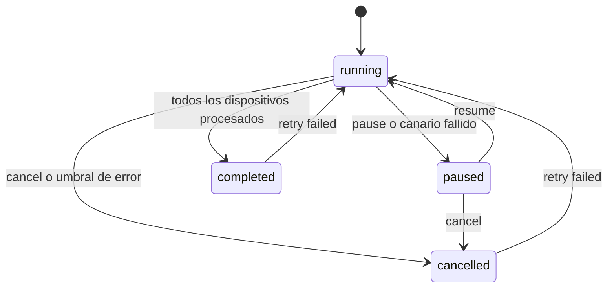

Esta guía lleva una actualización desde cero hasta los dispositivos: crea un paquete de actualización, adjunta un artefacto y un `sw-description`, construye el entregable, crea un lanzamiento (una campaña en el dashboard) y libéralo lote a lote. Las peticiones usan el modo nativo. El modo hawkBit construye y crea los paquetes en otro orden, que se describe en [Modo hawkBit](#modo-hawkbit). Para hacer lo mismo con pantallas, sigue [Usa el dashboard](/docs/platform/iot-fleets/updates/guides/dashboard).


## Antes de empezar

- El [stack está en marcha](/docs/platform/iot-fleets/updates/getting-started) y `curl localhost:10090/health` responde.
- Un grupo de dispositivos de Lamassu IoT que contenga los dispositivos que quieres actualizar. Su ID es `$GROUP`. Un paquete pertenece a un grupo y solo se puede lanzar a los dispositivos de ese grupo.
- El binario que vas a entregar y, para un paquete SWU, un fichero `sw-description`.
- Dispositivos que puedan recibir la actualización. Consulta [Conecta un dispositivo](/docs/platform/iot-fleets/updates/guides/connect-a-device).

```bash
API=http://localhost:10090/updates/v1
GROUP=<your-group-id>
```

El servicio no tiene autenticación propia, así que estos ejemplos no envían ninguna. Pon delante una pasarela que autentique a quien llama: consulta [Seguridad](/docs/platform/iot-fleets/updates/security).

## 1. Crea el paquete

```bash
curl -s -X POST $API/groups/$GROUP/distribution-sets \
  -H 'Content-Type: application/json' \
  -d '{"name":"my-firmware","version":"1.0.0","group_id":"'$GROUP'","type":"firmware","packaging":"swu"}'
```

La respuesta es `201` con el paquete, incluido su `id`. Un paquete empieza como `draft`.

| Campo | Notas |
|---|---|
| `name` | Obligatorio. Único dentro del grupo; un duplicado responde `409`. El modo nativo lo usa como segmento de ruta, así que solo puede contener letras, dígitos, `.`, `_` y `-` (sin espacios) |
| `version` | Obligatorio. Semver estricto `x.y.z`, la defines tú |
| `group_id` | Obligatorio en el cuerpo. Usa el mismo valor que en la ruta |
| `type` | `rawfile` o `firmware`. Se registra en el paquete y se envía al dispositivo en el trabajo; el dashboard también ofrece `both` y `other`. No se valida al crear |
| `packaging` | `swu` (por defecto) o `non-swu`. Un paquete `non-swu` entrega sus ficheros como un `.tar.gz` y usa el workflow `download-install` |
| `allow_previous_version_download` | Opcional. Permite que los dispositivos descarguen versiones anteriores del paquete |
| `preconditions` | Opcional. Reglas que un dispositivo debe cumplir para recibir el paquete. Consulta [Conceptos](/docs/platform/iot-fleets/updates/concepts) |
| `modules` | **Solo modo hawkBit**: la composición del paquete, como módulos del catálogo ya construidos. El modo nativo lo ignora |

## 2. Sube el sw-description y el artefacto

El `sw-description` es un fichero de SWUpdate que enumera lo que instala el dispositivo. Su formato es el de SWUpdate, y la [documentación de SWUpdate](https://sbabic.github.io/swupdate/sw-description.html) es la referencia. Cuando el servicio construye el `.swu`, `swugenerator` lee este fichero y los binarios preparados, así que el `filename` de cada imagen debe ser el nombre de un fichero subido. Un ejemplo mínimo:

```text
software =
{
	version = "1.0.0";
	description = "My panel";
	hardware-compatibility: [ "1.0" ];
	images: (
		{
			filename = "rootfs.img";        # the uploaded file's name
			path = "/web/index.html";
			type = "rawfile";
			compressed = "zlib";            # swugenerator compresses the file
			properties: {
				decompressed-size = "<bytes>";  # set it whenever compressed is set
			};
		}
	);
}
```

`swugenerator` rellena el `filename` final (con `.zlib` añadido, y `.enc` en los ficheros cifrados), el `sha256` y, en los ficheros cifrados, la propiedad `ivt`. Para una construcción cifrada, añade `encrypted = true;` a cada imagen que deba cifrarse. Dos reglas causan la mayoría de los fallos:

- `encrypted = true` solo debe aparecer en una construcción que aporte una clave (la construcción falla sin ella), y una construcción por dispositivo rechaza una descripción en la que ninguna imagen lo tenga.
- Las imágenes comprimidas necesitan `decompressed-size`.

Si construyes tú el `.swu` y lo subes como entregable prefabricado, rellenas tú mismo `sha256` e `ivt`, y el `sha256` es sobre los bytes que descarga el dispositivo, porque SWUpdate calcula el hash antes de descifrar.

```bash
# The sw-description (multipart field "file")
curl -s -X POST $API/groups/$GROUP/distribution-sets/my-firmware/descriptor/upload \
  -F file=@sw-description

# The binary (multipart: "file", plus "artifact_name" and "version")
curl -s -X POST $API/groups/$GROUP/distribution-sets/my-firmware/artifact/upload \
  -F file=@rootfs.img -F artifact_name=rootfs.img -F version=1.0.0
```

- `artifact_name` es por defecto el nombre del fichero sin su extensión. `version` es opcional; cuando subes un fichero nuevo con un `artifact_name` existente, debe ser estrictamente mayor que la versión más alta ya guardada con ese nombre.
- El artefacto se guarda como artefacto global y se enlaza a este paquete. La respuesta contiene su `id`. Para reutilizar un artefacto ya subido, enlázalo con `POST .../artifact/link` y `{"artifact_id":"<id>"}`.
- El fichero más grande admitido es `max_artifact_size_mb` (10 GiB por defecto). Una subida mayor responde `413`.
- Una vez construido el paquete, las subidas y los enlaces responden `409`: crea antes una versión nueva.

### Compón un paquete con varios módulos (opcional)

Un paquete nativo es una composición de módulos de software: un módulo `os` más cualquier número de módulos `application`. Un paquete sin módulos declarados se comporta como un único módulo `os` implícito que posee los artefactos que subiste antes. Para añadir un módulo de aplicación y darle sus propios ficheros:

```bash
curl -s -X POST $API/groups/$GROUP/distribution-sets/my-firmware/modules \
  -H 'Content-Type: application/json' \
  -d '{"type":"application","name":"telemetry","version":"1.0.0"}'

curl -s -X POST $API/groups/$GROUP/distribution-sets/my-firmware/modules/application:telemetry/artifact/upload \
  -F file=@telemetry.bin -F artifact_name=telemetry
```

La clave del módulo es `<type>:<name>`. El modo nativo sigue construyendo un único `.swu` para todo el paquete, a partir de los artefactos de todos los módulos y del único `sw-description` del paquete. También puedes componer desde un módulo que ya existe con `POST .../modules/import`; en modo nativo eso copia el módulo, mientras que en modo hawkBit enlaza el mismo módulo. Consulta [Conceptos](/docs/platform/iot-fleets/updates/concepts) para el modelo.

## 3. Construye el entregable

```bash
curl -s -X POST $API/groups/$GROUP/distribution-sets/my-firmware/swu \
  -H 'Content-Type: application/json' \
  -d '{"selected_artifact_ids":["<artifact id>"]}'
```

`selected_artifact_ids` es lo que mete artefactos en la construcción: solo se preparan los listados. Con una lista vacía la construcción falla porque no se preparó ningún binario, y el paquete pasa a `build_failed`. Toma el ID de la respuesta de la subida del artefacto, o de `GET $API/artifacts`.

El cuerpo anterior construye un `.swu` sin cifrar y sin firmar. Para firmar o cifrar, añade campos como se describe en [Firma y cifrado](/docs/platform/iot-fleets/updates/signing-and-encryption).

- Para un paquete `non-swu`, llama a `POST .../package` en lugar de `.../swu`. Sin `selected_artifact_ids` empaqueta los artefactos enlazados al paquete.
- Para entregar un fichero que construiste por tu cuenta, súbelo a `POST .../swu/upload` (o `.../package/upload`) como un `file` multipart. Se guarda y se sirve sin cambios, así que ya debe estar firmado y cifrado como esperan tus dispositivos. Solo modo nativo.

Cuando la construcción termina bien, el paquete pasa a `built` y sus artefactos y su composición son inmutables. Si falla, el paquete pasa a `build_failed` y `last_build_error` guarda el motivo: corrige la entrada y construye de nuevo. Una construcción que se ejecuta mientras otra tiene bloqueado el mismo paquete responde `409`.

## 4. Crea el lanzamiento

```bash
curl -s -X POST $API/groups/$GROUP/launch \
  -H 'Content-Type: application/json' \
  -d '{
        "distribution_set_name":"my-firmware",
        "workflow_type":"direct",
        "rollout_type":"percentage",
        "rollout_value":10,
        "test_device_id":"<canary-device-id>",
        "name":"my-firmware 1.0.0 first wave"
      }'
```

El lanzamiento apunta a todos los dispositivos del grupo en el momento de crearlo, y necesita un paquete construido. La respuesta es `201` con `launch_id`, `precondition_failures`, `forced` y, en modo hawkBit, `superseded_devices` y `never_seen_devices`.

| Campo | Notas |
|---|---|
| `distribution_set_name`, `workflow_type`, `rollout_type`, `rollout_value` | Obligatorios. `rollout_value` debe ser mayor que 0 |
| `rollout_type` | `percentage` del grupo por lote, o `fixed` (un número de dispositivos). Cualquier valor distinto de `percentage` se interpreta como un número |
| `workflow_type` | Nativo: `direct`, `phased`, `download-install`, o el nombre completo de otro workflow registrado en WFX (`GET $API/workflows`). hawkBit: `phased` crea una acción soft, cualquier otro valor una forced |
| `test_device_id` | Canario opcional: un miembro del grupo que se actualiza primero y debe tener éxito antes de tocar ningún otro dispositivo |
| `auto`, `approval_threshold`, `error_threshold` | Opcionales. `auto` libera los lotes siguientes por sí solo. Ambos umbrales son porcentajes de 0 a 100 |
| `scheduled_at` | Hora RFC 3339 opcional. El primer lote se retrasa hasta entonces |
| `name`, `description`, `weight` | Opcionales. `name` es por defecto el nombre del paquete. `weight` (de 0 a 1000) se guarda pero nada lo lee |
| `force_preconditions` | Despliega también en los dispositivos que no cumplen las precondiciones del paquete. Los fallos se registran igualmente |

Elige el workflow según el paquete:

- Usa `direct` para paquetes SWU salvo que gestiones WFX tú mismo. El workflow `phased` tiene pasos que WFX o un operador deben confirmar, y este servicio no los avanza. Un lanzamiento `phased` se queda en su primer estado hasta que alguien lo confirma a través de WFX.
- Para un paquete `non-swu`, pon `workflow_type` a `download-install`. El lanzamiento usa el valor que indicas tal cual, así que `direct` ejecutaría el workflow SWU y la actualización parecería atascada cuando el dispositivo ya terminó.
- En modo hawkBit no hay WFX. La elección es el modo de instalación de hawkBit.

Si el paquete tiene precondiciones, previsualiza qué dispositivos cumplen antes de crear nada añadiendo `?dry_run=true` a la misma petición. Responde `200` con `qualifying_devices`, `precondition_failures`, `superseded_devices` y `never_seen_devices`, y no crea nada.

**Umbrales de aprobación y de error.** Con `auto: true`, el siguiente lote se libera cuando al menos `approval_threshold` por ciento del lote actual ha tenido éxito (0 significa el lote completo). En modo nativo, la campaña se cancela cuando `error_threshold` por ciento de todos sus dispositivos ha fallado; en modo hawkBit se detiene cuando falla más de ese porcentaje de un lote. En cambio, un canario fallido pausa una campaña nativa: reanúdala para reintentar el canario.

Toma el ID del lanzamiento de la respuesta. Es `$LAUNCH` más abajo.

## 5. Lánzalo

```bash
curl -s -X POST $API/groups/$GROUP/launch/$LAUNCH/rollout
```

Sin `auto`, cada llamada despacha el siguiente lote (primero el canario, si lo definiste). Con `auto: true`, llama una vez para iniciar el primer lote: el servicio libera después los demás lotes por sí solo al cumplirse el umbral de aprobación, y las llamadas posteriores responden `400`. Si el lanzamiento tiene un `scheduled_at` futuro, la llamada se acepta pero no hace nada: el servicio lo inicia solo a esa hora (el modo nativo comprueba cada 30 segundos; en hawkBit inicia el rollout el propio planificador de hawkBit).

Un lanzamiento nativo pasa por estos estados:



Puedes dirigir un lanzamiento mientras se ejecuta:

| Acción | Petición | Efecto |
|---|---|---|
| Pausar | `POST $API/groups/$GROUP/launch/$LAUNCH/pause` | No hay más lotes hasta reanudar. Los dispositivos que ya están en curso terminan |
| Reanudar | `POST .../resume` | Nativo: una campaña automática libera su siguiente lote de inmediato si el actual ya cumplió el umbral, y reanudar tras un canario fallido lo reintenta |
| Reintentar dispositivos fallidos | `POST .../retry-failed` | Vuelve a poner en cola los dispositivos fallidos y los despacha. Responde `400` si no hay ninguno |
| Cancelar (terminal) | `POST .../cancel` | Los dispositivos pendientes no se actualizan |
| Marcar como completado (terminal) | `POST .../complete` | No disponible en modo hawkBit |
| Leer o cambiar la estrategia | `GET`, `PUT .../strategy` | Cambiarla no está disponible en modo hawkBit |

En modo hawkBit, un rollout solo se puede pausar después de que haya empezado a despachar.

## Verifica el resultado

```bash
# The launches of the group, each with its per-status device counts
curl -s $API/groups/$GROUP/launch

# One job per device of a launch
curl -s $API/launch/$LAUNCH/jobs

# What a given device now carries
curl -s $API/devices/<device-id>/distribution-set-inventory
```

El listado de lanzamientos responde `{"list":[...],"next":"..."}`. Un lanzamiento ha terminado cuando `pending_count` y `active_count` valen cero; un lanzamiento nativo pone entonces su `status` en `completed` por sí solo. Los dispositivos terminan como `completed` (estado del trabajo `ACTIVATED`, o `INSTALLED` para `non-swu`) o `failed` (`TERMINATED`).

## Publica la siguiente versión

Una versión construida de un paquete es inmutable. Para cambiarla, crea la versión siguiente, sube lo que haya cambiado y construye de nuevo:

```bash
curl -s -X POST $API/groups/$GROUP/distribution-sets/my-firmware/new \
  -H 'Content-Type: application/json' -d '{"version":"1.1.0"}'
```

La versión debe ser estrictamente mayor que la actual. La versión nueva empieza sin construir y arrastra los artefactos actuales.

Para actualizar un dispositivo a una versión exacta sin campaña, usa `POST $API/devices/<device-id>/force-version` con `{"distribution_set_id":"<pack id>","version":"1.1.0"}`; en modo nativo crea un lanzamiento de un solo dispositivo y usa por defecto el workflow `phased` para paquetes SWU (`download-install` para `non-swu`), salvo que indiques un `workflow`.

## Modo hawkBit

Los paquetes de hawkBit se ensamblan a partir de módulos del catálogo ya construidos, así que los pasos 2 y 3 del lado del paquete pasan al catálogo:

1. Crea el módulo: `POST $API/softwaremodules` con `type` (`os` o `application`), `name`, `version` y un `delivery_intent`: `swu-build`, `swu-prebuilt` o `raw`. `undecided` se acepta, pero un módulo no puede entrar en un paquete hasta que elijas.
2. Sube el fichero con `POST $API/softwaremodules/by-id/<id>/artifacts`. Para `swu-build`, sube también el `sw-description` a `.../descriptor` y llama a `POST $API/softwaremodules/by-id/<id>/build`. Para `swu-prebuilt`, subir el `.swu` es la construcción. Para `raw`, llama a `.../build` para que los ficheros sean el entregable; firmar y cifrar es opcional.
3. Crea el paquete con `"modules":[{"source_module_id":"<id>"}]`. Se crea ya construido.

Después continúa en el paso 4. Los detalles, incluidas las intenciones de entrega, están en [Modo hawkBit](/docs/platform/iot-fleets/updates/hawkbit-mode), y una secuencia completa de peticiones en la [guía curl de hawkBit](/docs/platform/iot-fleets/updates/guides/hawkbit-curl).

## Solución de problemas

| Síntoma | Causa probable |
|---|---|
| Una llamada devuelve `501 Not Implemented` | El backend activo no la admite. Consulta [Capacidades](/docs/platform/iot-fleets/updates/reference/capabilities) |
| `400` «has not been built yet» al crear un lanzamiento | El paquete está en `draft` o `build_failed`. Constrúyelo primero |
| `400` sobre dispositivos sin paquete | Un paquete cifrado por dispositivo se construyó solo para algunos. El mensaje nombra los dispositivos sin clave; corrígelos y reconstruye |
| `400` «group has no devices to launch to» | El grupo no tiene miembros, o ninguno cumple. Revisa los criterios del grupo y las precondiciones del paquete |
| La construcción devuelve un error sobre `encrypted = true` | Una construcción por dispositivo necesita al menos una imagen marcada con `encrypted = true` en el `sw-description` |
| La construcción SWU falla con «failed to read binaries directory» o «binaries directory is empty» | No se preparó nada: falta `selected_artifact_ids` en el cuerpo de la construcción |
| `409` al subir, enlazar o construir | La versión ya está construida (crea una versión nueva), o otra petición está construyendo el mismo paquete |
| `413` al subir | El fichero supera `max_artifact_size_mb` |
| El lanzamiento responde `400` «paused» o «rolls out automatically» | Reanuda el lanzamiento, o deja que la campaña automática libere sus propios lotes |
| El lanzamiento sigue en `running` sin progreso de dispositivos (hawkBit) | Los dispositivos nunca contactaron con hawkBit. Un grupo de rollout no avanza hasta que sus dispositivos consultan |
| Los dispositivos no pueden descargar el `.swu` (nativo) | `update_domain` no es alcanzable desde el dispositivo, o no es la base completa `.../updates/v1/` con barra final. La URL de descarga se fija al construir el paquete, así que reconstruye tras cambiarla |
| Falla la creación del paquete en modo hawkBit | Ya existe un paquete con ese nombre en el grupo (`409`), un módulo no está construido o no se enlazó con `source_module_id`, o el nombre y la versión de un módulo anterior están reservados. Sube la versión |
| Un lanzamiento `non-swu` ejecuta los estados SWU | Se creó con `workflow_type: direct`. Usa `download-install` |

## Siguientes pasos

<Cards>
  <Card title="Conceptos" href="/docs/platform/iot-fleets/updates/concepts" description="Paquetes, módulos, lanzamientos, workflows y precondiciones." />
  <Card title="Guía curl nativa" href="/docs/platform/iot-fleets/updates/guides/native-curl" description="Todas las peticiones del flujo nativo, en orden." />
  <Card title="Referencia de la API" href="/docs/platform/iot-fleets/updates/reference/api" description="Todas las rutas, cuerpos y códigos de estado." />
</Cards>
