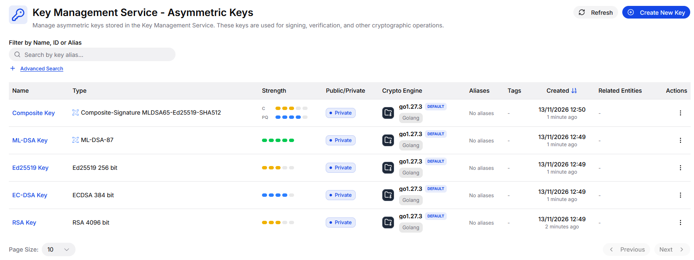
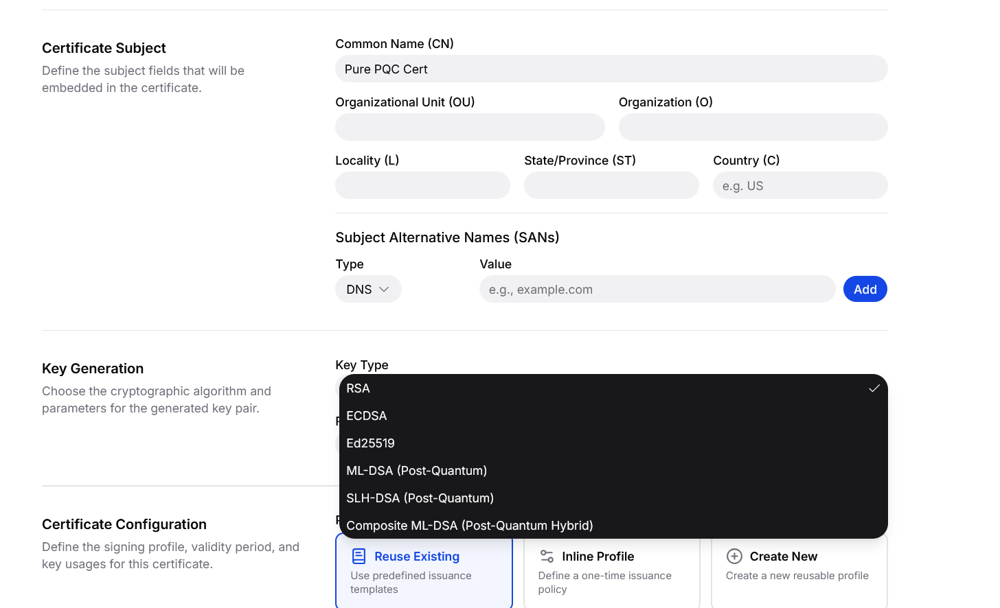
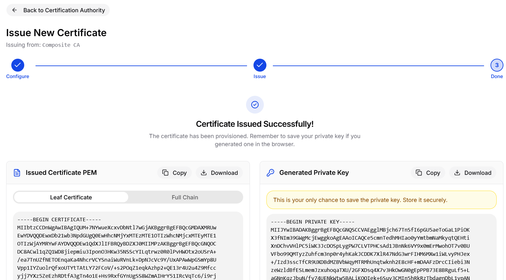
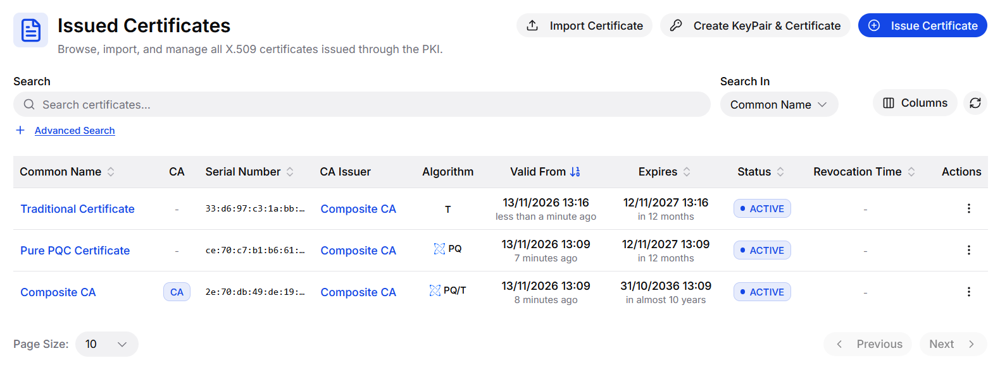
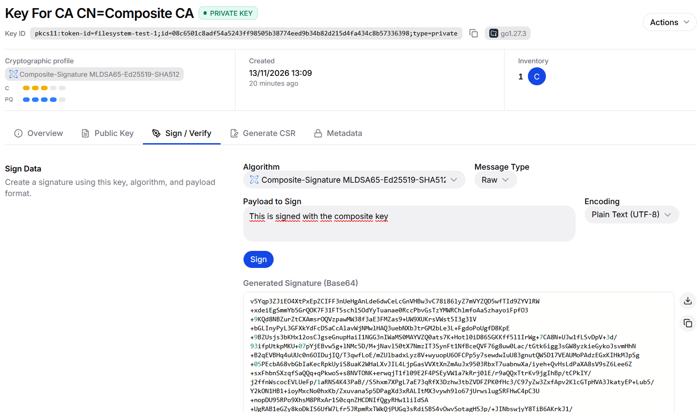
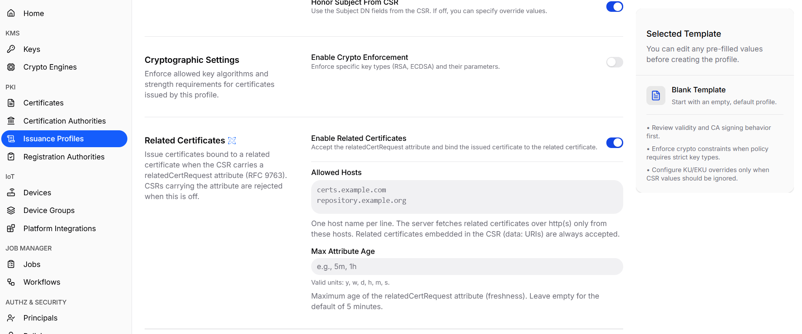
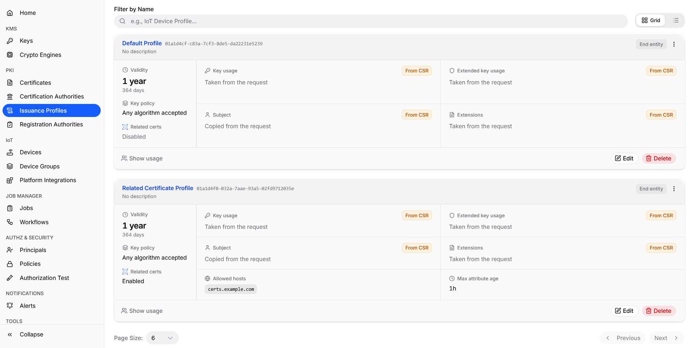
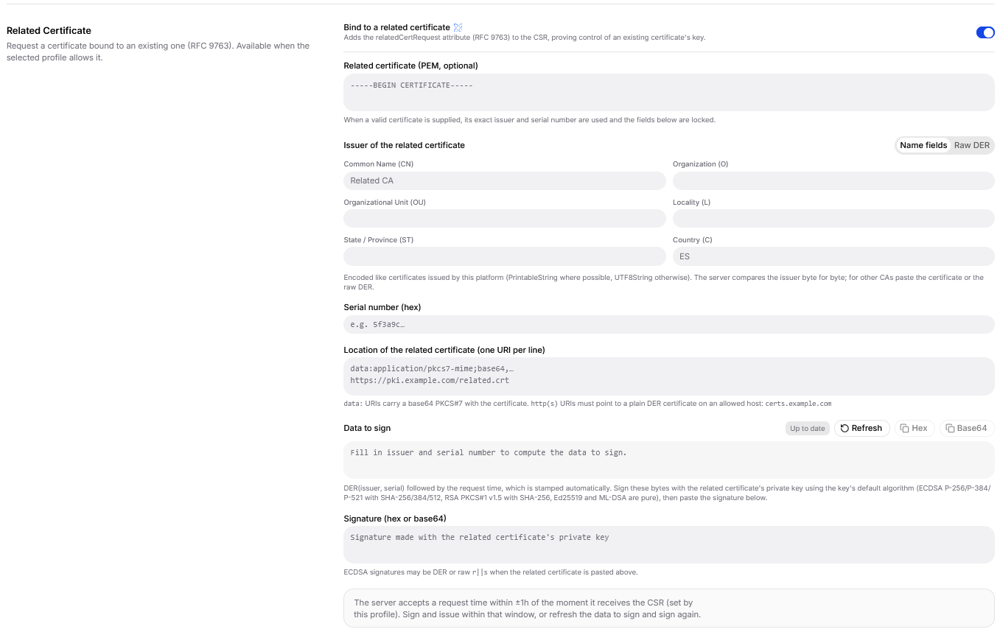
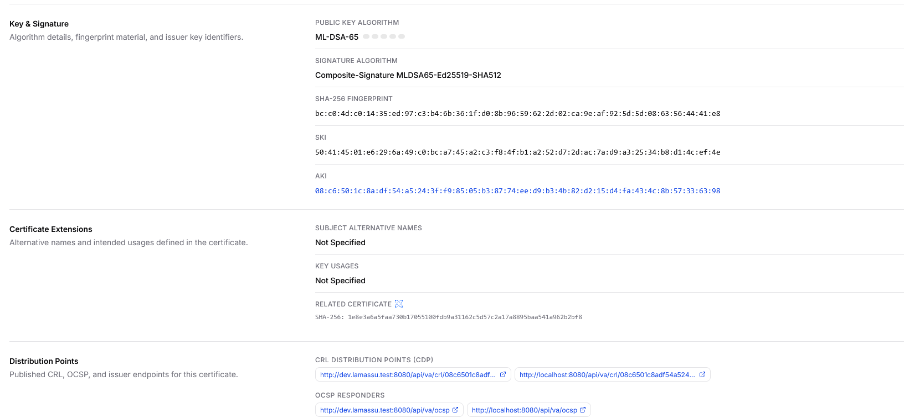

El dashboard (rama `feat/lamassu-q`) permite a un administrador crear e inspeccionar claves, autoridades de certificación y certificados poscuánticos sin escribir peticiones a la API. Añade las opciones de algoritmo, muestra la familia de algoritmo de cada objeto e interpreta los nuevos identificadores en los certificados. Todo lo que envía se describe en [Claves y autoridades de certificación](/docs/platform/pqc/keys-and-cas); esta página cubre lo que muestra la interfaz y dónde difiere su comportamiento entre pantallas.

## Elegir tipo de clave y especificación

Crear una clave del KMS, una CA con una clave nueva y un certificado con clave generada en el servidor usan el mismo par de selectores. *Key type* está agrupado por familia y *Key specification* depende del tipo.

| Grupo | Tipos de clave |
| --- | --- |
| T (Traditional) | `RSA`, `ECDSA`, `Ed25519` |
| PQ (Pure PQC) | `ML-DSA`, `SLH-DSA` |
| PQ/T (Hybrid) | `Composite-ML-DSA-RSA`, `Composite-ML-DSA-ECDSA`, `Composite-ML-DSA-Ed25519` |

La lista de especificaciones muestra ML-DSA-44, -65 o -87, los doce conjuntos de parámetros de SLH-DSA (por ejemplo *4 - SHAKE_128f*) o las variantes composite por nombre. La interfaz envía como `size` el identificador del conjunto de parámetros, según se explica en [Algoritmos](/docs/platform/pqc/algorithms), y muestra un indicador de fortaleza junto a cada opción. En las claves composite el indicador muestra dos barras, una para el componente clásico y otra para el poscuántico.

Una vez creada, la lista de claves muestra el tipo de cada clave y su fortaleza. Una clave composite muestra dos indicadores, uno para su componente clásico (C) y otro para su componente poscuántico (PQ).



Las opciones habilitadas dependen del motor criptográfico. Al crear una clave o una CA, la interfaz lista todos los algoritmos pero deshabilita los que el motor seleccionado no soporta, y pide seleccionar antes un motor. Al crear un certificado en el servidor, los tipos no soportados se ocultan en su lugar.

## Emitir un certificado con una clave generada en el navegador

Emitir un certificado desde una CA genera el par de claves en el navegador, construye la solicitud de certificado y la envía a la CA para su firma. Los tipos de clave que se ofrecen aquí son `RSA`, `ECDSA`, `Ed25519`, `ML-DSA`, `SLH-DSA` y una única entrada `Composite ML-DSA`, y se generan en el navegador: con las bibliotecas `@noble` para ML-DSA y SLH-DSA y con WebCrypto para los algoritmos clásicos.



La generación de claves composite no está disponible en `@noble`. El equipo de Lamassu la ha implementado para el dashboard: combina la clave ML-DSA con una clave RSA, ECDSA o Ed25519 y firma el mensaje representativo composite tal como define la especificación, de modo que una solicitud de certificado composite puede crearse íntegramente en el navegador.

La clave privada generada se muestra una sola vez al final del procedimiento, junto al certificado emitido, con una advertencia para guardarla de forma segura. Lamassu no la conserva, así que descárgala o cópiala antes de salir de la página.



El navegador no verifica las firmas de las solicitudes ML-DSA, SLH-DSA, composite ni Ed25519; confía en el KMS.

## Cómo se muestran los objetos

Las listas y las vistas de detalle muestran la familia del algoritmo. La tabla de CA tiene una columna *PQC* con T, PQ o PQ/T, las tarjetas de CA y el grafo de CA muestran una insignia *PQC*, las listas de claves muestran un icono cuántico, y el detalle de una CA o un certificado muestra el algoritmo, su fortaleza y la insignia de familia. La familia se calcula a partir del identificador de algoritmo del certificado interpretado.

La lista de certificados tiene una columna *Algorithm* con las mismas etiquetas: en el ejemplo siguiente, un certificado tradicional (T), un certificado poscuántico puro (PQ) y la CA composite que los emitió (PQ/T).



Los nombres de algoritmo se resuelven a partir de los identificadores de objeto. Los identificadores de ML-DSA, SLH-DSA, composite y Ed25519 se muestran como nombres con su conjunto de parámetros, por ejemplo *ML-DSA-65* o *Composite-Signature MLDSA65-ECDSA-P384-SHA512*, y para ellos no se muestra longitud en bits. Los algoritmos de firma RSA y ECDSA se muestran con etiquetas propias del dashboard, como *RSA PKCS#1 v1.5 SHA-256* y *ECDSA SHA-256*, en lugar de los nombres de OpenSSL `sha256WithRSAEncryption` y `ecdsa-with-SHA256`.

La página de detalle de una clave puede firmar y verificar con una clave poscuántica y habilita únicamente el algoritmo de firma que le corresponde.

El ejemplo siguiente firma un contenido con la clave de una CA composite, usando el algoritmo composite que corresponde a la clave.



## Certificados relacionados

El dashboard cubre todo el flujo de [certificados relacionados](/docs/platform/pqc/related-certificates) sin peticiones a la API: habilitar la función en un perfil de emisión, comprobar qué perfiles la tienen y solicitar el certificado vinculado. Los campos de configuración son los descritos en [Configurar un perfil de emisión](/docs/platform/pqc/related-certificates#configurar-un-perfil-de-emisión).

<Steps>
  <Step>
    ### Crea un perfil de emisión que habilite la función

    Ve a **Issuance Profiles** y selecciona **Create New Profile**. En la sección *Related Certificates*, activa **Enable Related Certificates**. Con el interruptor desactivado, se rechaza una solicitud de certificado que lleve el atributo `relatedCertRequest`.

    - **Allowed Hosts** lista un nombre de host por línea. El servidor descarga los certificados relacionados por `http` o `https` solo desde esos hosts, como se explica en [Ubicaciones desde las que la CA puede descargar](/docs/platform/pqc/related-certificates#ubicaciones-desde-las-que-la-ca-puede-descargar). Los certificados incluidos en la solicitud como URI `data:` se aceptan siempre.
    - **Max Attribute Age** es la antigüedad máxima de la hora de solicitud del atributo. Usa las unidades `y`, `w`, `d`, `h`, `m` o `s`, por ejemplo `5m` o `1h`. Si lo dejas vacío, se aplica el valor por defecto de 5 minutos.

    

    Completa el resto del perfil como de costumbre, según se describe en [Perfiles de certificado](/docs/platform/pki/certificate-profiles).
  </Step>

  <Step>
    ### Comprueba qué perfiles la permiten

    La lista de perfiles de emisión muestra en cada tarjeta una fila *Related certs* con el valor **Enabled** o **Disabled**. Un perfil que la tiene habilitada muestra además sus hosts permitidos y su antigüedad máxima del atributo. En el ejemplo, el perfil por defecto tiene la función deshabilitada, y el segundo perfil la tiene habilitada con el host `certs.example.com` y una antigüedad máxima de una hora. Selecciona **Edit** para cambiar cualquiera de los dos ajustes más adelante.

    

    Solo un perfil guardado con la función habilitada permite solicitar un certificado vinculado. Si eliges un perfil que no la tiene, o un perfil en línea, el formulario explica por qué la opción no está disponible.
  </Step>

  <Step>
    ### Solicita el certificado vinculado

    Abre la CA que lo firmará, selecciona **Issue Certificate** y genera la clave en el navegador, según se describe en [la sección anterior](#emitir-un-certificado-con-una-clave-generada-en-el-navegador). En *Certificate Configuration*, elige **Reuse Existing** y selecciona el perfil del paso anterior. Después activa **Bind to a related certificate** en la sección *Related Certificate* y complétala:

    - **Related certificate (PEM, optional).** Pega el certificado existente. Se usan su emisor y su número de serie exactos y los campos siguientes quedan bloqueados. Si no lo pegas, introduce el emisor, como campos de nombre o como DER sin procesar, y el número de serie en hexadecimal.
    - **Location of the related certificate.** Una URI por línea: una URI `data:` con un PKCS#7 en base64 que contenga el certificado, o una URL `http` o `https` que apunte a un certificado DER simple en un host permitido.
    - **Data to sign.** El formulario construye el emisor y el número de serie seguidos de la hora de solicitud, que estampa automáticamente. Cópialo como hex o base64. **Refresh** lo recalcula con la hora actual.
    - **Signature.** Firma esos bytes con la clave privada del certificado relacionado, fuera del navegador, y pega la firma en hex o base64. Usa el algoritmo habitual de la clave: ECDSA con SHA-256, SHA-384 o SHA-512 según la curva, RSA PKCS#1 v1.5 con SHA-256, y Ed25519 o ML-DSA puros. Una firma ECDSA puede ser DER o `r||s` sin procesar.

    Para construir la URI `data:` a partir de un fichero de certificado, `cert.pem`, envuélvelo en una estructura PKCS#7 y codifícalo en base64:

    ```bash
    printf 'data:application/x-pkcs7-certificates;base64,%s\n' \
      "$(openssl crl2pkcs7 -nocrl -certfile cert.pem -outform DER | base64 | tr -d '\n')"
    ```

    Pega la salida en una sola línea en el campo de ubicación. El servidor solo comprueba que la URI esté codificada en base64 y que el contenido sea una estructura PKCS#7 cuyo primer certificado sea el relacionado.

    

    La clave del certificado relacionado suele permanecer en el dispositivo o sistema que la posee, de modo que la firma se produce allí. Si esa clave está en Lamassu, usa **Sign / Verify** sobre la clave, según se describe en [Claves y motores criptográficos](/docs/platform/pki/key-management#firmar-y-verificar).

    La CA solo acepta la solicitud si su hora está dentro de la antigüedad máxima del atributo del perfil, contada desde el momento en que recibe la solicitud. Firma y emite dentro de esa ventana, o selecciona **Refresh** y firma los datos nuevos. Después emite el certificado como de costumbre.
  </Step>

  <Step>
    ### Comprueba el resultado

    Las páginas de detalle del nuevo certificado muestran una fila *Related Certificate* con el algoritmo de hash y el hash del certificado relacionado. Solo aparece en los certificados que llevan la extensión, de modo que un certificado emitido sin el vínculo no muestra esa fila.

    

    Para comprobar que el valor corresponde al certificado esperado, calcula el hash de su codificación DER con el mismo algoritmo y compáralo:

    ```bash
    openssl x509 -in cert.pem -outform DER | openssl dgst -sha256
    ```

    El algoritmo es SHA-256, SHA-384 o SHA-512, el que indica la fila. Las reglas que debe cumplir el certificado vinculado están en [Qué debe cumplir el certificado emitido](/docs/platform/pqc/related-certificates#qué-debe-cumplir-el-certificado-emitido).
  </Step>
</Steps>


## Aspectos a tener en cuenta

Los nombres de los tipos de clave no son idénticos en todas las pantallas. La creación de claves y de CA usa `Composite-ML-DSA-RSA`, `-ECDSA` y `-Ed25519`; el formulario de emisión de certificados usa un único `Composite-ML-DSA`; y el formulario de certificado en el servidor compara nombres en mayúsculas. Los nombres que el backend informa para una clave pueden diferir, por tanto, en mayúsculas y minúsculas de lo que envía la interfaz.

La interfaz no incluye ningún aviso de carácter experimental para estos algoritmos y no está traducida: todos los textos están en inglés.

<Callout type="warn" title="SLH-DSA en claves generadas en el navegador">
La correspondencia entre el identificador del conjunto de parámetros de SLH-DSA y el algoritmo que usa el generador de claves del navegador no sigue el mismo orden que los identificadores que muestra el selector y que usa el backend, salvo en el identificador 1. Un certificado emitido por el flujo del navegador con un identificador SLH-DSA del 2 al 12 puede usar, por tanto, un conjunto de parámetros distinto del que nombra el selector. Hasta que se corrija, conviene crear las claves SLH-DSA con el KMS.
</Callout>

<Cards>
  <Card title="Claves y autoridades de certificación" description="La API que hay detrás de estas pantallas." href="/docs/platform/pqc/keys-and-cas" />
  <Card title="Limitaciones conocidas" description="Carencias de la interfaz y de la plataforma." href="/docs/platform/pqc/limitations" />
</Cards>
