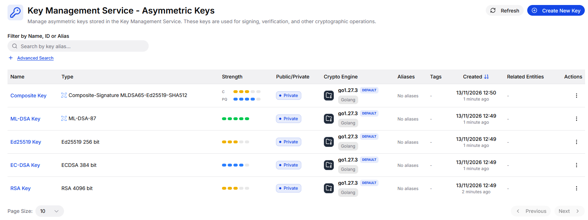
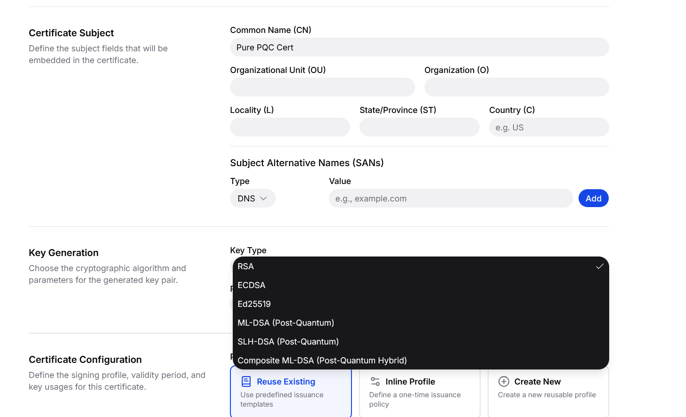
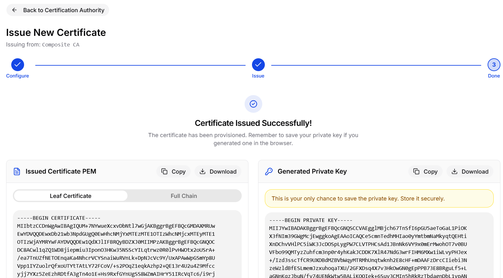
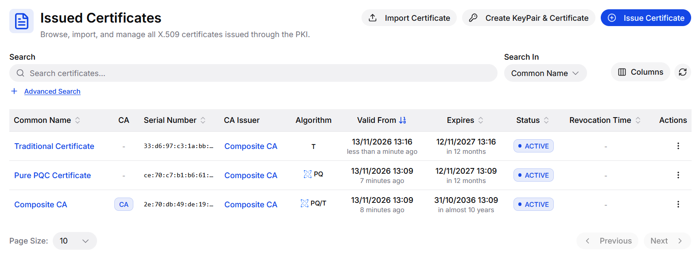
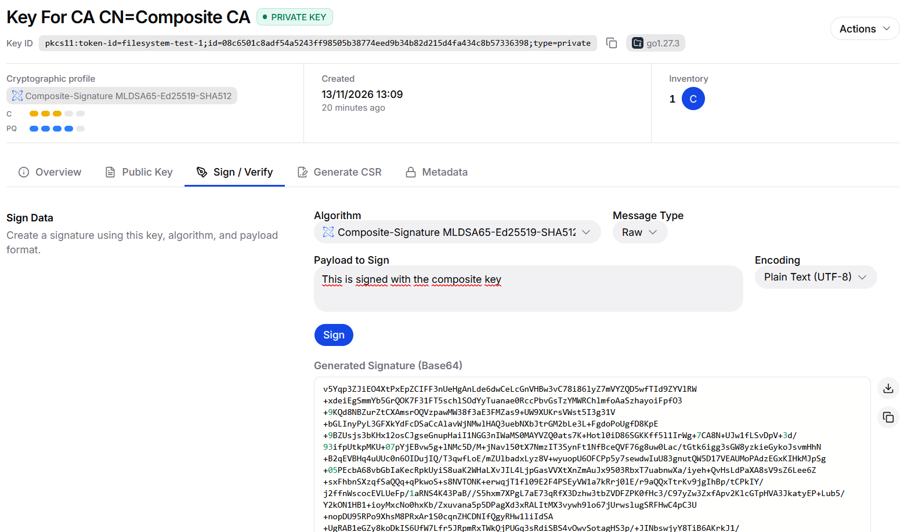
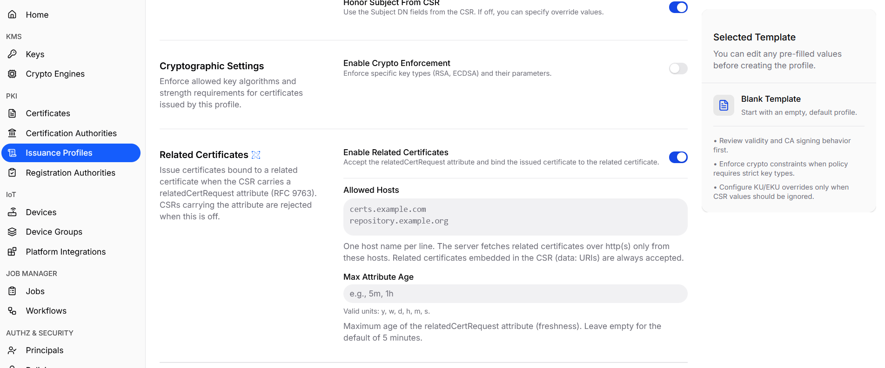
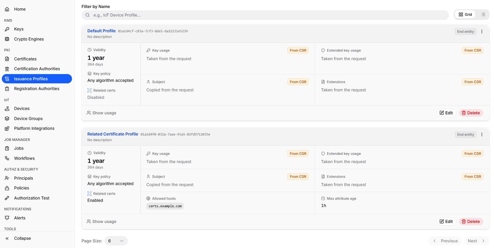
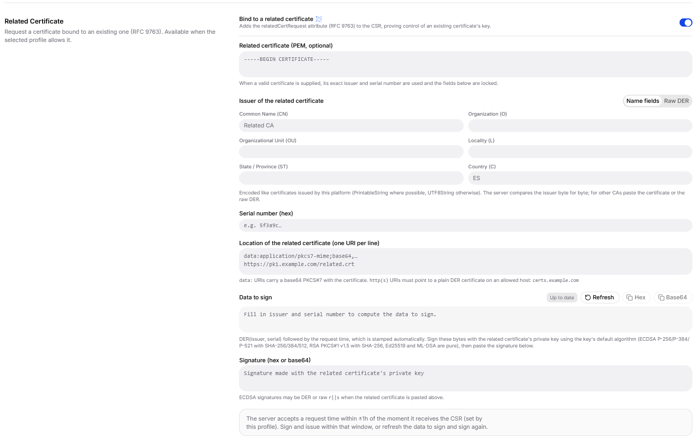
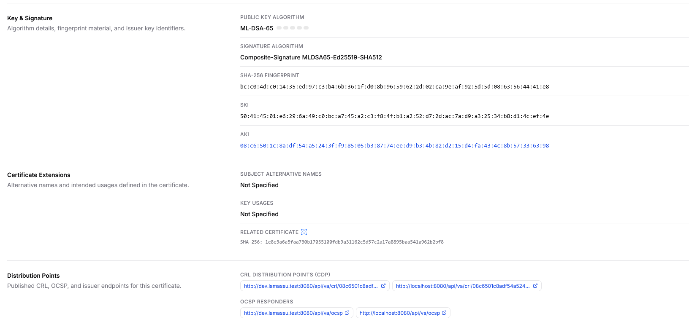

The dashboard (branch `feat/lamassu-q`) lets an administrator create and inspect post-quantum keys, certificate authorities and certificates without writing API requests. It adds the algorithm choices, shows the algorithm family of every object and parses the new identifiers in certificates. Everything it sends is described in [Keys and certificate authorities](/docs/platform/pqc/keys-and-cas); this page covers what the interface shows and where its behaviour differs between screens.

## Choosing a key type and specification

Creating a KMS key, a CA with a new key and a certificate with a server-generated key all use the same pair of selectors. *Key type* is grouped by family and *Key specification* depends on the type.

| Group | Key types |
| --- | --- |
| T (Traditional) | `RSA`, `ECDSA`, `Ed25519` |
| PQ (Pure PQC) | `ML-DSA`, `SLH-DSA` |
| PQ/T (Hybrid) | `Composite-ML-DSA-RSA`, `Composite-ML-DSA-ECDSA`, `Composite-ML-DSA-Ed25519` |

The specification list shows ML-DSA-44, -65 or -87, the twelve SLH-DSA parameter sets (for example *4 - SHAKE_128f*) or the composite variants by name. The interface sends the identifier of the parameter set as `size`, as explained in [Algorithms](/docs/platform/pqc/algorithms), and shows a strength indicator next to each option. For composite keys the indicator shows two bars, one for the classical component and one for the post-quantum component.

Once created, the key list shows the type of each key and its strength. A composite key shows two indicators, one for its classical component (C) and one for its post-quantum component (PQ).



Which options are enabled depends on the crypto engine. When creating a key or a CA, the interface lists every algorithm but disables those that the selected engine does not support, and asks to select an engine first. When creating a certificate on the server, unsupported types are hidden instead.

## Issuing a certificate with a browser-generated key

Issuing a certificate from a CA generates the key pair in the browser, builds the certificate request and sends it to the CA for signing. The key types offered here are `RSA`, `ECDSA`, `Ed25519`, `ML-DSA`, `SLH-DSA` and a single `Composite ML-DSA` entry, and they are generated in the browser: with the `@noble` libraries for ML-DSA and SLH-DSA and with WebCrypto for the classical algorithms.



Composite key generation is not available in `@noble`. The Lamassu team implemented it for the dashboard, combining the ML-DSA key with an RSA, ECDSA or Ed25519 key and signing the composite message representative as the specification defines, so that a composite certificate request can be created entirely in the browser.

The generated private key is shown once at the end of the procedure, next to the issued certificate, with a warning to store it securely. It is not kept by Lamassu, so download or copy it before leaving the page.



The browser does not verify the signatures of ML-DSA, SLH-DSA, composite or Ed25519 requests; it relies on the KMS.

## How objects are displayed

Lists and detail views show the algorithm family. The CA table has a *PQC* column with T, PQ or PQ/T, CA cards and the CA graph show a *PQC* badge, key lists show a quantum icon, and the details of a CA or certificate show the algorithm, its strength and the family badge. The family is computed from the algorithm identifier in the parsed certificate.

The Certificates list has an *Algorithm* column with the same labels: in the example below, a traditional certificate (T), a pure post-quantum certificate (PQ) and the composite CA that issued them (PQ/T).



Algorithm names are resolved from the object identifiers. ML-DSA, SLH-DSA, composite and Ed25519 identifiers are shown as names with their parameter set, for example *ML-DSA-65* or *Composite-Signature MLDSA65-ECDSA-P384-SHA512*, and no bit length is shown for them. RSA and ECDSA signature algorithms are displayed with the dashboard's own labels, such as *RSA PKCS#1 v1.5 SHA-256* and *ECDSA SHA-256*, instead of the OpenSSL names `sha256WithRSAEncryption` and `ecdsa-with-SHA256`.

The key detail page can sign and verify with a post-quantum key and enables only the signature algorithm that corresponds to it.

The following example signs a payload with the key of a composite CA, using the composite algorithm that matches the key.



## Related certificates

The dashboard covers the whole [related certificates](/docs/platform/pqc/related-certificates) flow without API requests: enable the feature in an issuance profile, check which profiles have it, and request the bound certificate. The configuration fields are those described in [Configure an issuance profile](/docs/platform/pqc/related-certificates#configure-an-issuance-profile).

<Steps>
  <Step>
    ### Create an issuance profile that enables the feature

    Go to **Issuance Profiles** and select **Create New Profile**. In the *Related Certificates* section, turn on **Enable Related Certificates**. With the switch off, a certificate request that carries the `relatedCertRequest` attribute is rejected.

    - **Allowed Hosts** lists one host name per line. The server downloads related certificates over `http` or `https` only from these hosts, as explained in [Locations the CA may fetch from](/docs/platform/pqc/related-certificates#locations-the-ca-may-fetch-from). Certificates embedded in the request as `data:` URIs are always accepted.
    - **Max Attribute Age** is the maximum age of the request time in the attribute. Use the units `y`, `w`, `d`, `h`, `m` or `s`, for example `5m` or `1h`. If you leave it empty, the default of 5 minutes applies.

    

    Complete the rest of the profile as usual, as described in [Certificate profiles](/docs/platform/pki/certificate-profiles).
  </Step>

  <Step>
    ### Check which profiles allow it

    The list of issuance profiles shows a *Related certs* row on every card, with the value **Enabled** or **Disabled**. A profile where it is enabled also shows its allowed hosts and its maximum attribute age. In the example, the default profile has the feature disabled, and the second profile has it enabled with the host `certs.example.com` and a maximum age of one hour. Select **Edit** to change either setting later.

    

    Only a stored profile with the feature enabled lets you request a bound certificate. If you choose a profile without it, or an inline profile, the form explains why the option is unavailable.
  </Step>

  <Step>
    ### Request the bound certificate

    Open the CA that will sign it, select **Issue Certificate** and generate the key in the browser, as described in [the section above](#issuing-a-certificate-with-a-browser-generated-key). Under *Certificate Configuration*, choose **Reuse Existing** and select the profile from the previous step. Then turn on **Bind to a related certificate** in the *Related Certificate* section and complete it:

    - **Related certificate (PEM, optional).** Paste the existing certificate. Its exact issuer and serial number are used and the fields below are locked. If you do not paste it, enter the issuer, as name fields or as raw DER, and the serial number in hexadecimal.
    - **Location of the related certificate.** One URI per line: a `data:` URI with a base64 PKCS#7 that contains the certificate, or an `http` or `https` URL that points to a plain DER certificate on an allowed host.
    - **Data to sign.** The form builds the issuer and serial number followed by the request time, which it stamps automatically. Copy it as hex or base64. **Refresh** recomputes it with the current time.
    - **Signature.** Sign those bytes with the private key of the related certificate, outside the browser, and paste the signature as hex or base64. Use the key's usual algorithm: ECDSA with SHA-256, SHA-384 or SHA-512 depending on the curve, RSA PKCS#1 v1.5 with SHA-256, and pure Ed25519 or ML-DSA. An ECDSA signature may be DER or raw `r||s`.

    To build the `data:` URI from a certificate file, `cert.pem`, wrap it in a PKCS#7 structure and encode it in base64:

    ```bash
    printf 'data:application/x-pkcs7-certificates;base64,%s\n' \
      "$(openssl crl2pkcs7 -nocrl -certfile cert.pem -outform DER | base64 | tr -d '\n')"
    ```

    Paste the output as one line in the location field. The server only checks that the URI is base64 encoded and that the payload is a PKCS#7 structure whose first certificate is the related one.

    

    The key of the related certificate normally stays on the device or system that owns it, so the signature is produced there. If that key is held in Lamassu, use **Sign / Verify** on the key, as described in [Keys and cryptographic engines](/docs/platform/pki/key-management#sign-and-verify).

    The CA accepts the request only if its time is within the maximum attribute age of the profile, counted from the moment it receives the request. Sign and issue within that window, or select **Refresh** and sign the new data. Then issue the certificate as usual.
  </Step>

  <Step>
    ### Check the result

    The detail pages of the new certificate show a *Related Certificate* row with the hash algorithm and the hash of the related certificate. It appears only on certificates that carry the extension, so a certificate issued without the binding shows no such row.

    

    To check that the value belongs to the certificate you expect, compute the hash of its DER encoding with the same algorithm and compare it:

    ```bash
    openssl x509 -in cert.pem -outform DER | openssl dgst -sha256
    ```

    The algorithm is SHA-256, SHA-384 or SHA-512, as shown in the row. The rules the bound certificate must satisfy are in [What the issued certificate must satisfy](/docs/platform/pqc/related-certificates#what-the-issued-certificate-must-satisfy).
  </Step>
</Steps>


## Things to know

The key type names are not identical across all screens. Key and CA creation use `Composite-ML-DSA-RSA`, `-ECDSA` and `-Ed25519`; the issue-certificate form uses a single `Composite-ML-DSA`; and the server-side certificate form compares upper-case names. The names that the backend reports for a key may therefore differ in case from what the interface submits.

The interface carries no experimental warning for these algorithms and has no translation: all texts are in English.

<Callout type="warn" title="SLH-DSA in browser-generated keys">
The mapping from the SLH-DSA parameter set identifier to the algorithm used by the in-browser key generator does not follow the same order as the identifiers shown in the selector and used by the backend, except for identifier 1. A certificate issued through the browser flow with an SLH-DSA identifier from 2 to 12 may therefore use a different parameter set than the one named in the selector. Create SLH-DSA keys with the KMS until this is corrected.
</Callout>

<Cards>
  <Card title="Keys and certificate authorities" description="The API behind these screens." href="/docs/platform/pqc/keys-and-cas" />
  <Card title="Known limitations" description="Gaps in the interface and the platform." href="/docs/platform/pqc/limitations" />
</Cards>
