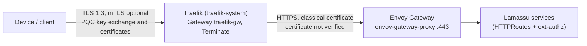

The `pqc` branch of the Lamassu Helm chart adds a front proxy: a Traefik instance built with the [Go PQC toolchain](/docs/platform/pqc/go-toolchain) that terminates the devices' TLS, authenticates them and forwards the traffic to Envoy Gateway. This page describes the resulting topology, the values that control it and the installer that automates a laboratory deployment.

<Callout type="warn" title="Laboratory deployment">
The chart and the installer assume a development cluster. The proxy image uses a mutable tag, the PQC certificates are not renewed automatically and the hop between Traefik and Envoy does not verify certificates. Do not use this configuration as it is for production.
</Callout>

## Topology



Traefik is the public edge. It negotiates the key exchange, serves the certificate and, if requested, receives the client certificate. It then opens a second TLS connection to the `envoy-gateway-proxy` service of Envoy Gateway, which presents the chart's self-signed classical certificate; Traefik is configured to accept it without verifying it. Envoy therefore never sees a post-quantum handshake, and the post-quantum protection covers only the connection between the client and Traefik. Traefik and Envoy Gateway are installed once per cluster and shared across namespaces, whereas the front proxy resources (the Gateway, route, middleware, certificate and reference grant) belong to the Lamassu release.

When the client sent a certificate, the `inject-client-cert` middleware of the chart adds it, in PEM form, to the `X-Forwarded-Tls-Client-Cert` header, and the `X-Forwarded-Proto: https` header is set on the request.

## Chart values

All the new values are under `traefikFrontProxy` and are validated by the chart's schema, which rejects unknown keys.

| Name | Type | Default | Description |
| --- | --- | --- | --- |
| `traefikFrontProxy.enabled` | boolean | `false` | Deploys the front proxy resources. |
| `traefikFrontProxy.domain` | string | `""` | Name of the edge certificate and host name of the route. Set it when the proxy is enabled. |
| `traefikFrontProxy.webSecurePort` | integer | `8443` | Port of the HTTPS listener; it must match Traefik's `websecure` entry point. |
| `traefikFrontProxy.tls.type` | string | `certManager` | Source of the classical certificate: `certManager`, `external` or `none`. |
| `traefikFrontProxy.tls.certManagerOptions.addresses` | list | `[]` | IP addresses added to the self-signed certificate. |
| `traefikFrontProxy.tls.externalOptions.secretName` | string | `""` | Secret with `tls.crt` and `tls.key` when the type is `external`. |
| `traefikFrontProxy.tls.additionalSecretNames` | list | `[]` | Extra TLS secrets, for example ML-DSA or composite certificates, served on the same listener. |

With `certManager`, the chart requests an ECDSA P-256 certificate valid for 2160 hours from its own self-signed issuer and stores it in the secret `edge-cert`. With `none`, only the additional secrets are served, and the chart stops with an error if there are none. The proxy chooses among all the certificates according to the client, as described in [TLS front proxy with Traefik](/docs/platform/pqc/tls-front-proxy). The names of the resources the chart creates are fixed, so only one release per namespace is supported.

```yaml
traefikFrontProxy:
  enabled: true
  domain: lab.example.com
  webSecurePort: 8443
  tls:
    type: certManager
    certManagerOptions:
      addresses: ["10.0.0.5"]
    additionalSecretNames:
      - edge-cert-pq
      - edge-cert-pqt
```

The chart also changes the Envoy Gateway service so that its HTTPS port declares `appProtocol: https`, which recent Traefik versions require in order to speak TLS to it. When `gateway.addresses` is empty, the Envoy service is a `ClusterIP` instead of a load balancer.

The chart does not deploy Traefik itself, the `traefik` GatewayClass, or the `default` TLS option in the `traefik-system` namespace; the installer creates them. Without them, the edge has no post-quantum key exchange and no client-certificate request. The chart also does not set the Lamassu service images: the defaults are the development images, and the installer overrides the UI, CA, KMS, VA, device manager, DMS manager, alerts and authorization images with the `:pqc` tags of `ghcr.io/lamassuiot`.

## The fast-lane installer

`scripts/lamassu-fast-lane.sh` installs everything on a cluster: the Gateway API custom resource definitions (version 1.6.3, experimental channel), Envoy Gateway 1.8.0, the Traefik chart 41.0.2 with the PQC image, the TLS option, PostgreSQL, Keycloak, RabbitMQ, optionally observability and SoftHSM, and finally the Lamassu release. The two flags that matter here select which algorithms are offered.

```bash
./scripts/lamassu-fast-lane.sh -d lab.example.com -ip <IP> -n
./scripts/lamassu-fast-lane.sh -d lab.example.com --tls-kex PQ,PQ/T --tls-auth PQ,PQ/T
```

Both flags take a comma-separated list of `T`, `PQ` and `PQ/T`, and both default to all three. For the key exchange, `PQ/T` is a hybrid group that combines a classical and an ML-KEM exchange (`X25519MLKEM768`, `SecP256r1MLKEM768` and `SecP384r1MLKEM1024`) and `PQ` is pure ML-KEM (`MLKEM1024`); for authentication, `PQ/T` is a composite certificate. `--tls-kex` fills the `curvePreferences` of the TLS option, and `--tls-auth` selects which certificates are served:

| Value | Key exchange groups | Certificate |
| --- | --- | --- |
| `T` | `X25519`, `CurveP256`, `CurveP384` | cert-manager ECDSA P-256, or the files given with `--tls-crt` and `--tls-key`, in the secret `edge-cert`. |
| `PQ` | `MLKEM1024` | ML-DSA-65, in the secret `edge-cert-pq`. |
| `PQ/T` | `X25519MLKEM768`, `SecP256r1MLKEM768`, `SecP384r1MLKEM1024` | Composite `MLDSA65-RSA3072-PSS-SHA512`, in the secret `edge-cert-pqt`. |

The minimum TLS version is 1.3 unless both flags are only `T`, in which case it is 1.2. cert-manager cannot issue post-quantum certificates, so the installer creates the PQ and PQ/T certificates locally with OpenSSL 3.5 or later; the composite certificate also needs the `hybrid-provider` module, which the script builds on demand with `git`, `cmake` and a C compiler. The ML-DSA private keys are written in the seed-only form that Go accepts, and the secrets are created from a manifest because `kubectl create secret tls` rejects ML-DSA keys. The certificates last 365 days and are kept if the secret already exists.

The script requires `yq`, `kubectl` and `helm`, and `jq` with `--sample-data`. At the end it prints how to extract the CA that devices must trust, for example `kubectl get secret edge-cert-pq -o jsonpath='{.data.ca\.crt}'`.

<Callout type="info" title="Helper scripts not yet in the repository">
Companion scripts for an MQTT broker behind Traefik (`scripts/emqx`), for exporting KMS keys and for restoring a backup are present in the working tree of the chart but not committed. They are for laboratory use only and are not described further here.
</Callout>

<Cards>
  <Card title="TLS front proxy with Traefik" description="How the proxy chooses a certificate and how it is built." href="/docs/platform/pqc/tls-front-proxy" />
  <Card title="Known limitations" description="Caveats of the laboratory deployment." href="/docs/platform/pqc/limitations" />
</Cards>
