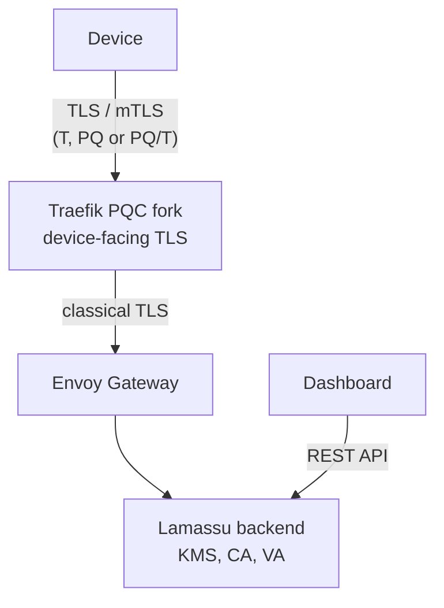

Lamassu can create keys, certificate authorities (CAs) and certificates that use post-quantum signature algorithms, and it can serve and verify them over TLS. The work spans five codebases that depend on one another: a fork of the Go toolchain that implements the algorithms, the Lamassu backend, the web dashboard, a fork of the Traefik proxy that terminates TLS for devices, and the Helm chart that deploys all of it together.

<Callout type="warn" title="Experimental">
PQC support lives in development branches and in forks of Go and Traefik, not in the upstream projects or in the standard Lamassu images. The composite TLS signature schemes use private-use code points that no other TLS stack understands, and the composite certificate format follows [RFC 10073](https://www.rfc-editor.org/rfc/rfc10073.html), a recent standard that has little deployment experience yet. Plan pilots and laboratory deployments, not production fleets. [Known limitations](/docs/platform/pqc/limitations) lists what is incomplete.
</Callout>

## Why it matters for device fleets

Certificates issued to devices often live for years, and the devices that hold them are hard to replace. A signature algorithm that is broken by a future quantum computer would force a fleet-wide re-enrollment. Issuing devices a certificate signed with a post-quantum or composite algorithm today, and serving them a TLS endpoint that accepts it, lets a fleet be validated against that risk before it becomes urgent. Signatures are not exposed to "harvest now, decrypt later" attacks the way a key exchange is, so the urgency is about the lifetime of certificates and devices, not about recorded traffic.

## Three families of algorithms

Lamassu groups signature algorithms in three families, the same labels the dashboard shows.

| Label | Family | Algorithms |
| --- | --- | --- |
| **T** | Traditional | RSA, ECDSA, Ed25519 |
| **PQ** | Pure post-quantum | ML-DSA, SLH-DSA |
| **PQ/T** | Hybrid (composite) | ML-DSA combined with RSA, ECDSA or Ed25519 in a single key and a single signature |

A composite signature is valid only if both of its components verify. Its unforgeability is intended to hold as long as at least one of the two algorithms remains unbroken, provided the relying party requires the composite and does not fall back to a classical certificate. In the key exchange, `PQ/T` means a hybrid group that combines a classical and an ML-KEM exchange, and `PQ` means pure ML-KEM. [Algorithms](/docs/platform/pqc/algorithms) describes each one and the parameter sets Lamassu accepts.

## How the pieces fit

The Go fork is the foundation: the backend and Traefik are compiled with it, because the standard Go toolchain does not provide the composite and SLH-DSA certificate support. The backend creates and holds the keys, issues certificates and signs revocation data. The dashboard drives the same REST API. Devices reach the platform through Traefik, which negotiates post-quantum authentication and key exchange with the device and then forwards the request to Envoy Gateway over ordinary TLS. Post-quantum protection therefore applies only to the hop between the device and Traefik.

## Where to read next

Read [Algorithms](/docs/platform/pqc/algorithms) first to learn what is supported and how parameter sets are written in API requests. Developers writing a device client should continue with [Go PQC toolchain](/docs/platform/pqc/go-toolchain). Administrators who want to create a post-quantum CA follow [Keys and certificate authorities](/docs/platform/pqc/keys-and-cas), and those who deploy the platform go to [Deployment with the Helm chart](/docs/platform/pqc/deployment).

<Cards>
  <Card title="Algorithms" description="ML-DSA, SLH-DSA and the 15 composite algorithms, with their parameter sets." href="/docs/platform/pqc/algorithms" />
  <Card title="Keys and certificate authorities" description="Create post-quantum keys and CAs and issue certificates through the API." href="/docs/platform/pqc/keys-and-cas" />
  <Card title="Deployment with the Helm chart" description="Install the platform with a Traefik front proxy that serves PQC certificates." href="/docs/platform/pqc/deployment" />
</Cards>
