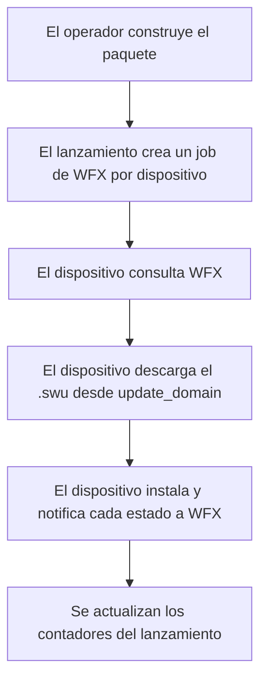

Los términos que usa Lamassu Updates y cómo encajan entre sí. Lee esta página antes de las guías si «paquete de actualización», «lanzamiento» o «módulo» son conceptos nuevos para ti.

## Vocabulario

El dashboard y esta documentación hablan de **paquete de actualización** (update pack). La API REST y el código hablan de **distribution set** (`/distribution-sets/...`). Son lo mismo.

| Término | Significado | Nombre en API / código |
|---|---|---|
| Paquete de actualización | Un entregable con nombre y versión que envías a los dispositivos | `distribution-set` |
| Módulo de software | Un componente con tipo y nombre dentro de un paquete, como una aplicación. Se identifica con la clave `type:name`, donde `type` es `os` o `application` | `softwaremodule` |
| Artefacto | Un fichero (binario) asociado a un módulo o a un paquete | `artifact` |
| Grupo de dispositivos | Un conjunto de dispositivos registrados en Lamassu IoT. Un paquete pertenece a un grupo | `groupID` |
| Campaña de lanzamiento | Un despliegue de una versión de un paquete sobre los dispositivos de un grupo | `launch` |
| Trabajo (job) | La actualización de un dispositivo dentro de un lanzamiento | job, device assignment |

## Paquetes de actualización

Un paquete tiene una **versión** (semántica, `x.y.z`) y un **estado**:

| Estado | Significado |
|---|---|
| `draft` | Editable. Se pueden añadir o reemplazar artefactos. Aún no está construido. |
| `built` | El entregable existe. La versión es inmutable. Crea una versión nueva para cambiarla. |
| `build_failed` | Se intentó construir y falló. Sigue siendo editable y se puede reintentar. El motivo está en `last_build_error`. |

Un paquete tiene un **empaquetado** (packaging):

| Empaquetado | Se entrega como | Estado terminal del workflow |
|---|---|---|
| `swu` | Un `.swu` construido con swugenerator, opcionalmente firmado y cifrado | `ACTIVATED` |
| `non-swu` | Los artefactos en bruto. El modo nativo construye un paquete `.tar.gz` (opcionalmente cifrado, `.tar.gz.enc`). El modo hawkBit entrega el único fichero de un módulo `raw` tal como se subió (opcionalmente cifrado) y archiva varios ficheros como `<name>.tar.gz` | `INSTALLED` |

Un paquete también puede llevar **precondiciones**: reglas como «el dispositivo ya debe tener el paquete X en la versión 1.2.0 o superior», o «el módulo `os:gateway-fw` en la versión 2.1.0 o superior». Cada precondición nombra exactamente un paquete (`required_distribution_set_name`) o un módulo (`required_module_key`) y una `min_version` semántica. Un dispositivo que no cumple una precondición no es desplegable, salvo que un operador fuerce el lanzamiento. Cada lanzamiento registra qué dispositivos fallaron y por qué.

## Módulos de software

Un paquete es una composición de módulos. Contiene un módulo `os` (el ancla obligatoria) y cualquier número de módulos `application`. En modo nativo, un paquete sin filas de módulo se muestra con un módulo implícito `os:<nombre del paquete>`, y los ficheros que subes al paquete le pertenecen. Un módulo guarda sus propios ficheros y, opcionalmente, notas de versión. Puedes:

- crear un módulo por separado en el **catálogo** (`POST /updates/v1/softwaremodules`) y componer paquetes con él más adelante,
- añadir un módulo directamente a un paquete, o
- importar un módulo que ya tiene otro paquete.

La **intención de entrega** (delivery intent) de un módulo indica cómo se enviará: `undecided` (por defecto), `swu-build`, `swu-prebuilt` o `raw`.

Cómo se relacionan los módulos con la construcción depende del backend:

- **native**: los módulos son *entradas de la construcción*. El paquete construye un único `.swu` con todos ellos, y un lanzamiento envía a cada dispositivo una única dirección de descarga.
- **hawkbit**: cada módulo tiene su *propio entregable*, construido en el catálogo de módulos antes de que exista el paquete. Solo los módulos ya construidos se pueden enlazar a un paquete, y un módulo enlazado queda congelado. hawkBit entrega al dispositivo los artefactos de cada módulo, de modo que un paquete con varios módulos se instala como varias transacciones SWUpdate independientes. SWUpdate no puede hacer rollback entre varios ficheros `.swu`.

La importación de un módulo también difiere. En modo hawkBit la importación lo **enlaza**, así que ambos paquetes comparten el módulo y una reconstrucción se ve en los dos. En modo nativo lo **copia**, así que los dos divergen después. El listado de módulos reutilizables te indica cuál obtendrás (`shared`).

## Campañas de lanzamiento

Un lanzamiento despliega una versión de un paquete sobre los dispositivos de un grupo en **lotes**.

### Estrategia

| Campo | Significado |
|---|---|
| `rollout_type` | Cómo se dimensiona un lote. Solo `percentage` hace que `rollout_value` sea un porcentaje. Cualquier otro valor (`fixed`, o `numeric`, que es el que envía el dashboard) lo convierte en un número de dispositivos |
| `rollout_value` | El porcentaje o el número de dispositivos. Debe ser mayor que 0 |
| `workflow_type` | El workflow de WFX: `direct` (sin confirmación), `phased` (con pasos de confirmación) o `download-install`. Usa `download-install` para paquetes `non-swu`. Cualquier otro valor se pasa a WFX como nombre completo de workflow, como `wfx.workflow.dau.simple`. En modo hawkBit no hay WFX: `phased` se convierte en una acción soft de hawkBit (el dispositivo confirma o pospone) y cualquier otro valor en una acción forced |
| `test_device_id` | Un canario. El primer lote es este único dispositivo, y debe tener éxito antes de tocar a ningún otro |
| `auto` | Libera el siguiente lote automáticamente cuando se cumplen las condiciones |
| `approval_threshold` | % del lote actual que debe tener éxito antes de empezar el siguiente (0 a 100). Sin definir, 0 o 100 significa el lote completo |
| `error_threshold` | El lanzamiento se cancela cuando este % de todos los dispositivos ha fallado (redondeado hacia arriba: con el 10 % de 100 dispositivos se cancela en el décimo fallo). `0` significa sin límite |
| `scheduled_at` | Hora de inicio prevista (RFC 3339). El modo nativo lanza el primer lote cuando pasa esa hora (consulta cada 30 segundos); el modo hawkBit se la entrega a hawkBit como hora de inicio del rollout |
| `name`, `description` | Nombre para mostrar (por defecto, el nombre del paquete) y notas de texto libre |
| `weight` | Una pista de prioridad almacenada, de 0 a 1000. Nada la lee |

### Ciclo de vida

Un lanzamiento está `running`, `paused` (se puede reanudar), `cancelled` (terminal) o `completed` (terminal). Un dispositivo dentro de él pasa de `pending` → `active` → `completed` o `failed`. Puedes reintentar solo los dispositivos fallidos (`retry-failed`). En modo nativo esto también reabre un lanzamiento terminado o cancelado. Los controles del operador son `rollout`, `pause`, `resume`, `cancel`, `complete` y `retry-failed`, y la estrategia se puede editar mientras el lanzamiento exista. El modo nativo los soporta todos. El modo hawkBit no tiene `complete` ni edición de la estrategia, porque los grupos y umbrales de un rollout se fijan al crearlo (consulta [Capacidades](/docs/platform/updates/reference/capabilities)).

## Versiones, cumplimiento e inventario

Además de los lanzamientos puntuales, puedes declarar la **última versión** de un paquete para un grupo. El servicio informa entonces de la **desviación** (drift): los dispositivos que no están en la última versión. Puedes forzar un dispositivo a la última versión, o a una exacta. Consulta la [referencia de la API](/docs/platform/updates/reference/api).

El servicio también mantiene un **inventario de dispositivos**: qué versión de paquete lleva ahora cada dispositivo, con los artefactos que declara el manifiesto de esa versión, y el historial de intentos de actualización. Ambos se rellenan a medida que se ejecutan los lanzamientos del servicio.

## Cómo llega una actualización a un dispositivo (modo nativo)

La máquina de estados del lado del dispositivo es un workflow de WFX, en `wfx/workflow/dau/` del repositorio:

| Fichero de workflow | Estados | Uso |
|---|---|---|
| `wfx.workflow.dau.direct.yml` | INSTALL → INSTALLING → INSTALLED → ACTIVATE → ACTIVATING → ACTIVATED | Paquetes SWU, sin confirmación |
| `wfx.workflow.dau.phased.yml` | CREATED → DOWNLOAD → … → ACTIVATED | Paquetes SWU, con pasos de confirmación |
| `wfx.workflow.dau.download-install.yml` | DOWNLOAD → DOWNLOADING → DOWNLOADED → INSTALL → INSTALLING → INSTALLED | Paquetes `non-swu`. Se selecciona con `workflow_type`: un lanzamiento no lo elige por ti |
| `wfx.workflow.dau.simple.yml` | DOWNLOAD → INSTALL → INSTALLED o TERMINATED | Flujo mínimo |

Todos los workflows terminan en `TERMINATED` si hay un fallo. El servicio registra los cuatro ficheros al arrancar. `workflow_file` debe nombrar el fichero `direct`, y los otros tres se buscan a su lado sustituyendo `direct` en el nombre del fichero (consulta [Configuración](/docs/platform/updates/reference/configuration)). En modo hawkBit no hay jobs de WFX: consulta [Modo hawkBit](/docs/platform/updates/hawkbit-mode).

## Siguientes pasos

<Cards>
  <Card title="Arquitectura" description="Los componentes y lo que se ejecuta dentro del servicio." href="/docs/platform/updates/architecture" />
  <Card title="Flujos" description="Diagramas de secuencia de cada operación importante." href="/docs/platform/updates/flows" />
  <Card title="Publicar y desplegar una actualización" description="Hazlo de principio a fin." href="/docs/platform/updates/guides/publish-and-roll-out" />
</Cards>
