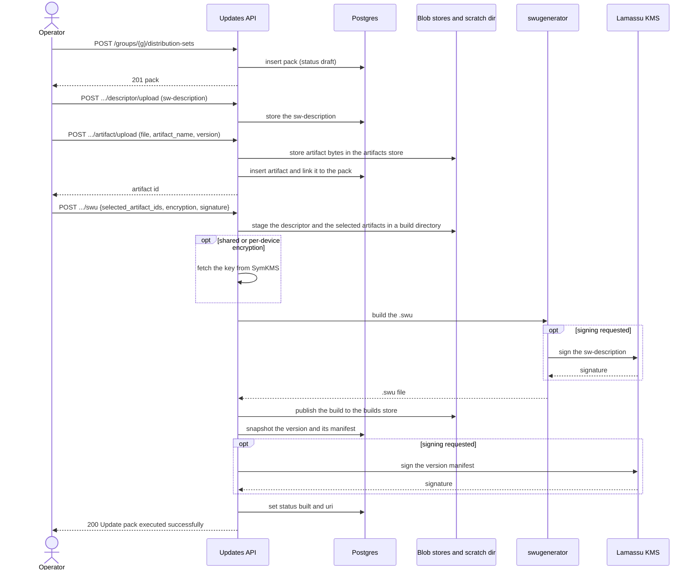
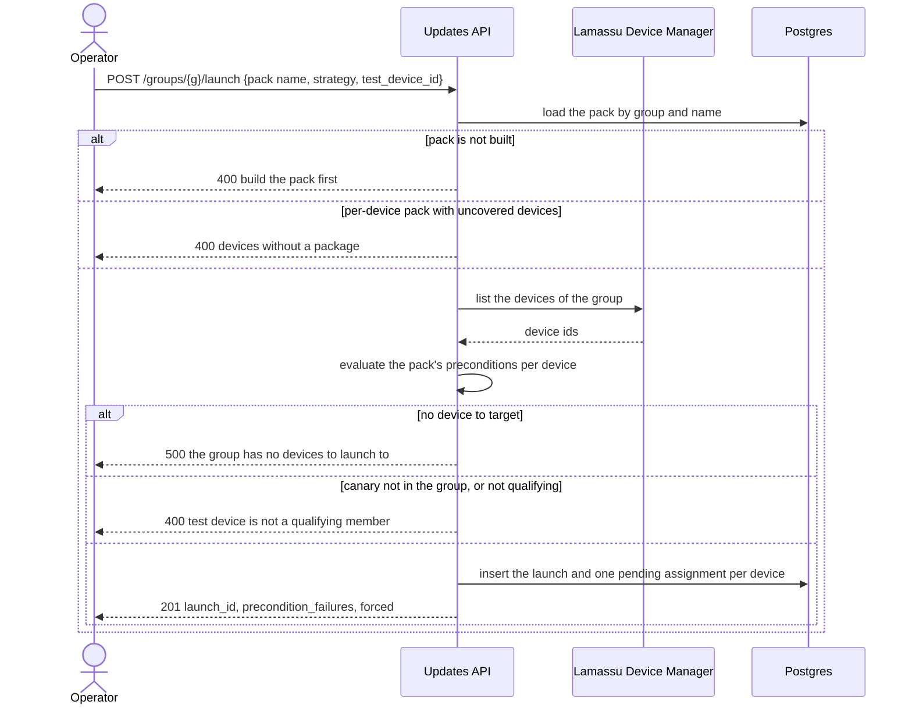
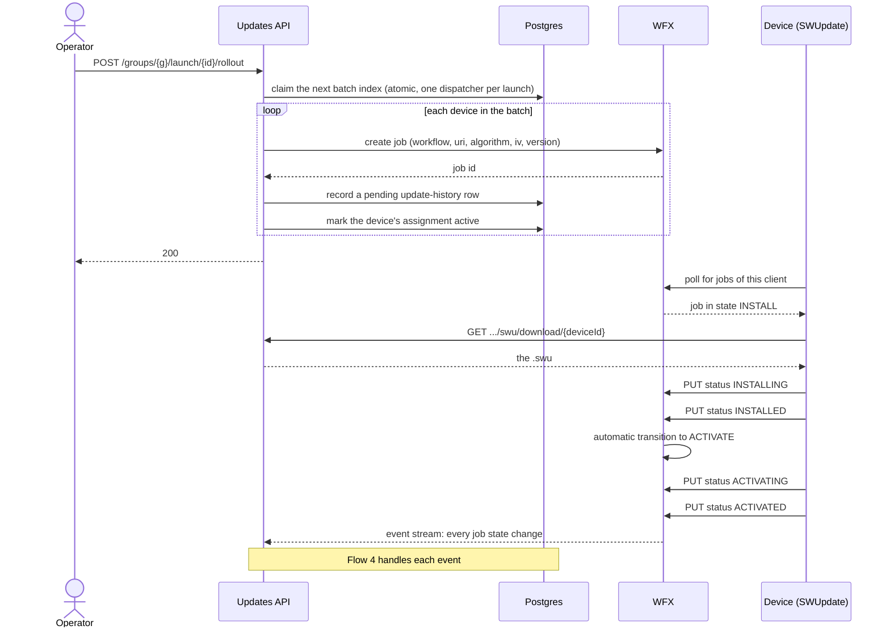
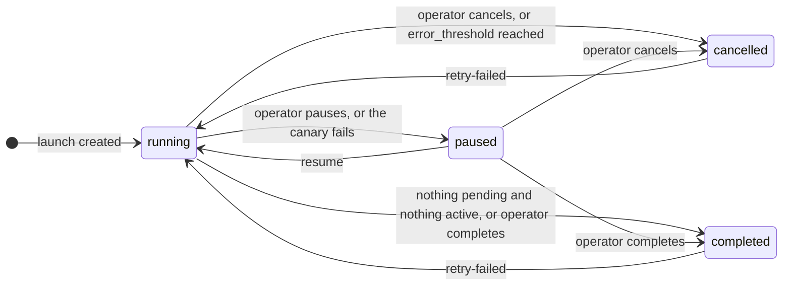
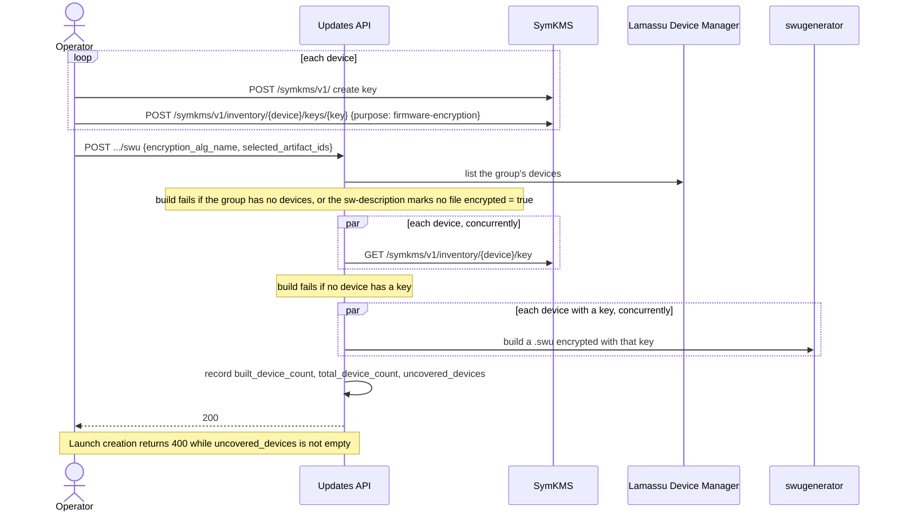
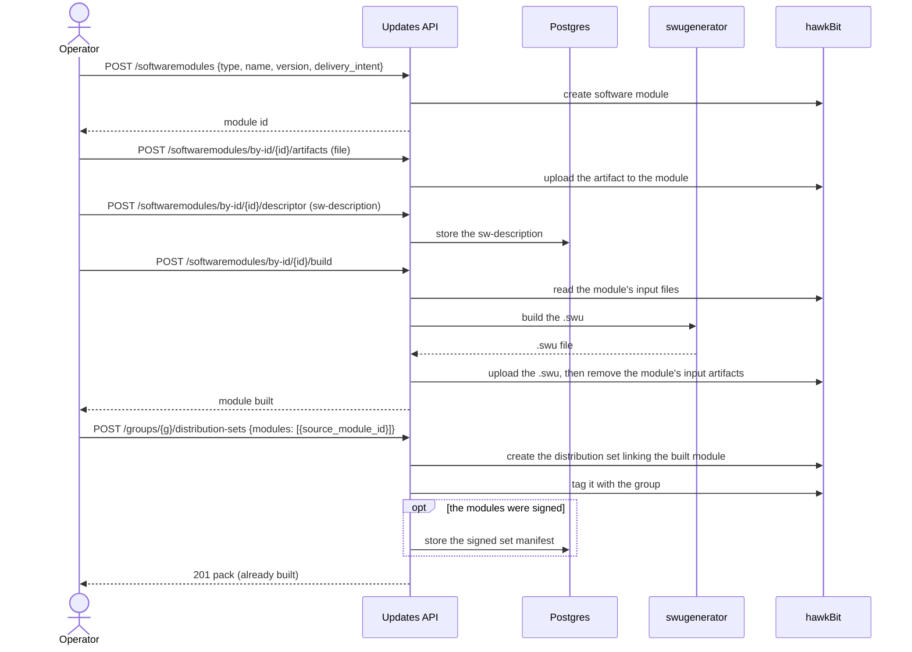
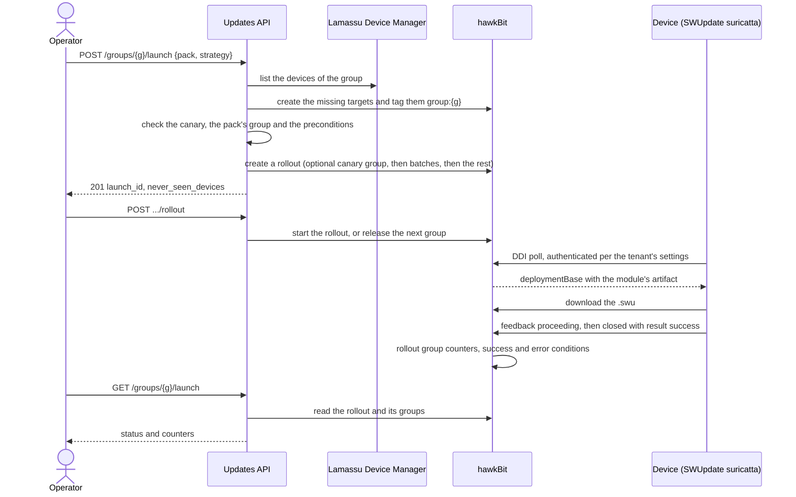

These diagrams follow what the service does, step by step. Routes are relative to `/updates/v1`. For runnable commands see the [native](/docs/platform/updates/guides/native-curl) and [hawkBit](/docs/platform/updates/guides/hawkbit-curl) curl guides, and the [API reference](/docs/platform/updates/reference/api) for every route and body.

## Native mode

### 1. Publish and build a pack

Building turns the uploaded artifacts and the sw-description into one `.swu`. Nothing is signed or encrypted unless the build request asks for it.

Things to know about the build:

- The pack is created with a name, a semantic `version`, a `group_id`, a `type` and an optional `packaging`. A duplicate name in the group is a `409`.
- Uploading an artifact (or a prebuilt deliverable) to a version that is already built is refused with `409`: create a new version first. A build or change that collides with another one on the same pack answers `409` too.
- A file larger than `max_artifact_size_mb` (10240 MiB by default) is refused with `413`.
- Encryption is chosen by the build body: `user` plus `encryption_key_name` is shared-key encryption, and `encryption_alg_name` alone is per-device encryption (flow 5).
- If the build fails, the pack becomes `build_failed`, `last_build_error` says why, and the pack stays editable. The selected artifacts replace the pack version's earlier artifact links.
- Without signing fields the manifest is stored unsigned. If a signing key is given but no certificate, the build fails instead.
- A `non-swu` pack is built with `POST .../package` into a `.tar.gz`, and a deliverable built elsewhere is attached with `POST .../swu/upload` or `.../package/upload`.

### 2. Create a launch

Creating a launch decides who is targeted, and checks the pack is deliverable. Nothing is sent to a device yet.

`?dry_run=true` stops after the precondition check and answers `200` with `qualifying_devices`, `precondition_failures`, `superseded_devices` and `never_seen_devices`. `force_preconditions` targets every device of the group and still records who failed. `distribution_set_name`, `workflow_type` and `rollout_type` are required, and so is a `rollout_value` above zero. `approval_threshold` and `error_threshold` must be between 0 and 100, and each violation is a `400`. A launch can also carry `auto`, `scheduled_at`, `name`, `description` and `weight` (see [Concepts](/docs/platform/updates/concepts#launch-campaigns)).

### 3. Roll out a batch and update a device

One `rollout` call sends the next batch. The canary goes alone first, then batches of the configured size, chosen at random from the devices still pending. The device side below is the `direct` workflow, where a job starts in `INSTALL`.

With the `phased` workflow a job starts in `CREATED`, and some transitions need a person or system to confirm them in WFX. This service does not advance them. The `download-install` workflow, used by `non-swu` packs, runs `DOWNLOAD → DOWNLOADING → DOWNLOADED → INSTALL → INSTALLING → INSTALLED`.

With `auto` on, one `rollout` call starts the launch and the following batches are released by flow 4. A launch with `scheduled_at` is started by the scheduled-launch trigger on the leader replica once that time passes.

The `rollout` call is not always a plain `200`:

- It is refused with `400` when the launch is paused, cancelled, completed or aborted, and on an `auto` launch once any batch has gone out.
- It does nothing and answers `200` while `scheduled_at` is still in the future, and while the canary is still active. It returns an error if the canary failed.
- If some jobs cannot be created, those devices stay `pending` and the call returns a "partial rollout" error (`500`).

### 4. React to a device finishing

Every state change WFX reports runs the same logic. This is what makes automatic batching, the canary gate and the error threshold work.

On **every** event the service updates the device's update history and writes the event to the device's metadata in Lamassu. Then, only if the state is a terminal one of the workflow, it runs these checks in order, and the first one that applies decides what happens:

| # | Check | If it applies |
|---|---|---|
| 1 | Is the state terminal in the workflow? | If not, nothing more happens |
| 2 | (always) | Mark the device's assignment `completed` or `failed`. On success, record the installed version |
| 3 | Did the canary device fail? | Pause the launch. Resume to retry |
| 4 | Is the launch paused, cancelled or completed? | Stop: no further batches |
| 5 | Is `error_threshold` set, and have failures reached that share of all devices (rounded up)? | Cancel the launch. Pending devices are not sent |
| 6 | Is nothing pending and nothing active? | Mark the launch `completed` |
| 7 | Is `auto` off, or is nothing left to send? | Wait for the operator's next `rollout` call, or for the devices still in flight |
| 8 | Did at least `approval_threshold` of this batch succeed? (0 or 100 or more means all of it) | Dispatch the next batch. Otherwise wait for more results |

Only devices dispatched in the current batch count toward its approval: a straggler from an earlier batch never does. The checks move the launch between these states:

A new launch is stored with an empty status, which means `running`. Resuming after a failed canary re-queues the canary so it is tried again. Cancelling stops further batches but does not recall jobs that are already running on devices.

### 5. Build a per-device encrypted pack

Each device gets its own package, encrypted with its own key. The build first resolves every device's key, then builds. A device without a key is skipped, and a launch on a pack with skipped devices is refused.

`uncovered_devices` lists devices without a key and also devices whose own build failed. A build where no device got a package leaves the pack `build_failed`.

## hawkBit mode

### 6. Build a module and create a pack

hawkBit itself has no notion of a built module, and this service links only built modules into a hawkBit distribution set. A set is never built directly: `POST .../swu` and `.../package` answer `501` in this mode. The module is built first, in the catalog, and the pack is created from it. The diagram shows the `swu-build` intent.

The other delivery intents skip steps: `swu-prebuilt` only uploads the finished `.swu`, which is what builds the module, and `raw` only encrypts or signs the files, with no swugenerator and no sw-description (signing adds a `.sha256` checksum document and its detached signature as extra artifacts). A build can sign through the KMS and encrypt with a shared SymKMS key. Per-device encryption is refused in hawkBit mode. A linked module is frozen: to change it, edit and build it in the catalog, then link it again.

### 7. Launch and device update

The device talks to hawkBit, not to this service. The service reads progress back from hawkBit whenever it is asked.

A canary group exists only when `test_device_id` is given. hawkBit decides when a group succeeds and the next group starts, using the approval and error thresholds the service gave it. With `auto` off, hawkBit pauses after each group and the next `rollout` call releases the following one. The launch response also lists `superseded_devices` (devices whose in-flight update the new rollout replaces) and `never_seen_devices` (devices that have never polled, which can stall a group that must reach its success threshold).

The `rollout` call depends on the rollout's state:

- A `ready` rollout is started, and nothing happens while its start time is in the future.
- A paused rollout is resumed only if it is paused between batches. An operator pause needs `resume`, and a rollout stopped by its error threshold cannot be resumed.
- A running manual rollout releases its next group.
- An `auto` rollout that is already running is refused with `400`.
- A second `rollout` on the same launch while one is in progress answers `409`.

Device authentication is a hawkBit tenant setting. Target security tokens are off by default. See [Connect a device](/docs/platform/updates/guides/connect-a-device).

## Next steps

<Cards>
  <Card title="Publish and roll out an update" description="Run flows 1 to 4 end to end." href="/docs/platform/updates/guides/publish-and-roll-out" />
  <Card title="Data model" description="The tables behind these flows." href="/docs/platform/updates/data-model" />
  <Card title="Signing and encryption" description="Keys, signatures and the manifest." href="/docs/platform/updates/signing-and-encryption" />
</Cards>
