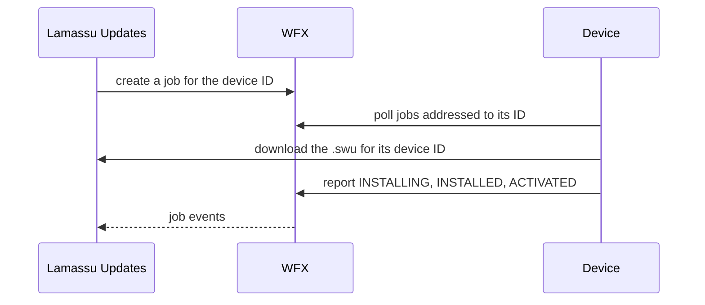
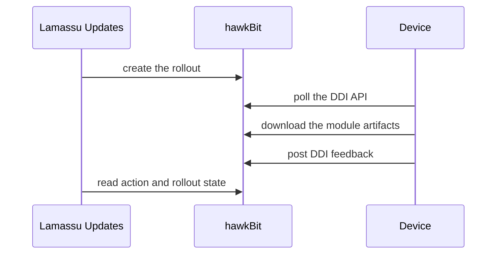

This guide describes the contract between a device and Lamassu Updates, for each backend. The device software is [SWUpdate](https://swupdate.org/): this page covers what the device must send and receive, not SWUpdate's own installation and configuration, which its documentation describes. Use it when a launch is running and no device moves.

## Before you begin

- A device with SWUpdate installed, and a way to run an update client: a small agent, or SWUpdate's `suricatta` module.
- A device identity: one ID that is the same everywhere. It is the WFX client ID in native mode and the hawkBit controller ID in hawkBit mode, and it must equal the device's ID in the Lamassu device registry (see [Device management](/docs/platform/iot-fleets/device-management)).
- The device must be a member of a Lamassu IoT device group, because a pack belongs to a group and a launch targets the group's devices. In hawkBit mode group membership is also read from the registry when `dms_endpoint` is set.
- Native mode only: `update_domain` must be an address the device can reach. See [Configuration](/docs/platform/updates/reference/configuration). In hawkBit mode devices download from hawkBit.

## Native mode: the device polls WFX

In native mode a launch creates one WFX job per device. The device polls WFX for jobs addressed to its ID, downloads the deliverable from the Updates API, installs it and reports each state back to WFX. Lamassu Updates reads those states from WFX to drive the launch.



The sample device in `docker-compose.yml` (`swupdate-device1`) shows the minimum configuration. It takes three variables: `DEVICE_NAME` (its ID), `WFX_URI` (the WFX **client** API, `http://custom-wfx:8080/api/wfx/v1` inside the Compose network, `localhost:9080` from the host) and `PORT`. The WFX management API on `9081` is for the service, not for devices.

### The job the device receives

The job is addressed to the device (the WFX `clientId` is the device ID), names a workflow and is tagged with the launch (`lms://secure-updates/<launch id>`) and the group (`lms://dms/<group id>`). Its definition looks like this:

```json
{
  "type": ["firmware"],
  "launchID": "<launch id>",
  "version": "1.0.0",
  "groupID": "<group id>",
  "artifacts": [
    {
      "name": "my-firmware",
      "uri": "http://updates:10090/updates/v1/groups/<group>/distribution-sets/my-firmware/swu/download/<device-id>",
      "algorithm": "<algorithm name>",
      "iv": "<hex>"
    }
  ]
}
```

| Field | Meaning |
|---|---|
| `type` | The pack type: `rawfile`, `firmware`, or both (`["rawfile","firmware"]`) |
| `artifacts[0].uri` | Where to download the deliverable. The service appends the device ID, so each device fetches its own file. A `.swu` for SWU packs, a `.tar.gz` for `non-swu` packs |
| `algorithm`, `iv` | Present only for an encrypted pack: the algorithm and, for shared-key packs, the hex IV or nonce. A per-device pack carries the algorithm but no `iv` |
| `signature_key_id`, `signature_algorithm`, `signature_certificate` | Present only for a signed pack |

The device needs the key to decrypt, and holds it itself. For a per-device pack it is the key that SymKMS assigned to that device, and each device downloads a different file.

### Downloading

The download answers with the bytes, or with `302` to a short-lived signed URL when presigned downloads are enabled for the build store. Make sure the device's HTTP client follows redirects. The route also answers `HEAD` and byte-range requests (`206`), so an interrupted download can resume. The URL is fixed when the pack is built, so a device never sees a new `update_domain` until you rebuild.

### The states the device reports

The device moves its job through the workflow's states, and the workflow decides who may make each move. For the `direct` workflow:

```text
INSTALL → INSTALLING → INSTALLED → (WFX, automatic) ACTIVATE → ACTIVATING → ACTIVATED
```

The device reports `INSTALLING`, `INSTALLED`, `ACTIVATING` and `ACTIVATED`. WFX itself makes the `INSTALLED → ACTIVATE` step. From `INSTALL`, `INSTALLING`, `ACTIVATE` and `ACTIVATING` the device can move to `TERMINATED` to report a failure; `INSTALLED` has no failure transition.

| Workflow | Used for | Terminal states |
|---|---|---|
| `wfx.workflow.dau.direct` | SWU packs, no confirmation | `ACTIVATED` (success), `TERMINATED` (failure) |
| `wfx.workflow.dau.phased` | SWU packs with confirmation steps (`CREATED → DOWNLOAD → ... → ACTIVATED`) | `ACTIVATED`, `TERMINATED` |
| `wfx.workflow.dau.download-install` | `non-swu` packs: `DOWNLOAD → ... → INSTALLED`, every move made by the device | `INSTALLED`, `TERMINATED` |
| `wfx.workflow.dau.simple` | Minimal `DOWNLOAD → INSTALL → INSTALLED` | `INSTALLED`, `TERMINATED` |

A `phased` job has moves that WFX or an operator makes, and nothing in Lamassu Updates advances them: it stays at `CREATED` until someone confirms it through WFX (the dashboard's **Next** button does that). The launch endpoints `force-version` and `sync-to-latest` use `phased` for SWU packs unless you pass a `workflow`. The workflow files are in `wfx/workflow/dau/` of the repository. The WFX HTTP API (listing jobs, updating status) is documented by [WFX](https://github.com/siemens/wfx).

## hawkBit mode: the device polls hawkBit

In hawkBit mode devices do not poll Lamassu Updates. They poll hawkBit's DDI API, and Lamassu Updates reads the resulting action state from hawkBit.



<Steps>
  <Step>
    ### Make the device a hawkBit target

    The device needs a controller ID, and a target tagged `group:<id>` for its group. With `dms_endpoint` set, the service does this itself: when it reads a group's devices from the registry it creates the missing targets and tags them. Without `dms_endpoint` you create the targets and tags yourself. Either way the device must poll hawkBit with valid credentials.
  </Step>
  <Step>
    ### Configure SWUpdate

    Point the device's SWUpdate (`suricatta`) at hawkBit's URL (`hawkbit.ddi_url`, which defaults to `hawkbit.base_url`), with the tenant, the controller ID and an authentication method that your hawkBit tenant accepts. hawkBit refuses unauthenticated devices by default. With target security tokens, enable them for the tenant (`PUT /rest/v1/system/configs/authentication.targettoken.enabled` with `{"value":true}`) and give each device its target's `securityToken`, which it sends as `Authorization: TargetToken <token>`. The [hawkBit curl guide](/docs/platform/updates/guides/hawkbit-curl) shows every request.
  </Step>
  <Step>
    ### Point it at the right hawkBit

    The device must poll the **same hawkBit** that the service is configured for. A service pointed at a hawkBit with no targets builds and launches without error, and nothing downloads it. See [Troubleshooting](/docs/platform/updates/troubleshooting).
  </Step>
</Steps>

hawkBit then hands the device every artifact of its distribution set. A pack with several modules runs several independent installs.

When your gateway routes hawkBit's device artifact URLs (the path of `hawkbit.ddi_url`, `.../<tenant>/controller/v1/<controller>/softwaremodules/<id>/artifacts/<file>`) to Lamassu Updates, the service serves them only for modules assigned to or installed on that controller, and answers `404` otherwise. With presigned downloads on, it redirects to a signed URL of hawkBit's S3 bucket instead of streaming the file.

## Signed and encrypted images

If the device verifies signatures, set its public key (`public-key-file` in SWUpdate's configuration) and sign the package with the matching key. If it decrypts, it needs the same key and algorithm the pack was built with. A mismatch is the usual reason an install fails silently after a successful download. [Signing and encryption](/docs/platform/updates/signing-and-encryption) explains which key, algorithm and IV each mode uses, and what the device receives.

## Verify the result

After a launch, the device's job reaches `ACTIVATED` (or `INSTALLED` for a `non-swu` pack), the launch counters update, and the device inventory lists the pack:

```bash
API=http://localhost:10090/updates/v1
curl -s $API/devices/<device-id>/distribution-set-inventory
curl -s $API/launch/<launch-id>/jobs
```

See [Publish and roll out an update](/docs/platform/updates/guides/publish-and-roll-out#verify-the-result) for the rest of the checks.

## Troubleshooting

| Symptom | Likely cause |
|---|---|
| The device never sees a job (native) | It polls the wrong WFX endpoint or uses a different ID than the group member. The WFX `clientId` must equal the device ID |
| The job stays at `CREATED` | The launch uses `phased`. Confirm it through WFX or the dashboard, or relaunch with `direct` |
| The download fails with `404` | The pack is per-device encrypted and the device has no key, or the URL names another device. Check the pack's coverage and that the URL ends with this device's ID |
| The download succeeds and the install fails | The signature or the key does not match what the device holds. See [Signing and encryption](/docs/platform/updates/signing-and-encryption) |
| A `non-swu` launch looks stuck although the device finished | It was launched with `direct` or `phased`, which wait for `ACTIVATED`. Launch `non-swu` packs with `download-install` |
| The launch never advances (hawkBit) | The device is not polling this hawkBit, is not tagged into the group, or cannot authenticate |

## Next steps

<Cards>
  <Card title="Signing and encryption" href="/docs/platform/updates/signing-and-encryption" description="Keys, algorithms and what the device must hold." />
  <Card title="hawkBit mode" href="/docs/platform/updates/hawkbit-mode" description="How the adapter maps packs and campaigns onto hawkBit." />
  <Card title="Troubleshooting" href="/docs/platform/updates/troubleshooting" description="Updates not reaching devices, and other failures." />
</Cards>
