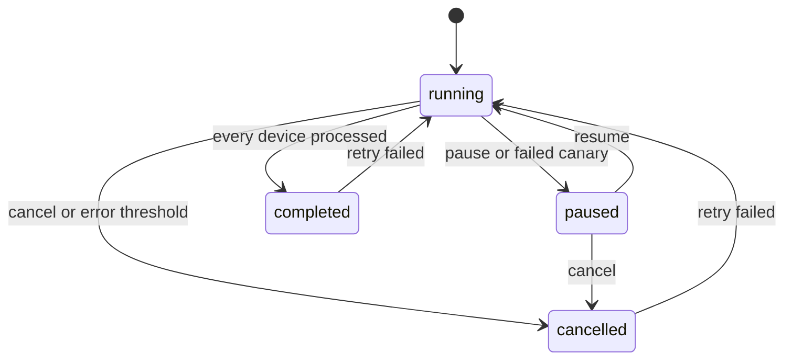

This guide takes one update from nothing to devices: create an update pack, attach an artifact and a `sw-description`, build the deliverable, create a launch (a campaign in the dashboard) and release it batch by batch. The requests use native mode. hawkBit mode builds and creates packs in a different order, described in [hawkBit mode](#hawkbit-mode). To do the same through screens, follow [Use the dashboard](/docs/platform/updates/guides/dashboard).


## Before you begin

- The [stack is running](/docs/platform/updates/getting-started) and `curl localhost:10090/health` answers.
- A Lamassu IoT device group that contains the devices you want to update. Its ID is `$GROUP`. A pack belongs to one group and can only be launched to that group's devices.
- The binary to deliver and, for an SWU pack, a `sw-description` file.
- Devices that can receive the update. See [Connect a device](/docs/platform/updates/guides/connect-a-device).

```bash
API=http://localhost:10090/updates/v1
GROUP=<your-group-id>
```

The service has no built-in authentication, so these examples send none. Put a gateway that authenticates callers in front of it: see [Security](/docs/platform/updates/security).

## 1. Create the pack

```bash
curl -s -X POST $API/groups/$GROUP/distribution-sets \
  -H 'Content-Type: application/json' \
  -d '{"name":"my-firmware","version":"1.0.0","group_id":"'$GROUP'","type":"firmware","packaging":"swu"}'
```

The response is `201` with the pack, including its `id`. A pack starts as `draft`.

| Field | Notes |
|---|---|
| `name` | Required. Unique within the group; a duplicate answers `409`. Native mode uses it as a path segment, so it may contain only letters, digits, `.`, `_` and `-` (no spaces) |
| `version` | Required. Strict semver `x.y.z`, set by you |
| `group_id` | Required in the body. Use the same value as in the path |
| `type` | `rawfile` or `firmware`. Recorded on the pack and sent to the device in the job; the dashboard also offers `both` and `other`. Not validated at creation |
| `packaging` | `swu` (default) or `non-swu`. A `non-swu` pack delivers its files as a `.tar.gz` and uses the `download-install` workflow |
| `allow_previous_version_download` | Optional. Lets devices download older versions of the pack |
| `preconditions` | Optional rules a device must meet to receive the pack. See [Concepts](/docs/platform/updates/concepts) |
| `modules` | **hawkBit mode only**: the pack's composition, as built catalog modules. Native ignores it |

## 2. Upload the sw-description and the artifact

The `sw-description` is an SWUpdate file that lists what the device installs. Its format is SWUpdate's, and the [SWUpdate documentation](https://sbabic.github.io/swupdate/sw-description.html) is the reference. When the service builds the `.swu`, `swugenerator` reads this file and the staged binaries, so the `filename` of every image must be the name of an uploaded file. A minimal one:

```text
software =
{
	version = "1.0.0";
	description = "My panel";
	hardware-compatibility: [ "1.0" ];
	images: (
		{
			filename = "rootfs.img";        # the uploaded file's name
			path = "/web/index.html";
			type = "rawfile";
			compressed = "zlib";            # swugenerator compresses the file
			properties: {
				decompressed-size = "<bytes>";  # set it whenever compressed is set
			};
		}
	);
}
```

`swugenerator` fills in the final `filename` (with `.zlib` added, and `.enc` for encrypted files), the `sha256` and, for encrypted files, the `ivt` property. For an encrypted build, add `encrypted = true;` to each image that must be encrypted. Two rules cause most failures:

- `encrypted = true` must appear only in a build that supplies a key (the build fails without one), and a per-device build refuses a description in which no image has it.
- Compressed images need `decompressed-size`.

If you build the `.swu` yourself and upload it as a prebuilt deliverable, you fill in `sha256` and `ivt` yourself, and the `sha256` is over the bytes the device downloads, because SWUpdate hashes before it decrypts.

```bash
# The sw-description (multipart field "file")
curl -s -X POST $API/groups/$GROUP/distribution-sets/my-firmware/descriptor/upload \
  -F file=@sw-description

# The binary (multipart: "file", plus "artifact_name" and "version")
curl -s -X POST $API/groups/$GROUP/distribution-sets/my-firmware/artifact/upload \
  -F file=@rootfs.img -F artifact_name=rootfs.img -F version=1.0.0
```

- `artifact_name` defaults to the file name without its extension. `version` is optional; when you upload a new file under an existing `artifact_name` it must be strictly higher than the highest version already stored under that name.
- The artifact is stored as a global artifact and linked to this pack. The response contains its `id`. To reuse an artifact that is already uploaded, link it with `POST .../artifact/link` and `{"artifact_id":"<id>"}`.
- The largest accepted file is `max_artifact_size_mb` (10 GiB by default). A bigger upload answers `413`.
- Once the pack is built, uploads and links answer `409`: create a new version first.

### Compose a pack from several modules (optional)

A native pack is a composition of software modules: one `os` module plus any number of `application` modules. A pack with no declared modules behaves as a single implicit `os` module that owns the artifacts you uploaded above. To add an application module and give it its own files:

```bash
curl -s -X POST $API/groups/$GROUP/distribution-sets/my-firmware/modules \
  -H 'Content-Type: application/json' \
  -d '{"type":"application","name":"telemetry","version":"1.0.0"}'

curl -s -X POST $API/groups/$GROUP/distribution-sets/my-firmware/modules/application:telemetry/artifact/upload \
  -F file=@telemetry.bin -F artifact_name=telemetry
```

The module key is `<type>:<name>`. Native still builds one `.swu` for the whole pack, from every module's artifacts and the pack's single `sw-description`. You can also compose from a module that already exists with `POST .../modules/import`; in native mode that copies the module, while in hawkBit mode it links the same module. See [Concepts](/docs/platform/updates/concepts) for the model.

## 3. Build the deliverable

```bash
curl -s -X POST $API/groups/$GROUP/distribution-sets/my-firmware/swu \
  -H 'Content-Type: application/json' \
  -d '{"selected_artifact_ids":["<artifact id>"]}'
```

`selected_artifact_ids` is what puts artifacts into the build: only the listed artifacts are staged. With an empty list the build fails because no binaries were staged, and the pack becomes `build_failed`. Take the ID from the artifact upload response, or from `GET $API/artifacts`.

The body above builds an unencrypted, unsigned `.swu`. To sign or encrypt, add fields as described in [Signing and encryption](/docs/platform/updates/signing-and-encryption).

- For a `non-swu` pack, call `POST .../package` instead of `.../swu`. With no `selected_artifact_ids` it packages the artifacts linked to the pack.
- To deliver a file you built elsewhere, upload it to `POST .../swu/upload` (or `.../package/upload`) as a multipart `file`. It is stored and served unchanged, so it must already be signed and encrypted the way your devices expect. Native mode only.

When the build succeeds, the pack becomes `built` and its artifacts and composition are immutable. If it fails, the pack becomes `build_failed` and `last_build_error` holds the reason: fix the input and build again. A build that runs while another one holds the same pack answers `409`.

## 4. Create the launch

```bash
curl -s -X POST $API/groups/$GROUP/launch \
  -H 'Content-Type: application/json' \
  -d '{
        "distribution_set_name":"my-firmware",
        "workflow_type":"direct",
        "rollout_type":"percentage",
        "rollout_value":10,
        "test_device_id":"<canary-device-id>",
        "name":"my-firmware 1.0.0 first wave"
      }'
```

The launch targets every device of the group at the moment you create it, and it needs a built pack. The response is `201` with `launch_id`, `precondition_failures`, `forced`, and, in hawkBit mode, `superseded_devices` and `never_seen_devices`.

| Field | Notes |
|---|---|
| `distribution_set_name`, `workflow_type`, `rollout_type`, `rollout_value` | Required. `rollout_value` must be greater than 0 |
| `rollout_type` | `percentage` of the group per batch, or `fixed` (a device count). Any value other than `percentage` is read as a count |
| `workflow_type` | Native: `direct`, `phased`, `download-install`, or the full name of another workflow registered in WFX (`GET $API/workflows`). hawkBit: `phased` creates a soft action, anything else a forced one |
| `test_device_id` | Optional canary: a member of the group that is updated first and must succeed before any other device is touched |
| `auto`, `approval_threshold`, `error_threshold` | Optional. `auto` releases later batches by itself. Both thresholds are percentages from 0 to 100 |
| `scheduled_at` | Optional RFC 3339 time. The first batch is delayed until then |
| `name`, `description`, `weight` | Optional. `name` defaults to the pack's name. `weight` (0 to 1000) is stored but nothing reads it |
| `force_preconditions` | Deploy to devices that fail the pack's preconditions anyway. The failures are still recorded |

Choose the workflow to match the pack:

- Use `direct` for SWU packs unless you drive WFX yourself. The `phased` workflow has steps that WFX or an operator must confirm, and this service does not advance them. A `phased` launch stays at its first state until someone confirms it through WFX.
- For a `non-swu` pack set `workflow_type` to `download-install`. The launch uses the value you give verbatim, so `direct` would run the SWU workflow and the update would look stuck after the device finished.
- In hawkBit mode there is no WFX. The choice is hawkBit's install mode.

If the pack has preconditions, preview who qualifies before creating anything by adding `?dry_run=true` to the same request. It answers `200` with `qualifying_devices`, `precondition_failures`, `superseded_devices` and `never_seen_devices`, and creates nothing.

**Approval and error thresholds.** With `auto: true`, the next batch is released once at least `approval_threshold` percent of the current batch has succeeded (0 means the whole batch). In native mode the campaign is cancelled when `error_threshold` percent of all its devices have failed; in hawkBit mode it stops when more than that percentage of a batch fails. A failed canary pauses a native campaign instead: resume it to retry the canary.

Take the launch ID from the response. It is `$LAUNCH` below.

## 5. Roll it out

```bash
curl -s -X POST $API/groups/$GROUP/launch/$LAUNCH/rollout
```

Without `auto`, each call dispatches the next batch (the canary first, if you set one). With `auto: true`, call it once to start the first batch: the service then releases the later batches itself as the approval threshold is met, and further calls answer `400`. If the launch has a future `scheduled_at`, the call is accepted but does nothing: the service starts it by itself at that time (native checks every 30 seconds; hawkBit's own scheduler starts the rollout).

A native launch moves through these statuses:



You can steer a launch while it runs:

| Action | Request | Effect |
|---|---|---|
| Pause | `POST $API/groups/$GROUP/launch/$LAUNCH/pause` | No further batches until resumed. Devices already in flight finish |
| Resume | `POST .../resume` | Native: an automatic campaign releases its next batch at once if the current one already met the threshold, and resuming after a failed canary retries it |
| Retry failed devices | `POST .../retry-failed` | Re-queues the failed devices and dispatches them. Answers `400` when there is none |
| Cancel (terminal) | `POST .../cancel` | Pending devices are not updated |
| Mark complete (terminal) | `POST .../complete` | Not available in hawkBit mode |
| Read or change the strategy | `GET`, `PUT .../strategy` | Changing it is not available in hawkBit mode |

In hawkBit mode a rollout can only be paused after it has started dispatching.

## Verify the result

```bash
# The launches of the group, each with its per-status device counts
curl -s $API/groups/$GROUP/launch

# One job per device of a launch
curl -s $API/launch/$LAUNCH/jobs

# What a given device now carries
curl -s $API/devices/<device-id>/distribution-set-inventory
```

The launch list answers `{"list":[...],"next":"..."}`. A launch is done when `pending_count` and `active_count` are zero; a native launch then sets its `status` to `completed` by itself. Devices end as `completed` (job state `ACTIVATED`, or `INSTALLED` for `non-swu`) or `failed` (`TERMINATED`).

## Ship the next version

A built pack version is immutable. To change it, create the next version, upload what changed and build again:

```bash
curl -s -X POST $API/groups/$GROUP/distribution-sets/my-firmware/new \
  -H 'Content-Type: application/json' -d '{"version":"1.1.0"}'
```

The version must be strictly higher than the current one. The new version starts unbuilt and carries the current artifacts forward.

To update one device to an exact version without a campaign, use `POST $API/devices/<device-id>/force-version` with `{"distribution_set_id":"<pack id>","version":"1.1.0"}`; in native mode it creates a one-device launch and defaults to the `phased` workflow for SWU packs (`download-install` for `non-swu`) unless you pass a `workflow`.

## hawkBit mode

hawkBit packs are assembled from built catalog modules, so the pack-side steps 2 and 3 move to the catalog:

1. Create the module: `POST $API/softwaremodules` with `type` (`os` or `application`), `name`, `version` and a `delivery_intent`: `swu-build`, `swu-prebuilt` or `raw`. `undecided` is accepted, but a module cannot join a pack until you choose.
2. Upload the file with `POST $API/softwaremodules/by-id/<id>/artifacts`. For `swu-build`, also upload the `sw-description` to `.../descriptor` and call `POST $API/softwaremodules/by-id/<id>/build`. For `swu-prebuilt`, uploading the `.swu` is the build. For `raw`, call `.../build` to make the files the deliverable; signing and encryption are optional.
3. Create the pack with `"modules":[{"source_module_id":"<id>"}]`. It is created already built.

Then continue at step 4. Details, including the delivery intents, are in [hawkBit mode](/docs/platform/updates/hawkbit-mode), and a full request sequence is in [hawkBit curl guide](/docs/platform/updates/guides/hawkbit-curl).

## Troubleshooting

| Symptom | Likely cause |
|---|---|
| A call returns `501 Not Implemented` | The active backend does not support it. Check [Capabilities](/docs/platform/updates/reference/capabilities) |
| `400` "has not been built yet" when creating a launch | The pack is `draft` or `build_failed`. Build it first |
| `400` about devices with no package | A per-device encrypted pack was built for only some devices. The message names the devices missing a key; fix them and rebuild |
| `400` "group has no devices to launch to" | The group has no members, or none qualify. Check the group's criteria and the pack's preconditions |
| Build returns an error about `encrypted = true` | A per-device build needs at least one image marked `encrypted = true` in the `sw-description` |
| SWU build fails with "failed to read binaries directory" or "binaries directory is empty" | Nothing was staged: no `selected_artifact_ids` in the build body |
| `409` on upload, link or build | The version is already built (create a new version), or another request is building the same pack |
| `413` on upload | The file is larger than `max_artifact_size_mb` |
| Rollout answers `400` "paused" or "rolls out automatically" | Resume the launch, or let the automatic campaign release its own batches |
| Launch stays `running` with no device progress (hawkBit) | Devices never contacted hawkBit. A rollout group cannot advance until its devices poll |
| Devices cannot download the `.swu` (native) | `update_domain` is not reachable from the device, or is not the full `.../updates/v1/` base with a trailing slash. The download URL is fixed when the pack is built, so rebuild after changing it |
| Create-pack fails in hawkBit mode | A pack with that name already exists in the group (`409`), a module is not built or not linked by `source_module_id`, or the name and version of an earlier module are reserved. Bump the version |
| A `non-swu` launch runs the SWU states | The launch was created with `workflow_type: direct`. Use `download-install` |

## Next steps

<Cards>
  <Card title="Concepts" href="/docs/platform/updates/concepts" description="Packs, modules, launches, workflows and preconditions." />
  <Card title="Native curl guide" href="/docs/platform/updates/guides/native-curl" description="Every request of the native flow, in order." />
  <Card title="API reference" href="/docs/platform/updates/reference/api" description="All routes, bodies and status codes." />
</Cards>
