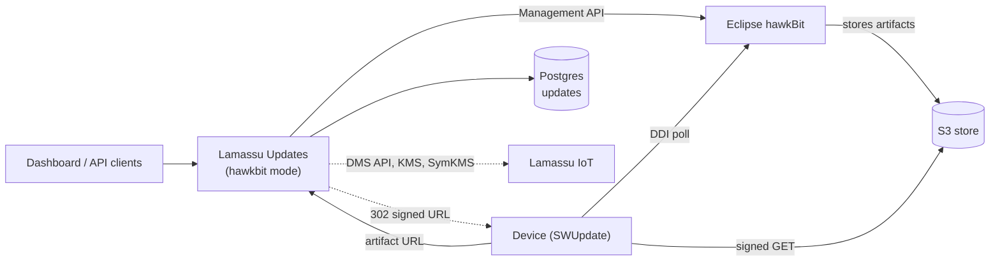

En modo `hawkbit`, Lamassu Updates sirve la misma API `/updates/v1` sobre un servidor [Eclipse hawkBit](https://www.eclipse.org/hawkbit/) en lugar de su propio backend basado en Postgres, WFX y SymKMS. El servicio se convierte en un **adaptador**: hawkBit es el dueño de los paquetes, módulos, rollouts y trabajos, y se lee en vivo en cada petición, y los dispositivos hablan directamente con hawkBit.

Úsalo cuando hawkBit ya sea el backend de actualizaciones de tu flota, o para comparar los dos backends. Para elegir entre ellos, consulta la [descripción general](/docs/platform/updates/overview).



## Requisitos previos

- Un servidor hawkBit (1.x) accesible y sus credenciales de la API de gestión.
- Postgres para este servicio. Consulta [Qué vive dónde](#qué-vive-dónde).
- Dispositivos que consultan hawkBit mediante el módulo `suricatta` de SWUpdate. Con `dms_endpoint` definido, el propio servicio crea y etiqueta los targets de hawkBit de los dispositivos de un grupo (consulta [Dispositivos y targets](#dispositivos-y-targets)). Sin él, los registras y etiquetas tú en hawkBit.

## Actívalo

```yaml
mode: hawkbit
hawkbit:
  base_url: "http://hawkbit:8080"      # hawkBit's Management API
  username: "admin"
  password: "<hawkbit admin password>"
  tenant: ""                           # DDI tenant path segment; defaults to DEFAULT
storage:                               # required: Postgres of this service
  provider: postgres
  hostname: postgres
  port: 5432
  username: postgres
  password: "<password>"
```

`mode` vale `native` cuando no está definido, así que las configuraciones existentes no se ven afectadas. El arranque falla si `hawkbit.base_url` o `storage.hostname` están vacíos. Un hawkBit inaccesible no detiene el arranque: se manifiesta como errores en las peticiones.

Para construir entregables en este modo, añade encima lo que necesites. Todo se lee una sola vez al arrancar:

| Quieres | Define |
|---|---|
| Módulos `swu-build` (`.swu` ensamblado) | `swugenerator_path` |
| Firma con el KMS de Lamassu | además `sign_script_path` y `kms_endpoint` (los módulos raw solo necesitan `kms_endpoint`) |
| Cifrado con clave compartida | `symkms_endpoint`, más el bloque `symkms` o `sym_keys_dir` para que el proceso registre las rutas `/symkms/v1` |

Consulta la [referencia de configuración](/docs/platform/updates/reference/configuration) y [Firma y cifrado](/docs/platform/updates/signing-and-encryption). Sin estas claves, `GET /updates/v1/capabilities` informa `artifact_encryption: false` y el dashboard oculta el selector de cifrado.

<Callout type="info" title="¿En qué puerto está el adaptador?">
La API escucha en `app.server.port`, y lo eliges tú. El dashboard lee la URL de su API de `LAMASSU_UPDATES_API`, así que apúntala a la instancia que ejecuta el modo que quieres. Si ejecutas a la vez una instancia native y una `hawkbit`, dales puertos distintos y define el `symkms_endpoint` de cada instancia con **su propio** puerto: apunta al mismo proceso.
</Callout>

## Ejecútalo en local

El `docker-compose.yml` del repositorio arranca un hawkBit (puerto `8090` del host, respaldado por la base de datos Postgres `hawkbit`) y el Postgres que usan ambos servicios:

```bash
# docker-compose.yml needs this network to exist (skip if you already created it).
docker network create ota-net

docker compose up -d postgres hawkbit

# Wait until hawkBit is ready. The first boot runs its migrations and takes about 30 seconds.
until curl -sf -u "admin:${HAWKBIT_ADMIN_PASSWORD:-admin}" 'http://localhost:8090/rest/v1/targets?limit=1' >/dev/null; do sleep 2; done

OTA_CONFIG_FILE=./config-hawkbit.yml go run ./cmd/monolithic
```

`config-hawkbit.yml` contiene valores de una máquina de desarrollo: rutas absolutas para `swugenerator_path`, `sign_script_path` y los directorios de SymKMS, y una dirección de red local para `kms_endpoint`. Edítalos primero y apúntalos a rutas que el usuario del servicio pueda crear. El fichero no tiene `dms_endpoint`: añade la URL de tu Device Manager de Lamassu, o el servicio no tendrá grupos de dispositivos a los que lanzar.

Comprueba el backend:

```bash
curl -s localhost:10090/updates/v1/capabilities
# {"backend":"hawkbit","supported":{...},"unsupported":[...]}
```

## Crear y construir un paquete

Un distribution set de hawkBit solo puede enlazar módulos de software **construidos**, así que el orden difiere del modo native. El flujo empieza por el catálogo:

<Steps>
  <Step>
    ### Crea el módulo en el catálogo

    `POST /updates/v1/softwaremodules` con su `type`, `name`, `version` y `delivery_intent`.
  </Step>
  <Step>
    ### Sube sus ficheros

    `POST /updates/v1/softwaremodules/by-id/:moduleID/artifacts`. Esta ruta transmite el fichero a hawkBit en streaming.
  </Step>
  <Step>
    ### Haz que quede construido

    Cómo depende del delivery intent (tabla siguiente).
  </Step>
  <Step>
    ### Crea el paquete a partir de los módulos construidos

    `POST /updates/v1/groups/:groupID/distribution-sets` con `modules: [{"source_module_id": "<id>"}]`. El paquete se crea ya construido.
  </Step>
</Steps>

| `delivery_intent` | Cómo queda construido el módulo | Se une a paquetes con |
|---|---|---|
| `swu-build` | Sube su sw-description con `POST /softwaremodules/by-id/:moduleID/descriptor` y después `POST /softwaremodules/by-id/:moduleID/build`. Necesita `swugenerator_path`: sin ella la construcción responde `501`. Los campos de firma y cifrado van en el cuerpo de la construcción. | `swu` (por defecto) o `non-swu` |
| `swu-prebuilt` | Sube el `.swu` terminado: subirlo construye el módulo. Llamar a build responde `400`. | `swu` |
| `raw` | `POST .../build` cifra (clave compartida) y/o firma los ficheros; con ninguna de las dos cosas, los ficheros se entregan sin cambios y el servicio registra una advertencia. Varios ficheros se archivan en `<name>.tar.gz`. Un entregable cifrado recibe el sufijo `.enc`; una firma añade `<file>.sha256` y `<file>.sha256.sig`. | `non-swu` |
| `undecided` | No se puede construir ni enlazar. Elige antes un intent con `PUT /softwaremodules/by-id/:moduleID`. | ninguno |

Una construcción **sustituye** los ficheros de entrada del módulo por el entregable, así que un módulo construido no se puede construir otra vez: publica una versión nueva del módulo.

Las operaciones que no tienen sentido para un paquete construido y congelado responden así:

| Petición | Respuesta |
|---|---|
| `POST .../distribution-sets/:name/swu` y `.../package` | `501`: construye los módulos en el catálogo. |
| `.../swu/upload` y `.../package/upload` | `409`: un paquete de hawkBit siempre está ya construido. |
| Enlazar un artefacto a un paquete, subir sw-description, descriptor de módulo, construir módulo, borrar artefacto, todos con ámbito de paquete | `400`: un módulo enlazado está congelado. Desenlázalo, cámbialo y constrúyelo en el catálogo, y enlázalo de nuevo. |
| Crear un módulo dentro de un paquete | No es posible. Créalo en el catálogo. |
| Cambiar la composición de un paquete ya asignado a dispositivos | `400`: crea una versión nueva. |

Consulta la [guía de publicación y despliegue](/docs/platform/updates/guides/publish-and-roll-out) para el procedimiento completo.

## Correspondencia

| Lamassu Updates | hawkBit |
|---|---|
| Versión de un paquete de actualización | Distribution set. Cada versión es su propio distribution set. |
| Módulo de software | Software module |
| Artefacto de módulo | Artefacto del software module |
| Dispositivo | Target. El controller ID es el ID del dispositivo. |
| Grupo de dispositivos | Etiqueta de target `group:<id>` |
| Lanzamiento (campaña) | Rollout (estático) |
| Trabajo por dispositivo | Acción del rollout |
| Lanzamiento programado | La hora de inicio del rollout (la arranca el planificador de hawkBit) |

## Qué vive dónde

hawkBit almacena los paquetes, los rollouts y los trabajos. El servicio sigue necesitando Postgres (la base de datos `updates`) para lo que hawkBit no tiene equivalente: subidas de artefactos en tránsito y alias, sw-descriptions, manifiestos de conjunto firmados, rollouts cancelados y fijaciones de última versión declaradas. Guardarlos en Postgres, y no en memoria, es lo que permite ejecutar varias réplicas con seguridad.

- **Las sw-descriptions** viven en Postgres, no en los metadatos de hawkBit, porque hawkBit limita el valor de un metadato a 4000 caracteres. Los descriptores escritos allí por versiones anteriores se siguen leyendo.
- **Las filas están acotadas a una instancia de hawkBit.** Los ids de hawkBit se repiten entre servidores y tras vaciar su base de datos, así que el servicio marca el hawkBit con el que habla con una etiqueta (una etiqueta de distribution set llamada `lamassu:instance`) e ignora las filas que pertenecen a otra instancia. No borres esa etiqueta.
- **Las subidas en tránsito son pesadas.** `POST /updates/v1/artifacts` (la subida global de artefactos) lee el fichero entero en memoria y lo guarda en Postgres durante 30 minutos salvo que un paquete lo enlace, y el modo hawkBit se niega a enlazar ficheros a paquetes. Para ficheros grandes, sube siempre por la ruta de catálogo de la sección anterior, que transmite a hawkBit en streaming.

## Dispositivos y targets

- Los dispositivos consultan a hawkBit, no a este servicio. Un paquete lanzado contra un hawkBit sin targets registrados no lo descarga nada.
- Con `dms_endpoint` definido, cada lectura de los dispositivos de un grupo crea los targets que falten (controller ID = ID del dispositivo) y los etiqueta `group:<id>`. Un dispositivo que no se puede reconciliar queda excluido de esa lectura y se registra. Sin `dms_endpoint`, los grupos son las etiquetas `group:<id>` existentes.
- El primer lanzamiento con un `test_device_id` (canario) falla con `test device X cannot act as this group's canary` hasta que los dispositivos del grupo existen en hawkBit. Ejecuta antes una simulación (`POST .../launch?dry_run=true`), que los registra.

### Autenticación de dispositivos en producción

Es hawkBit quien decide cómo se autentican los dispositivos, no este servicio. hawkBit 1.1.0 no tiene modo anónimo: un despliegue debe habilitar al menos uno entre el token de seguridad del target, el token de seguridad de gateway o el autenticador por cabecera de proxy inverso (`X-Controller-Id` más `X-Authority`). Elige uno y habilítalo como ajuste del tenant de hawkBit; una instalación con todos desactivados responde `401` a todos los dispositivos. Recomendado en producción:

- Termina el mTLS de los dispositivos en un gateway, haz que fije las cabeceras del autenticador por cabecera a partir del certificado del dispositivo, y deja que hawkBit confíe en esas cabeceras solo desde las direcciones del gateway (el ajuste de proxies de confianza de hawkBit). Cualquier cosa que alcance hawkBit directamente podría, si no, suplantar a cualquier dispositivo.
- O habilita los tokens de seguridad de target (`authentication.targettoken.enabled`) y configura cada dispositivo con su propio token; SWUpdate lo envía como `Authorization: TargetToken <token>`.

No expongas nunca la API de gestión a los dispositivos. Usa una contraseña robusta para el usuario de la API de gestión (`HAWKBIT_SECURITY_USER_ADMIN_PASSWORD` en la imagen) y sírvela por HTTPS. Si el gateway publica el DDI bajo un prefijo de ruta, define `hawkbit.ddi_url` con la URL pública del DDI para que los enlaces de artefactos que reciben los dispositivos sean alcanzables.

## Almacenamiento de artefactos y descargas

Por defecto hawkBit guarda los bytes de los artefactos en su propio sistema de ficheros. El directorio `docker/hawkbit` del repositorio construye una imagen de hawkBit con un **plugin de almacenamiento de artefactos en S3**, que se selecciona con `HAWKBIT_ARTIFACT_STORAGE=s3` (`fs` es el valor por defecto) y las variables `HAWKBIT_ARTIFACT_S3_*` (bucket, endpoint, región, acceso path-style, prefijo de claves; las credenciales vienen de la cadena de credenciales por defecto de AWS). hawkBit se niega a arrancar si se selecciona S3 pero el bucket no es alcanzable: nunca recurre en silencio al disco local. Los metadatos permanecen en Postgres en ambos casos. El plugin y sus instrucciones de construcción y pruebas están en [`docker/hawkbit`](https://github.com/lamassuiot/ota/tree/master/docker/hawkbit); la imagen se construye en local y no se publica en ningún registro.

Con el plugin y `hawkbit.artifact_store.presign` configurados, las descargas de artefactos de módulo se responden con `302` a una URL firmada de corta duración del bucket, en lugar de transmitirse a través de hawkBit o de este servicio. Los dispositivos conservan el enlace de artefacto que les dio hawkBit: el adaptador sirve esa ruta DDI (`<ddi path>/:tenant/controller/v1/:controllerId/softwaremodules/:id/artifacts/:filename`), comprueba que el módulo está asignado o instalado en ese dispositivo (si no, `404`) y redirige. Para que esto funcione, el gateway debe encaminar esa ruta a Lamassu Updates y el resto del DDI a hawkBit. Consulta [Configuración](/docs/platform/updates/reference/configuration#descargas-prefirmadas-presign) y [Seguridad](/docs/platform/updates/security#urls-de-descarga-prefirmadas).

hawkBit tiene sus propios límites de artefactos. La imagen de este repositorio los sube a 11 GiB por fichero y 1 TiB en total, para coincidir con el `max_artifact_size_mb` por defecto de 10 GiB (`SPRING_SERVLET_MULTIPART_MAXFILESIZE`, `SPRING_SERVLET_MULTIPART_MAXREQUESTSIZE`, `HAWKBIT_SERVER_SECURITY_DOS_MAXARTIFACTSIZE` y `HAWKBIT_SERVER_SECURITY_DOS_MAXARTIFACTSTORAGE`). Con hawkBit estándar el límite es de 1 GiB por fichero y 20 GiB en total. hawkBit escribe primero la subida en un fichero temporal, así que dale ese espacio libre en disco.

La imagen de hawkBit dimensiona su JVM con las variables de entorno `X_MS` y `X_MX` (por defecto `768m` cada una), además de `XX_MAX_METASPACE_SIZE`, `XSS` y `GC`. `JAVA_OPTS` no fija el heap. Reducir `X_MX` baja el techo, no el uso de memoria en régimen estable.

## Qué difiere del modo native

| Área | Modo `hawkbit` |
|---|---|
| A quién consultan los dispositivos | A hawkBit (DDI), no a este servicio. |
| Capacidades | No existen todas las funciones del modo native. `GET /updates/v1/capabilities` lista lo que soporta el backend activo: en modo `hawkbit` no hay workflows personalizados, ni edición de la estrategia tras la creación, ni cierre anticipado de una campaña, ni añadir dispositivos a una campaña en curso, ni eventos push, ni cifrado por dispositivo. Consulta [Capacidades](/docs/platform/updates/reference/capabilities). |
| Cifrado | **Solo clave compartida.** Un distribution set sirve artefactos idénticos a todos los targets, así que no hay dónde poner una carga distinta por dispositivo. Usa el modo `native` para cifrado por dispositivo. |
| Paquetes con varios módulos | Cada módulo tiene su propio entregable, así que un paquete con varios módulos se instala como **varias transacciones SWUpdate independientes**. SWUpdate no puede revertir entre varios ficheros `.swu`. Consulta [Conceptos](/docs/platform/updates/concepts). |
| Nombres | hawkBit borra los módulos de software de forma lógica (soft-delete), así que el nombre y la versión de un módulo que alguna vez se asignó a un dispositivo quedan ocupados para siempre. Sube la versión. |
| Estrategia de lanzamiento | Se lee de vuelta de los grupos del rollout, así que un lote fijo puede leerse como un porcentaje. No se puede editar tras la creación. |
| Cambios concurrentes | Construir o cambiar el mismo módulo desde dos peticiones responde `409` (`software module N is being built or changed by another request`). |
| Escalado | hawkBit es su propio servicio con su propia base de datos. El chart de Helm de este repositorio no lo despliega ni lo gestiona. |

## Escalado

En modo `hawkbit` no se elige líder y no hay ficheros locales que compartir, así que puede ejecutarse cualquier número de réplicas: el estado está en Postgres y en hawkBit, y las operaciones de módulos y lanzamientos toman bloqueos de Postgres. Si usas cifrado con clave compartida, pon el almacén de claves de SymKMS (`symkms.storage`) en almacenamiento compartido o en S3. Consulta [Operaciones](/docs/platform/updates/operations#escalar-horizontalmente).
