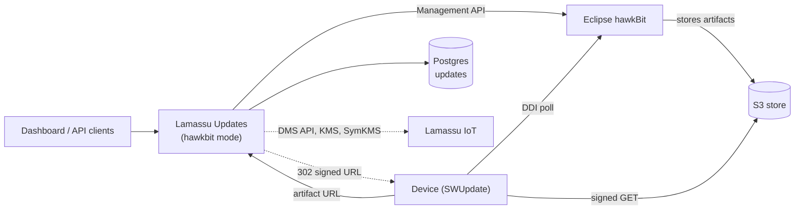

In `hawkbit` mode, Lamassu Updates serves the same `/updates/v1` API on top of an [Eclipse hawkBit](https://www.eclipse.org/hawkbit/) server instead of its own Postgres, WFX and SymKMS-based backend. The service becomes an **adapter**: hawkBit owns packs, modules, rollouts and jobs and is read live on every request, and devices talk to hawkBit directly.

Use it when hawkBit is already your fleet's update backend, or to compare the two backends. To choose between them, see the [overview](/docs/platform/updates/overview).



## Prerequisites

- A reachable hawkBit server (1.x) and its Management API credentials.
- Postgres for this service. See [What lives where](#what-lives-where).
- Devices that poll hawkBit through SWUpdate's `suricatta` module. With `dms_endpoint` set, the service creates the hawkBit targets of a group's devices and tags them itself (see [Devices and targets](#devices-and-targets)). Without it, you register and tag them in hawkBit.

## Enable it

```yaml
mode: hawkbit
hawkbit:
  base_url: "http://hawkbit:8080"      # hawkBit's Management API
  username: "admin"
  password: "<hawkbit admin password>"
  tenant: ""                           # DDI tenant path segment; defaults to DEFAULT
storage:                               # required: Postgres of this service
  provider: postgres
  hostname: postgres
  port: 5432
  username: postgres
  password: "<password>"
```

`mode` is `native` when unset, so existing configurations are unaffected. Startup fails if `hawkbit.base_url` or `storage.hostname` is empty. An unreachable hawkBit does not stop startup: it shows up as errors on requests.

To build deliverables in this mode, add the pieces you need on top. All are read once at start-up:

| You want | Set |
|---|---|
| `swu-build` modules (assembled `.swu`) | `swugenerator_path` |
| Signing with the Lamassu KMS | also `sign_script_path` and `kms_endpoint` (raw modules need only `kms_endpoint`) |
| Shared-key encryption | `symkms_endpoint`, plus the `symkms` block or `sym_keys_dir` so the process registers the `/symkms/v1` routes |

See the [configuration reference](/docs/platform/updates/reference/configuration) and [Signing and encryption](/docs/platform/updates/signing-and-encryption). Without these keys, `GET /updates/v1/capabilities` reports `artifact_encryption: false` and the dashboard hides the encryption selector.

<Callout type="info" title="Which port is the adapter on?">
The API listens on `app.server.port`, and clients choose it. The dashboard reads its API URL from `LAMASSU_UPDATES_API`, so point that at the instance that runs the mode you want. If you run a native and a `hawkbit` instance side by side, give them different ports, and set each instance's `symkms_endpoint` to **its own** port: it points at the same process.
</Callout>

## Run it locally

The repository's `docker-compose.yml` starts a hawkBit (host port `8090`, backed by the `hawkbit` Postgres database) and the Postgres both services use:

```bash
# docker-compose.yml needs this network to exist (skip if you already created it).
docker network create ota-net

docker compose up -d postgres hawkbit

# Wait until hawkBit is ready. The first boot runs its migrations and takes about 30 seconds.
until curl -sf -u "admin:${HAWKBIT_ADMIN_PASSWORD:-admin}" 'http://localhost:8090/rest/v1/targets?limit=1' >/dev/null; do sleep 2; done

OTA_CONFIG_FILE=./config-hawkbit.yml go run ./cmd/monolithic
```

`config-hawkbit.yml` contains values for one developer machine: absolute paths for `swugenerator_path`, `sign_script_path` and the SymKMS directories, and a LAN address for `kms_endpoint`. Edit them first, and point them at paths the service user can create. The file has no `dms_endpoint`: add the URL of your Lamassu Device Manager, or the service has no device groups to launch to.

Check the backend:

```bash
curl -s localhost:10090/updates/v1/capabilities
# {"backend":"hawkbit","supported":{...},"unsupported":[...]}
```

## Create and build a pack

A hawkBit distribution set can only link **built** software modules, so the order differs from native mode. The flow is catalog-first:

<Steps>
  <Step>
    ### Create the module in the catalog

    `POST /updates/v1/softwaremodules` with its `type`, `name`, `version` and `delivery_intent`.
  </Step>
  <Step>
    ### Upload its files

    `POST /updates/v1/softwaremodules/by-id/:moduleID/artifacts`. This route streams the file to hawkBit.
  </Step>
  <Step>
    ### Make it built

    How depends on the delivery intent (next table).
  </Step>
  <Step>
    ### Create the pack from the built modules

    `POST /updates/v1/groups/:groupID/distribution-sets` with `modules: [{"source_module_id": "<id>"}]`. The pack is created already built.
  </Step>
</Steps>

| `delivery_intent` | How the module becomes built | Joins packs with |
|---|---|---|
| `swu-build` | Upload its sw-description with `POST /softwaremodules/by-id/:moduleID/descriptor`, then `POST /softwaremodules/by-id/:moduleID/build`. Needs `swugenerator_path`: without it the build answers `501`. Signing and encryption fields go in the build body. | `swu` (default) or `non-swu` |
| `swu-prebuilt` | Upload the finished `.swu`: uploading it builds the module. Calling build answers `400`. | `swu` |
| `raw` | `POST .../build` encrypts (shared key) and/or signs the files; with neither, the files ship unchanged and the service logs a warning. Several files are archived into `<name>.tar.gz`. An encrypted deliverable gets the `.enc` suffix; a signature adds `<file>.sha256` and `<file>.sha256.sig`. | `non-swu` |
| `undecided` | Cannot be built or linked. Choose an intent first with `PUT /softwaremodules/by-id/:moduleID`. | none |

A build **replaces** the module's input files with the deliverable, so a built module cannot be built again: release a new version of the module.

Operations that make no sense for a built, frozen pack answer as follows:

| Request | Answer |
|---|---|
| `POST .../distribution-sets/:name/swu` and `.../package` | `501`: build the modules in the catalog instead. |
| `.../swu/upload` and `.../package/upload` | `409`: a hawkBit pack is always already built. |
| Pack-scoped artifact link, sw-description upload, module descriptor, module build, artifact delete | `400`: a linked module is frozen. Unlink it, change and build it in the catalog, link it again. |
| Creating a module inside a pack | Not possible. Create it in the catalog. |
| Changing the composition of a pack already assigned to devices | `400`: create a new version. |

See the [publish and roll out guide](/docs/platform/updates/guides/publish-and-roll-out) for the full procedure.

## How it maps

| Lamassu Updates | hawkBit |
|---|---|
| Update pack version | Distribution set. Every version is its own distribution set. |
| Software module | Software module |
| Module artifact | Software module artifact |
| Device | Target. The controller ID is the device ID. |
| Device group | Target tag `group:<id>` |
| Launch campaign | Rollout (static) |
| Per-device job | Rollout action |
| Scheduled launch | The rollout's start time (hawkBit's scheduler starts it) |

## What lives where

hawkBit stores packs, rollouts and jobs. The service still needs Postgres (the `updates` database) for what hawkBit has no equivalent of: staged artifact uploads and aliases, sw-descriptions, signed set manifests, cancelled rollouts and declared latest-version pins. Keeping them in Postgres, not in memory, is what makes running several replicas safe.

- **sw-descriptions** live in Postgres, not in hawkBit metadata, because hawkBit caps a metadata value at 4000 characters. Descriptors written there by older versions are still read.
- **Rows are scoped to a hawkBit instance.** hawkBit ids repeat across servers and after its database is wiped, so the service tags the hawkBit it talks to with a marker (a distribution-set tag named `lamassu:instance`) and ignores rows that belong to another instance. Do not delete that tag.
- **Staged uploads are heavy.** `POST /updates/v1/artifacts` (the global artifact upload) reads the whole file into memory and keeps it in Postgres for 30 minutes unless a pack links it, and hawkBit mode refuses to link files to packs. For large files, always upload through the catalog route of the previous section, which streams to hawkBit.

## Devices and targets

- Devices poll hawkBit, not this service. A pack launched against a hawkBit with no registered targets is never downloaded by anything.
- With `dms_endpoint` set, every read of a group's devices creates the missing targets (controller ID = device ID) and tags them `group:<id>`. A device that cannot be reconciled is excluded from that read and logged. Without `dms_endpoint`, groups are the existing `group:<id>` tags.
- The first launch with a `test_device_id` (canary) fails with `test device X cannot act as this group's canary` until the group's devices exist in hawkBit. Run a dry run first (`POST .../launch?dry_run=true`), which registers them.

### Device authentication in production

hawkBit decides how devices authenticate, not this service. hawkBit 1.1.0 has no anonymous mode: a deployment must enable at least one of the target security token, the gateway security token, or the reverse-proxy header authenticator (`X-Controller-Id` plus `X-Authority`). Pick one and enable it as a hawkBit tenant setting; an installation where all of them are off answers `401` to every device. Recommended for production:

- Terminate device mTLS at a gateway, have it set the header authenticator's headers from the device certificate, and let hawkBit trust those headers only from the gateway's addresses (hawkBit's trusted-proxy setting). Anything that can reach hawkBit directly could otherwise impersonate any device.
- Or enable target security tokens (`authentication.targettoken.enabled`) and configure each device with its own token; SWUpdate sends it as `Authorization: TargetToken <token>`.

Never expose the Management API to devices. Use a strong password for the Management API user (`HAWKBIT_SECURITY_USER_ADMIN_PASSWORD` in the image) and serve it over HTTPS. If the gateway publishes the DDI under a path prefix, set `hawkbit.ddi_url` to the public DDI URL so the artifact links devices receive are reachable.

## Artifact storage and downloads

By default hawkBit stores artifact bytes on its own filesystem. The `docker/hawkbit` directory of the repository builds a hawkBit image with an **S3 artifact storage plugin**, selected with `HAWKBIT_ARTIFACT_STORAGE=s3` (`fs` is the default) and the `HAWKBIT_ARTIFACT_S3_*` variables (bucket, endpoint, region, path-style access, key prefix; credentials come from the AWS default chain). hawkBit refuses to start if S3 is selected but the bucket is unreachable: it never falls back to local disk silently. Metadata stays in Postgres either way. The plugin and its build and test instructions are in [`docker/hawkbit`](https://github.com/lamassuiot/ota/tree/master/docker/hawkbit); the image is built locally and is not published to a registry.

With the plugin and `hawkbit.artifact_store.presign` configured, downloads of module artifacts are answered `302` to a short-lived signed URL of the bucket instead of streaming through hawkBit or this service. Devices keep the artifact link hawkBit gave them: the adapter serves that one DDI route (`<ddi path>/:tenant/controller/v1/:controllerId/softwaremodules/:id/artifacts/:filename`), checks that the module is assigned to or installed on that device (otherwise `404`) and redirects. For this to work, the gateway must route that path to Lamassu Updates and the rest of the DDI to hawkBit. See [Configuration](/docs/platform/updates/reference/configuration#presigned-downloads-presign) and [Security](/docs/platform/updates/security#presigned-download-urls).

hawkBit has its own artifact limits. The image of this repository raises them to 11 GiB per file and 1 TiB in total, to match the default `max_artifact_size_mb` of 10 GiB (`SPRING_SERVLET_MULTIPART_MAXFILESIZE`, `SPRING_SERVLET_MULTIPART_MAXREQUESTSIZE`, `HAWKBIT_SERVER_SECURITY_DOS_MAXARTIFACTSIZE` and `HAWKBIT_SERVER_SECURITY_DOS_MAXARTIFACTSTORAGE`). With stock hawkBit the limit is 1 GiB per file and 20 GiB in total. hawkBit writes an upload to a temporary file first, so give it that much free disk.

The hawkBit image sizes its JVM with the environment variables `X_MS` and `X_MX` (default `768m` each), plus `XX_MAX_METASPACE_SIZE`, `XSS` and `GC`. `JAVA_OPTS` does not set the heap. Lowering `X_MX` lowers the ceiling, not the steady memory use.

## What differs from native mode

| Area | `hawkbit` mode |
|---|---|
| Who devices poll | hawkBit (DDI), not this service. |
| Capabilities | Not every native feature exists. `GET /updates/v1/capabilities` lists what the active backend supports: in `hawkbit` mode there are no custom workflows, no strategy editing after creation, no early completion of a campaign, no adding devices to a running campaign, no push events and no per-device encryption. See [Capabilities](/docs/platform/updates/reference/capabilities). |
| Encryption | **Shared key only.** A distribution set serves identical artifacts to every target, so there is nowhere to put a different payload per device. Use `native` mode for per-device encryption. |
| Multi-module packs | Each module has its own deliverable, so a pack with several modules installs as **several independent SWUpdate transactions**. SWUpdate cannot roll back across several `.swu` files. See [Concepts](/docs/platform/updates/concepts). |
| Names | hawkBit soft-deletes software modules, so the name and version of a module that was ever assigned to a device are taken forever. Bump the version. |
| Launch strategy | Read back from the rollout's groups, so a fixed batch can read back as a percentage. It cannot be edited after creation. |
| Concurrent changes | Building or changing the same module from two requests answers `409` (`software module N is being built or changed by another request`). |
| Scaling | hawkBit is its own service with its own database. The Helm chart of this repository does not deploy or manage it. |

## Scaling

In `hawkbit` mode nothing is elected and there are no local files to share, so any number of replicas can run: state is in Postgres and hawkBit, and module and launch operations take Postgres locks. If you use shared-key encryption, put SymKMS key storage (`symkms.storage`) on shared storage or S3. See [Operations](/docs/platform/updates/operations#scale-out).
