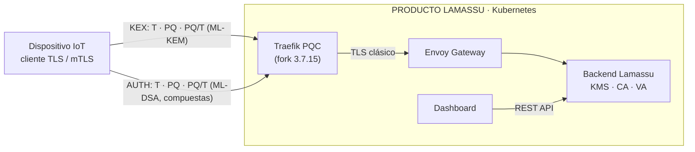

# Welcome Page PQC de Lamassu: contenido y diseño interactivo

Este documento reúne todo el trabajo PQC de Lamassu (el fork de Go, el backend, el dashboard, el fork de Traefik, el chart de Helm y las pruebas de interoperabilidad) y lo organiza como una página de bienvenida interactiva. Cada sección trae el texto listo para usar, qué interacción tiene y los datos que necesita.

**Fuentes:** la documentación PQC de la rama `pqc` de este repo (`content/docs/platform/pqc/**`), la presentación generada en `pqc.json` y la infografía "PQC in Both Dimensions".

---

## 0. Mensajes clave

Si el visitante solo se queda con tres ideas, que sean estas:

1. **PQC en las dos dimensiones del canal.** El intercambio de claves (KEX) y la autenticación (AUTH) se configuran por separado, y cada uno puede ser T (tradicional), PQ (post-cuántico) o PQ/T (híbrido).
2. **De la librería al dispositivo.** Hemos llevado PQC por toda la cadena: el toolchain de Go, la CA y el KMS de Lamassu, el dashboard, el proxy TLS que atiende a los dispositivos y el despliegue con Helm.
3. **Probado con software independiente.** OpenSSL, curl y mosquitto negocian ML-KEM y verifican certificados ML-DSA y compuestos servidos por Lamassu: 12 de 12 casos superados en HTTPS y otros 12 de 12 en MQTTS.

**Tono:** técnico y honesto. El soporte es **experimental y está pensado para pilotos y laboratorio**. No hay que usar "enterprise-ready", "production-ready" ni "future-proof". Esas frases de la infografía original contradicen la documentación (ver §11).

---

## 1. Estructura de la página

| # | Sección | Interacción principal | Componente |
|---|---|---|---|
| 1 | Hero: *PQC en ambas dimensiones* | Canal dispositivo ↔ Lamassu animado | Nuevo (SVG/CSS) |
| 2 | Por qué ahora | Contador de vida útil de dispositivos | Nuevo, ligero |
| 3 | **Configurador de canal KEX × AUTH** | Dos selectores T / PQ / PQ/T → grupos, certificado, resultado de las pruebas y comando | Nuevo (**pieza estrella**) |
| 4 | Arquitectura: 5 bases de código | Diagrama clicable con la frontera del producto y el tramo PQ | Nuevo, o `mermaid.tsx` como fallback |
| 5 | Las piezas, una a una | Pestañas: Go · Backend · Dashboard · Traefik · Helm | Tabs |
| 6 | Explorador de algoritmos | Filtro por familia, ficha por algoritmo | Tabla filtrable |
| 7 | Cómo elige Traefik el certificado | Simulador: orden de `signature_algorithms` del cliente → certificado servido | Nuevo |
| 8 | Certificados relacionados (RFC 9763) | Stepper de 4 pasos | `Steps` |
| 9 | Interoperabilidad directa | Matriz 3×3 con conmutador HTTPS/MQTTS, checklist de 6 comprobaciones y comandos copiables | Nuevo |
| 10 | Interoperabilidad indirecta: OpenVPN | **Pendiente de datos** | Placeholder |
| 11 | Estado y limitaciones | Acordeón por componente | `Accordion` |
| 12 | Por dónde seguir | Tarjetas a la documentación y a la demo del dashboard | `Cards` + demo |

Recursos que ya existen en el repo y se pueden reutilizar: `ArchitectureDiagram` (iframe animado), `mermaid.tsx`, el patrón de demos guiadas `*.flow.json` con `CreateCaDemo` y `RevokeCertificateDemo`, y los componentes MDX `Cards`, `Callout` y `Steps`.

---

## 2. Hero: PQC en ambas dimensiones

**Antetítulo:** CRIPTOGRAFÍA POST-CUÁNTICA EN LAMASSU IoT
**Título:** PQC en ambas dimensiones
**Subtítulo:** Canales seguros con criptografía post-cuántica para el intercambio de claves y para la autenticación. Tres variantes en cada dimensión: tradicional, post-cuántica e híbrida.
**Lema:** La misma confianza, preparada para el mañana.

**Visual:** basado en la infografía. A la izquierda el *Dispositivo* (cliente TLS / mTLS) y a la derecha *Lamassu* (Traefik PQC), unidos por un tubo "Canal TLS 1.3". Del tubo cuelgan dos paneles, **KEX** y **AUTH**, cada uno con tres tarjetas:

| Dimensión | T: Tradicional | PQ: Post-cuántico | PQ/T: Híbrido |
|---|---|---|---|
| **KEX** (confidencialidad) | ECDHE: X25519, P-256, P-384 | ML-KEM-1024 | X25519 + ML-KEM-768 (y variantes P-256 / P-384) |
| **AUTH** (quién está al otro lado) | RSA, ECDSA, Ed25519 | ML-DSA, SLH-DSA* | Firmas compuestas ML-DSA + clásico (RFC 10073) |

\*SLH-DSA vale para claves, CAs y certificados, pero **no autentica TLS**: el fork no tiene esquema de firma TLS para él.

**Interacción:** al pasar el ratón por una tarjeta, se ilumina el tramo del canal al que afecta. Al hacer clic se baja al configurador (§4) con esa opción ya seleccionada.

**Franja inferior: cuatro pilares** (sustituyen a los de la infografía, que prometían más de lo que hay):

| Pilar | Texto |
|---|---|
| Resistencia cuántica | ML-KEM, ML-DSA y SLH-DSA (FIPS 203, 204 y 205). |
| Adopción flexible | T, PQ o PQ/T, elegidos por separado en cada dimensión. |
| Basado en estándares | NIST FIPS, RFC 10073 (firmas compuestas) y RFC 9763 (certificados relacionados), probado con OpenSSL, curl y mosquitto. |
| Para pilotos | Experimental: pensado para laboratorio y pilotos, no para flotas en producción. |

---

## 3. Por qué ahora

**Título:** Los dispositivos de hoy seguirán en campo en la era cuántica.

**Texto:**
> Los certificados de los dispositivos duran años, y los dispositivos que los llevan son difíciles de sustituir. Si un ordenador cuántico rompe en el futuro un algoritmo de firma, habría que reenrolar toda la flota. Emitir hoy certificados post-cuánticos o compuestos, y servir un endpoint TLS que los acepte, permite validar la flota frente a ese riesgo antes de que sea urgente.

**Dos ideas, en dos columnas:**

- **Intercambio de claves: "harvest now, decrypt later".** El tráfico que se graba hoy puede descifrarse mañana. Esa amenaza ya existe y la resuelve ML-KEM.
- **Firmas: el reloj lo marca la vida útil.** Las firmas no sufren ese ataque. La urgencia viene de cuánto duran los certificados y los dispositivos, no del tráfico grabado.

**Firma compuesta:** solo es válida si verifican sus dos componentes. Resiste mientras al menos uno de los dos algoritmos siga sin romperse, siempre que quien la valida exija la compuesta y no acepte un certificado clásico en su lugar.

**Interacción (opcional):** un deslizador "vida útil del dispositivo" de 5 a 20 años que dibuja la línea temporal del dispositivo junto a una banda difusa "llegada estimada de un CRQC". No hay que dar fechas concretas del CRQC: basta con la banda, sin cifras.

---

## 4. ⭐ Configurador de canal KEX × AUTH

Es la pieza central de la página. Une la infografía, el instalador, las pruebas y los comandos.

**Título:** Elige cómo se protege el canal.
**Entrada:** dos controles segmentados.

- **KEX:** `T` · `PQ` · `PQ/T`
- **AUTH:** `T` · `PQ` · `PQ/T` (en PQ/T, un desplegable opcional con las variantes compuestas probadas)

**Salida** (se actualiza al momento):

1. **Lo que se negocia:** el grupo de KEX y el esquema de firma del handshake.
2. **El certificado que sirve Lamassu:** algoritmo y secret de Kubernetes.
3. **El resultado de las pruebas:** ✅ HTTPS y ✅ MQTTS, con el grupo y el esquema observados.
4. **Cómo desplegarlo:** los flags del instalador `lamassu-fast-lane.sh`.
5. **Cómo comprobarlo:** un comando `openssl s_client` copiable.
6. **TLS mínimo:** 1.3, salvo que KEX y AUTH sean solo `T` (entonces 1.2).

### Datos

**KEX: grupos que acepta el servidor (`--tls-kex`, rellena `curvePreferences`)**

| Clase | Grupos | Grupo observado en las pruebas |
|---|---|---|
| T | `X25519`, `CurveP256`, `CurveP384` | `X25519` |
| PQ | `MLKEM1024` | `MLKEM1024` |
| PQ/T | `X25519MLKEM768`, `SecP256r1MLKEM768`, `SecP384r1MLKEM1024` | `X25519MLKEM768` |

**AUTH: certificado servido (`--tls-auth`)**

| Clase | Certificado | Secret | Esquema TLS (nombre OpenSSL) |
|---|---|---|---|
| T | ECDSA P-256 (cert-manager) | `edge-cert` | `ecdsa_secp256r1_sha256` |
| PQ | ML-DSA-65 | `edge-cert-pq` | `mldsa65` |
| PQ/T | Compuesto `MLDSA65-RSA3072-PSS-SHA512` | `edge-cert-pqt` | `mldsa65_rsa3072_pss` |

**Variantes compuestas adicionales probadas (solo con KEX PQ/T)**

| Algoritmo | Esquema | HTTPS | MQTTS |
|---|---|---|---|
| `MLDSA44-ECDSA-P256-SHA256` | `mldsa44_ecdsa_p256` | ✅ | ✅ |
| `MLDSA65-ECDSA-P256-SHA512` | `mldsa65_ecdsa_p256` | ✅ | ✅ |
| `MLDSA65-Ed25519-SHA512` | `mldsa65_ed25519` | ✅ | ✅ |

**Plantillas de comandos**

```bash
# Instalador (laboratorio)
./scripts/lamassu-fast-lane.sh -d lab.example.com --tls-kex {KEX} --tls-auth {AUTH}

# Verificación
openssl s_client -connect <LAMASSU_HOST>:443 -servername <LAMASSU_HOST> \
  -tls1_3 -groups {GROUP} -sigalgs {SCHEME} \
  -CAfile ca.pem -verify_hostname <LAMASSU_HOST> -verify_return_error \
  < /dev/null 2>&1 | grep -E 'Negotiated TLS1.3 group|Peer signature type|Verify return code'
```

**Notas contextuales** (se muestran según la selección):

- **AUTH = PQ/T:** el cliente necesita el módulo `hybrid-provider` de OpenSSL configurado con los code points del fork (`0xFE00`–`0xFE0E`). ML-DSA puro y ML-KEM funcionan con OpenSSL 3.5 o posterior sin nada más.
- **KEX = T o PQ:** puede haber un HelloRetryRequest, porque los clientes envían primero una key share `X25519MLKEM768`.
- **Siempre visible:** la protección post-cuántica cubre **solo el tramo dispositivo ↔ Traefik**. De Traefik hacia dentro, el TLS es clásico.

---

## 5. Arquitectura: cinco bases de código, del dispositivo a la CA

**Título:** Cinco bases de código llevan PQC del dispositivo a la CA.



Debajo del diagrama, dos barras horizontales:

- **Toolchain Go PQC (fork de Go 1.27):** compila Traefik y el backend.
- **Chart de Helm (rama `pqc`):** despliega todo junto, con Traefik como proxy TLS frontal.

**Interacción:**

- Al hacer clic en un nodo se abre su ficha (§6) en un panel lateral.
- **Frontera del producto:** una zona azul claro con borde discontinuo navy, rotulada "PRODUCTO LAMASSU", agrupa Traefik, Envoy, el backend y el dashboard. El dispositivo queda fuera.
- **Tramo PQ:** el enlace dispositivo → Traefik se dibuja en verde y animado, como **dos flechas separadas, KEX y AUTH**. Hay que diferenciarlas siempre, porque Lamassu cubre las dos. Traefik → Envoy aparece en gris, "TLS clásico".
- Un conmutador "Ver capas de compilación" resalta qué binarios se construyen con el fork de Go (Traefik y el backend).

---

## 6. Las piezas, una a una

Cada pestaña tiene un titular, qué aporta, los datos clave y un enlace a la documentación.

### 6.1 Toolchain Go PQC

**Titular:** Ampliamos `crypto/x509` y `crypto/tls` con firmas post-cuánticas.

**Contexto:**
- Es un fork de **Go 1.27** (rama `release-branch.go1.27`). Venimos de mantener soporte PQC desde Go 1.25 y 1.26, y actualizamos el fork con cada versión.
- **Implementaciones base de los algoritmos:** ML-DSA y ML-KEM son las **oficiales de Go** (`crypto/mldsa` y los grupos híbridos de la librería estándar). SLH-DSA es **Cloudflare CIRCL** (vendorizada).

**Qué añade el fork:**

| `crypto/x509` | `crypto/tls` |
|---|---|
| **Firmas compuestas ML-DSA:** `CompositePublicKey` y `CompositePrivateKey` (`crypto.Signer`), 15 `CompositeAlgorithm`, PKCS#8 y certificados, CSR y CRL. | **15 esquemas de firma compuestos** para TLS 1.3, probados con autenticación mutua. |
| **SLH-DSA en X.509:** 12 algoritmos `PureSLHDSA…` para parsear y verificar. | **Code points de uso privado** `0xFE00`–`0xFE0E`, porque IANA aún no ha asignado ninguno. |
| **Certificados relacionados (RFC 9763):** `CreateBoundCertificate`, `VerifyRelatedCertificate` y el atributo `relatedCertRequest`. | **KEX sin cambios respecto a upstream:** `X25519MLKEM768`, `SecP256r1MLKEM768`, `SecP384r1MLKEM1024` y `MLKEM1024`. |

**Validación:** las firmas compuestas pasan los vectores de prueba del **Apéndice E de RFC 10073** en los 15 algoritmos implementados, con y sin contexto. La implementación se escribió contra el draft 19 y se revisó con el texto publicado.

**Distribución:** imagen multiarquitectura `ghcr.io/lamassuiot/golang-pqc` (etiquetas `go1.27` y `latest`), con el toolchain en `/usr/local/go-pqc`. El backend exige `go 1.27.3`.

**Línea temporal** (componente interactivo, sin fechas):
`Go 1.25 + PQC` → `Go 1.26 + PQC` → `Go 1.27 + PQC (actual)` · en paralelo: `Certificados Chameleon (descartados: el draft caducó)` → `Firmas compuestas draft 19` → `RFC 10073 publicado y verificado`.

**Fragmento de código** (pestaña "Ver código"):

```go
alg := x509.MLDSA65_ECDSA_P384_SHA512
pub, priv, _ := alg.GenerateCompositeKey(rand.Reader)
der, _ := x509.CreateCertificate(rand.Reader, tmpl, tmpl, pub, priv)
// ... tls.X509KeyPair(...) y tls.Config{MinVersion: tls.VersionTLS13}
```

### 6.2 Backend Lamassu (KMS · CA · VA)

**Titular:** KMS y CA gestionan identidades PQ y PQ/T con la misma API.

| Tarjeta | Texto |
|---|---|
| **KMS** | Genera y custodia claves ML-DSA, SLH-DSA, compuestas y Ed25519. Por ahora solo en el motor *filesystem* o *software*: claves protegidas por software. |
| **CAs post-cuánticas** | CAs raíz y subordinadas PQ y PQ/T. ML-DSA, SLH-DSA y las compuestas sirven como clave de CA, no solo de hoja. Se pueden mezclar algoritmos dentro de la jerarquía. |
| **Emisión por API** | Los mismos endpoints REST (`POST /api/kms/v1/keys`, `POST /api/ca/v1/cas`) para las tres familias. Solo cambia `key_metadata`: `type` y `bits`, donde `bits` lleva el conjunto de parámetros. |
| **Firmar y verificar** | Nuevos `signature_algorithm`: `MLDSA_{44,65,87}_PURE`, `SLHDSA_PURE`, `COMPOSITE_MLDSA_{RSA,ECDSA,ED25519}_PURE` y `Ed25519_PURE`. |
| **Revocación** | Las CRL se firman con el fork y deberían funcionar, aunque no tienen tests. Las respuestas OCSP **no** se pueden firmar con una CA PQ (ver §11). |

Ejemplo copiable:

```json
{ "id": "mldsa-root",
  "subject": { "common_name": "ML-DSA Root CA", "organization": "Lamassu", "country": "ES" },
  "key_metadata": { "type": "ML-DSA", "bits": 65 },
  "ca_expiration": { "type": "Duration", "duration": "8760h" } }
```

### 6.3 Dashboard

**Titular:** Etiqueta cada clave, CA y certificado como T, PQ o PQ/T.

- Selector *Key type* agrupado por familia, con *Key specification* según el tipo. Las claves compuestas muestran **dos barras de fuerza**, C y PQ.
- Columna *PQC* en la tabla de CAs, insignia en las tarjetas y en el grafo de CAs, y columna *Algorithm* en los certificados.
- **Claves generadas en el navegador:** ML-DSA y SLH-DSA con `@noble`. **La generación de claves compuestas la implementó el equipo de Lamassu**, porque `@noble` no la ofrece, así que un CSR compuesto se crea entero en el navegador.
- Firma y verificación con claves PQ desde la ficha de la clave.
- Flujo completo de certificados relacionados sin usar la API.
- Rama: `feat/lamassu-q`.

**Capturas disponibles** en la rama `pqc`, en `content/docs/platform/pqc/dashboard/`: `key-list-families.png`, `browser-key-types.png`, `issued-certificates-algorithm.png`, `composite-sign-verify.png`, `certificate-issued.png`, `profile-related-form.png`, `profile-list-related.png`, `bind-related-certificate.png` y `related-certificate-details.png`. Sirven para un carrusel.

**Demo guiada (propuesta):** un `create-pqc-ca.flow.json` siguiendo el patrón de `create-ca.flow.json`, que cree una CA con `Composite-ML-DSA-ECDSA` y la muestre con la insignia PQ/T.

### 6.4 Traefik PQC

**Titular:** Recompilado con el toolchain PQC y mejorado para servir varias identidades a la vez.

Esto responde a la pregunta que quedó abierta en la PPT sobre qué tiene de "mejorado". Además de recompilarlo:

| Mejora | Qué hace |
|---|---|
| **Varios certificados por host** | Upstream solo guarda uno por conjunto de nombres. El fork guarda todos (ECDSA, ML-DSA, compuesto) y **elige uno por cliente** según su `signature_algorithms` (ver simulador, §7). |
| **TLS options en listeners de Gateway API** | Lee `traefik.io/tls-options` en el listener (HTTPS y TLS en modo `Terminate`). Sin esto no se controlan los grupos KEX ni el mTLS, y los dispositivos que necesitan mTLS fallan. |
| **`mlkem1024` en `curvePreferences`** | Habilita KEX PQ puro. |
| **mTLS con certificados compuestos** | Verificado por la pila TLS del fork en handshakes TLS 1.3. |

- Basado en **Traefik 3.7.15**. Imagen: `ghcr.io/lamassuiot/traefik:pqc-3.7.15`. La etiqueta es mutable, así que conviene fijar el digest.
- Se construye con `build.sh` sobre un checkout compilado del fork de Go (`GO_FORK_ROOT`, `CGO_ENABLED=0`, `docker buildx`).

### 6.5 Despliegue con Helm

**Titular:** Un solo comando monta el laboratorio PQC completo.

- Rama `pqc` del chart, con el nuevo bloque `traefikFrontProxy` (`enabled`, `domain`, `webSecurePort`, `tls.type`, `tls.additionalSecretNames`).
- **`scripts/lamassu-fast-lane.sh`** instala los CRD de Gateway API 1.6.3, Envoy Gateway 1.8.0, Traefik (chart 41.0.2) con la imagen PQC, la TLS option, PostgreSQL, Keycloak, RabbitMQ y Lamassu con las imágenes `:pqc`.
- Genera los certificados PQ y PQ/T con **OpenSSL 3.5 o posterior** y `hybrid-provider`, con claves ML-DSA en formato *seed-only* para que Go las acepte.
- Los flags `--tls-kex` y `--tls-auth` enlazan con el configurador (§4).

**Interacción:** un terminal animado que reproduce la instalación por fases. Es un mock, no una ejecución real.

---

## 7. Simulador: cómo elige Traefik el certificado

**Título:** Un host, tres certificados: el cliente decide.

**Interacción:** el usuario ordena (arrastrando) o marca los esquemas que anuncia el cliente: `mldsa65`, `mldsa65_rsa3072_pss`, `ecdsa_secp256r1_sha256`. El simulador ilumina el certificado servido y recorre los pasos:

1. Normaliza el SNI y reúne los certificados cuyo nombre coincide (primero los exactos, luego los comodines).
2. Si no coincide ninguno, cierra la conexión en strict-SNI o sirve el certificado por defecto.
3. Si coincide uno solo, lo sirve.
4. Si coinciden varios, recorre los esquemas **en el orden del cliente** y sirve el primer certificado compatible.
5. Si el cliente no anuncia ningún esquema, sirve el primero compatible.

**Presets:**

| Cliente | Resultado |
|---|---|
| OpenSSL ≥ 3.5 por defecto | ML-DSA primero → **ML-DSA-65** (tiene que confiar en esa CA) |
| Cliente clásico | Nunca anuncia PQ → **ECDSA P-256** |
| Cliente con `hybrid-provider` y compuesto primero | **Compuesto** |
| TLS 1.2 | Nunca recibe ML-DSA ni compuesto |

**Aviso:** el servidor no tiene orden de preferencia propio; manda el del cliente.

---

## 8. Certificados relacionados (RFC 9763)

**Título:** Migrar sin romper: vincula el certificado PQ al clásico que ya tiene el dispositivo.

**Para qué:** durante la migración, el dispositivo tiene dos certificados. El nuevo, PQ, lleva la extensión `id-pe-relatedCert` con el hash del clásico, así que quien lo valida sabe que ambos identifican a la misma entidad.

**Stepper (lo que hace la CA):**
1. Comprueba que el perfil de emisión tiene activados los certificados relacionados.
2. Descarga el certificado relacionado de la primera ubicación válida: `data:` URI o una URL de un host permitido, sin redirecciones, con 10 s de timeout y un máximo de 1 MiB.
3. Verifica el emisor, el número de serie, la antigüedad de la petición (`max_age`, 5 min por defecto) y la firma hecha con la clave del certificado clásico.
4. Emite el nuevo certificado con la extensión.

**Aviso:** la extensión vincula, pero no sustituye. Cada certificado se valida con su propia cadena, y revocar el clásico no revoca el vinculado. Lamassu implementa solo la parte de emisión.

---

## 9. Interoperabilidad directa: HTTPS y MQTTS

**Título:** Software independiente habla PQC con Lamassu.

**Banda de cifras:**

| 12 / 12 | 12 / 12 | 6 | 2 |
|---|---|---|---|
| casos HTTPS superados | casos MQTTS superados | comprobaciones por caso | protocolos |

**Servidor:** Traefik PQC. **Clientes:** OpenSSL 4.0.3 y 4.1.0, `hybrid-provider` para las compuestas, `curl`, y `mosquitto_pub` / `mosquitto_sub` 2.1.2. El broker es EMQX 5.8.9, detrás de Traefik en el puerto 8883.

**Matriz interactiva** con conmutador `HTTPS | MQTTS`. Al pasar el ratón por una celda se ven el grupo y el esquema negociados:

| KEX ↓ / AUTH → | T: ECDSA P-256 | PQ: ML-DSA-65 | PQ/T: MLDSA65-RSA3072-PSS |
|---|---|---|---|
| **T** | ✅ `X25519` · `ecdsa_secp256r1_sha256` | ✅ `X25519` · `mldsa65` | ✅ `X25519` · `mldsa65_rsa3072_pss` |
| **PQ** | ✅ `MLKEM1024` · `ecdsa_secp256r1_sha256` | ✅ `MLKEM1024` · `mldsa65` | ✅ `MLKEM1024` · `mldsa65_rsa3072_pss` |
| **PQ/T** | ✅ `X25519MLKEM768` · `ecdsa_secp256r1_sha256` | ✅ `X25519MLKEM768` · `mldsa65` | ✅ `X25519MLKEM768` · `mldsa65_rsa3072_pss` |

A estos nueve casos se suman las 3 compuestas extra de §4, que dan 12.

**Checklist animado:** se marca cada comprobación al seleccionar una celda.
1. **KEX:** el grupo negociado es el esperado.
2. **Firma:** el esquema del handshake es el esperado.
3. **Cadena:** el cliente verifica la cadena y el nombre del servidor.
4. **Tráfico:** HTTP `200`, o el mensaje MQTT llega al suscriptor.
5. **KEX incorrecto rechazado:** falla con `handshake_failure`.
6. **Esquema incorrecto rechazado:** falla con `handshake_failure`.

Las dos últimas demuestran que el servidor **impone** su configuración, además de aceptar a un cliente compatible.

**Comandos copiables por protocolo:** `openssl s_client` y `curl` para HTTPS, y para MQTTS el `pqc-client.cnf` (`Groups`, `SignatureAlgorithms`, `hybrid` provider) con `mosquitto_sub` / `mosquitto_pub`.

**Letra pequeña** (honestidad):
- Los certificados de las pruebas se generaron **fuera de Lamassu** con herramientas estándar. Demuestran que el formato X.509 y TLS del fork es interoperable, pero no prueban certificados emitidos por una CA Lamassu.
- Para las compuestas hubo que alinear los code points de `hybrid-provider` con los del fork.

---

## 10. Interoperabilidad indirecta: OpenVPN

> ⚠️ **PENDIENTE.** La PPT dejó esta sección a la espera de datos y no hay nada documentado. Antes de publicar hace falta:
> - Escenario: qué rol tiene Lamassu (CA que emite los certificados de servidor y cliente, ¿EST?) y qué versión de OpenVPN y de OpenSSL se usó.
> - Matriz probada: KEX (¿`tls-groups`?) × AUTH (ML-DSA, compuestas).
> - Resultados y limitaciones (por ejemplo, si las compuestas necesitan `hybrid-provider` también aquí).
>
> Mientras tanto, se puede mostrar una tarjeta "Próximamente: pruebas indirectas con OpenVPN" o quitar la sección.

---

## 11. Estado y limitaciones

**Título:** Listo para pilotos, todavía no para producción.

Un acordeón con un bloque por componente. Cerrado, muestra un resumen de una línea; abierto, el detalle.

| Bloque | Resumen |
|---|---|
| **Estándares** | Code points TLS compuestos privados: solo interoperan con peers del mismo fork o con `hybrid-provider` alineado. No hay variantes Brainpool ni Ed448. SLH-DSA no autentica TLS. |
| **Claves** | Solo los motores *filesystem* y *software*: todavía no hay claves PQ en HSM (PKCS#11) ni en KMS cloud. |
| **CA y validación** | OCSP no funciona con CAs PQ, Ed25519 ni compuestas. Las CRL no tienen tests. Los perfiles no pueden permitir ni denegar algoritmos PQ. `serverkeygen` (EST) solo genera RSA y ECDSA. No hay tests de enrolamiento EST con claves PQ. |
| **Dashboard** | SLH-DSA en el navegador: los IDs 2 a 12 no corresponden al conjunto de parámetros que se elige. No hay aviso de "experimental" ni traducción. |
| **Despliegue** | Forks no upstream, etiquetas de imagen mutables, salto Traefik → Envoy sin verificar certificado, certificados PQ de 365 días sin renovación y una release por namespace. |
| **Alcance PQ** | Solo cubre el tramo dispositivo ↔ Traefik. |

**Siguiente paso** (pendiente de confirmar con el equipo): claves PQ en HSM, OCSP PQ, EST de extremo a extremo con certificados PQ y pruebas con OpenVPN.

---

## 12. Por dónde seguir

Tarjetas a la documentación, según el perfil del visitante:

| Perfil | Destino |
|---|---|
| Quiero entender el soporte | `/docs/platform/pqc/overview` → `/docs/platform/pqc/algorithms` |
| Escribo un cliente para dispositivo | `/docs/platform/pqc/go-toolchain` |
| Administro una PKI | `/docs/platform/pqc/keys-and-cas` → `/docs/platform/pqc/related-certificates` |
| Despliego la plataforma | `/docs/platform/pqc/deployment` → `/docs/platform/pqc/tls-front-proxy` |
| Quiero ver las pruebas | `/docs/platform/pqc/integration-tests/overview` |
| Antes de un piloto | `/docs/platform/pqc/limitations` |

---

## Anexo A: Explorador de algoritmos (datos para el §6 de la página)

Filtros: familia (T / PQ / PQ/T), "¿autentica TLS?" y categoría NIST.

**ML-DSA (FIPS 204):** implementación de Go 1.27 `crypto/mldsa`.

| `size` | Algoritmo | Cat. NIST | OID | TLS |
|---|---|---|---|---|
| 44 | ML-DSA-44 | 2 | `2.16.840.1.101.3.4.3.17` | ✅ `0x0904` |
| 65 | ML-DSA-65 | 3 | `…3.18` | ✅ `0x0905` |
| 87 | ML-DSA-87 | 5 | `…3.19` | ✅ `0x0906` |

**SLH-DSA (FIPS 205):** CIRCL. OIDs de `…3.20` a `…3.31`. Firmas de unos 8 a 50 KB. ❌ TLS.

| ID | Conjunto | ID | Conjunto |
|---|---|---|---|
| 1 | SHA2-128s | 7 | SHA2-192f |
| 2 | SHAKE-128s | 8 | SHAKE-192f |
| 3 | SHA2-128f | 9 | SHA2-256s |
| 4 | SHAKE-128f | 10 | SHAKE-256s |
| 5 | SHA2-192s | 11 | SHA2-256f |
| 6 | SHAKE-192s | 12 | SHAKE-256f |

**Compuestas ML-DSA (RFC 10073):** arco `1.3.6.1.5.5.7.6.x`.

| `size` | Algoritmo | OID .x | Code point TLS | ¿Firma el handshake? |
|---|---|---|---|---|
| 1 | MLDSA44-RSA2048-PSS-SHA256 | 37 | `0xFE00` | ✅ |
| 2 | MLDSA44-RSA2048-PKCS15-SHA256 | 38 | `0xFE01` | ❌ solo en la cadena |
| 3 | MLDSA65-RSA3072-PSS-SHA512 | 41 | `0xFE02` | ✅ |
| 4 | MLDSA65-RSA3072-PKCS15-SHA512 | 42 | `0xFE03` | ❌ solo en la cadena |
| 5 | MLDSA65-RSA4096-PSS-SHA512 | 43 | `0xFE04` | ✅ |
| 6 | MLDSA65-RSA4096-PKCS15-SHA512 | 44 | `0xFE05` | ❌ solo en la cadena |
| 7 | MLDSA87-RSA3072-PSS-SHA512 | 52 | `0xFE06` | ✅ |
| 8 | MLDSA87-RSA4096-PSS-SHA512 | 53 | `0xFE07` | ✅ |
| 9 | MLDSA44-ECDSA-P256-SHA256 | 40 | `0xFE08` | ✅ |
| 10 | MLDSA65-ECDSA-P256-SHA512 | 45 | `0xFE09` | ✅ |
| 11 | MLDSA65-ECDSA-P384-SHA512 | 46 | `0xFE0A` | ✅ |
| 12 | MLDSA87-ECDSA-P384-SHA512 | 49 | `0xFE0B` | ✅ |
| 13 | MLDSA87-ECDSA-P521-SHA512 | 54 | `0xFE0C` | ✅ |
| 14 | MLDSA44-Ed25519-SHA512 | 39 | `0xFE0D` | ✅ |
| 15 | MLDSA65-Ed25519-SHA512 | 48 | `0xFE0E` | ✅ |

`key_metadata.type` por familia: `Composite-ML-DSA-RSA` (1–8), `Composite-ML-DSA-ECDSA` (9–13) y `Composite-ML-DSA-Ed25519` (14–15).

**Guía de elección** (tarjetas):
- **Compuesta:** la opción más conservadora durante la transición. Claves y firmas más grandes.
- **ML-DSA:** protección PQ con tamaños moderados y operaciones rápidas.
- **SLH-DSA:** anclas de confianza de larga vida que solo dependen de funciones hash. Firmas grandes y no sirve para TLS.
- **Ed25519:** no es post-cuántico; se añadió en el mismo trabajo.

---

## Anexo B: Inventario de piezas y artefactos

| Pieza | Repo / rama | Artefacto |
|---|---|---|
| Fork de Go | `lamassuiot/go` · `release-branch.go1.27` | `ghcr.io/lamassuiot/golang-pqc:go1.27` / `:latest` |
| Backend (CA, KMS, VA, alerts, device manager, DMS manager, monolítico) | `lamassuiot` (rama de desarrollo PQC) | `ghcr.io/lamassuiot/*:pqc` |
| Dashboard | `feat/lamassu-q` | imagen UI `:pqc` |
| Traefik | fork de Traefik 3.7.15 | `ghcr.io/lamassuiot/traefik:pqc-3.7.15` |
| Helm chart | `lamassu-helm` · `pqc` | `scripts/lamassu-fast-lane.sh` |
| Documentación | `docs` · `pqc` (preview PR 58) | `/docs/platform/pqc/*` |

---

## Anexo C: Contenido de Lamassu IoT para una sección de contexto (opcional)

Viene de la diapositiva 4 de la PPT, que se basó en lamassu.io. Si la página va a un público que no conoce Lamassu:

- **PKI abierta para IoT:** CAs, EST (RFC 7030), CMP en *early access*, CRL y OCSP.
- **Custodia de claves:** HSM (PKCS#11), AWS KMS, Azure Key Vault, HashiCorp Vault y AWS Secrets Manager. Ojo: las claves PQ, por ahora, **solo en software**.
- **Despliegue:** SaaS, AWS o Kubernetes con Helm.
- **Clientes y apoyos:** Cegasa, GH Cranes & Components, Onnera Group y Erreka, con apoyo de LKS Next, Gobierno Vasco (SPRI) y CDTI. *Hay que confirmar que se pueden mostrar sus logos.*

---

## Anexo D: Diferencias entre la PPT y la documentación (corregir antes de reutilizar el texto)

| En la PPT | Según la documentación | Qué poner en la página |
|---|---|---|
| "Validación (VA): firma la información de revocación de las CAs post-cuánticas." | OCSP **no** puede firmarse con claves PQ. Las CRL se firman con el fork, pero no tienen tests. | "Las CRL se firman con el fork; OCSP con CAs PQ aún no está soportado." |
| Traefik "recompilado" sin detallar mejoras | Tiene cuatro mejoras concretas (§6.4). | Usar la tabla de §6.4. |
| Pruebas directas sin resultados | 12/12 HTTPS y 12/12 MQTTS, con grupo y esquema. | Usar la matriz de §9. |
| "OpenSSL y cURL no pueden negociar firmas compuestas" (nota de la PPT) | Sí pueden, con `hybrid-provider` y los code points alineados. | La nota contextual de §4. |
| Infografía: "Enterprise-ready", "future-proof" | Experimental, para pilotos. | Los pilares de §2. |
