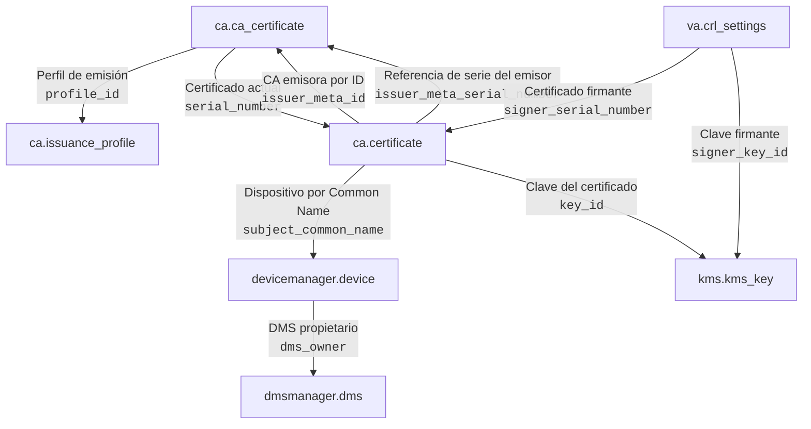

# Modelo de datos (/docs/pr-preview/pr-84/es/platform/administration/access-control/data-model)

El esquema `connectors/authz/pki.json` define las entidades del dominio `pki` para el control de acceso. Una política identifica el tipo de recurso mediante `namespace: pki`, `schema_name` y `entity_type`. Por ejemplo, `ca.certificate` corresponde al esquema `ca` y al tipo de entidad `certificate`.

Relaciones del esquema [#relaciones-del-esquema]

Cada flecha sale de la entidad que declara la relación y apunta a su `target_entity`. Debajo de la etiqueta aparece el valor de `foreign_key`, la columna de origen. En `pki.json`, el `name` de cada relación coincide con esa columna. El diagrama se puede pulsar para ampliarlo y recorrerlo.

Una política puede propagar acciones desde la entidad referenciada hacia la que declara la relación. Por ejemplo, para conceder lectura de los dispositivos de un DMS, la regla parte de `dmsmanager.dms`, apunta a `devicemanager.device` y especifica `via: dms_owner`.

En los filtros de acceso heredado, `authz` compara la columna `foreign_key` con la primera columna de `primary_key` de la entidad referenciada. Así, `subject_common_name` se compara con `device.id`, `issuer_meta_serial_number` con `ca_certificate.id` y los enlaces hacia `kms_key` con `kms_key.key_id`.

Entidades del esquema [#entidades-del-esquema]

| Entidad (`schema_name.entity_type`) | Tabla (`table_name`) | Clave (`primary_key`) |
| ----------------------------------- | -------------------- | --------------------- |
| `alerts.event`                      | `events`             | `event_type`          |
| `alerts.subscription`               | `subscriptions`      | `id`                  |
| `ca.ca_certificate`                 | `ca_certificates`    | `id`                  |
| `ca.certificate`                    | `certificates`       | `serial_number`       |
| `ca.issuance_profile`               | `issuance_profiles`  | `id`                  |
| `devicemanager.device_group`        | `device_groups`      | `id`                  |
| `devicemanager.device`              | `devices`            | `id`                  |
| `dmsmanager.dms`                    | `dms`                | `id`                  |
| `kms.kms_key`                       | `kms_keys`           | `key_id`, `engine_id` |
| `va.crl_settings`                   | `crl_settings`       | `ca_id`               |

Los eventos, las suscripciones y los grupos de dispositivos tienen acciones y filtros propios. Sus listas `relations` están vacías y tienen cero referencias entrantes en el esquema. Para `ca.certificate`, `view_tables` también registra `certificates_view`.

Cada entidad declara sus acciones sobre instancias en `atomic_actions`, sus acciones sin identificador de recurso en `global_actions` y las columnas y tipos que admite en `column_filters` mediante `filterable`.

<Cards>
  <Card title="Acceso heredado por relaciones" href="/docs/platform/administration/access-control#acceso-heredado-por-relaciones" />
</Cards>
