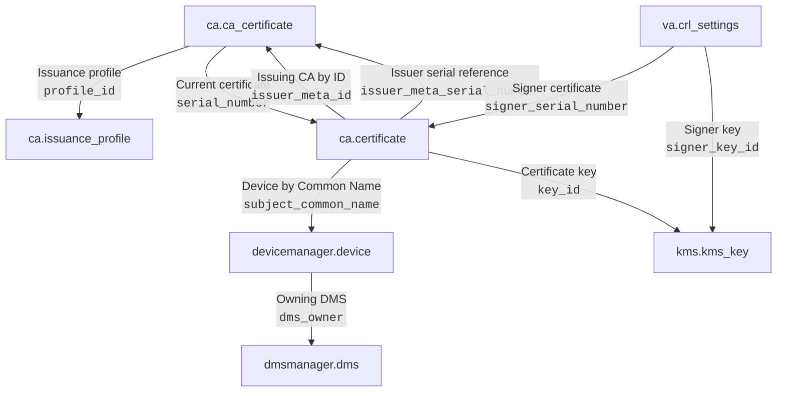

# Data model (/docs/pr-preview/pr-84/platform/administration/access-control/data-model)

The `connectors/authz/pki.json` schema defines the entities in the `pki` authorization namespace. A policy identifies a resource type through `namespace: pki`, `schema_name` and `entity_type`. For example, `ca.certificate` identifies the `certificate` entity type in the `ca` schema.

Schema relationships [#schema-relationships]

Each arrow starts at the entity that declares the relationship and points to its `target_entity`. The value of `foreign_key`, the source column, appears below the label. In `pki.json`, each relationship's `name` matches that column. Select the diagram to enlarge it and scroll through it.

A policy can propagate actions from the referenced entity to the one that declares the relationship. For example, to grant read access to a DMS's devices, a rule starts from `dmsmanager.dms`, targets `devicemanager.device` and specifies `via: dms_owner`.

When filtering inherited access, `authz` matches the `foreign_key` column against the first `primary_key` column of the referenced entity. For example, it matches `subject_common_name` to `device.id`, `issuer_meta_serial_number` to `ca_certificate.id` and the links to `kms_key` to `kms_key.key_id`.

Schema entities [#schema-entities]

| Entity (`schema_name.entity_type`) | Table (`table_name`) | Key (`primary_key`)   |
| ---------------------------------- | -------------------- | --------------------- |
| `alerts.event`                     | `events`             | `event_type`          |
| `alerts.subscription`              | `subscriptions`      | `id`                  |
| `ca.ca_certificate`                | `ca_certificates`    | `id`                  |
| `ca.certificate`                   | `certificates`       | `serial_number`       |
| `ca.issuance_profile`              | `issuance_profiles`  | `id`                  |
| `devicemanager.device_group`       | `device_groups`      | `id`                  |
| `devicemanager.device`             | `devices`            | `id`                  |
| `dmsmanager.dms`                   | `dms`                | `id`                  |
| `kms.kms_key`                      | `kms_keys`           | `key_id`, `engine_id` |
| `va.crl_settings`                  | `crl_settings`       | `ca_id`               |

Events, subscriptions and device groups have their own actions and filters. Their `relations` lists are empty and they have zero incoming references in the schema. For `ca.certificate`, `view_tables` also lists `certificates_view`.

Each entity declares instance-level operations in `atomic_actions`, operations that require no resource ID in `global_actions`, and the columns and types accepted by `column_filters` in `filterable`.

<Cards>
  <Card title="Access inherited through relations" href="/docs/platform/administration/access-control#access-inherited-through-relations" />
</Cards>
